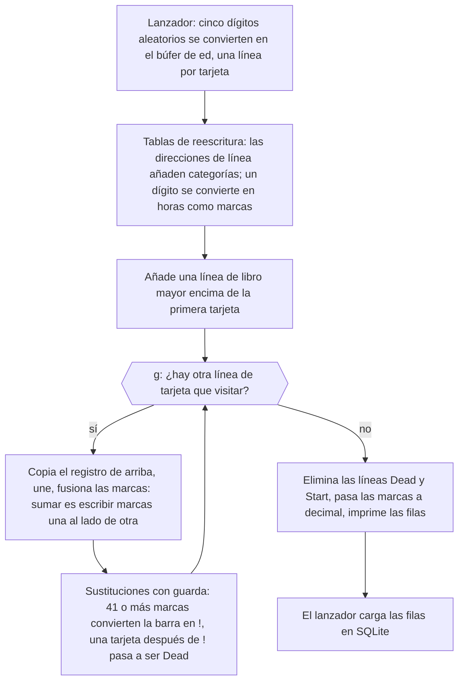

# ed: el búfer es la máquina

**Te enseña:** que un editor de líneas es una máquina de reescritura: las líneas son los datos, las direcciones son el programa y una sustitución fallida dentro de un comando global es un "si".

> **DEMO ONLY.** Tarjetas de horas ficticias, escritas en un archivo SQLite temporal bajo `$XDG_DATA_HOME/EdWeird/`.
> Nada de esto toca el registro real de horas.

El programa es un archivo de unos 45 comandos `ed`. `ed` es el editor de líneas de la década de 1970 del que provienen `sed`, `vi` y `grep`. No tiene variables, aritmética ni sentencias de bucle. Lo único que hace es cambiar líneas de texto. Esta entrada consigue que genere tarjetas de horas de todos modos. El búfer contiene cinco dígitos aleatorios cuando `ed` empieza. Cuando `ed` termina, el búfer contiene las filas.

```text
$ DICE="7 3 9 0 5" ed -s dice.txt < timecards.ed
Meetings 17 17
Coding 13 30
Debugging 19 49
```

Su par, [`ex-weird`](../ex-weird/README.md), usa el lenguaje más rico sobre el que se construye `vi`: registros, marcas y `@`. Aquí cada número se forma escribiendo marcas (`x`) una junto a otra y reescribiendo texto. Un lanzador le da a `ed` sus cinco dígitos y después guarda las filas. No hace ninguna aritmética.

## Ejecútalo

Necesitas **GNU ed** (se probó la versión 1.20.1), un intérprete de comandos (*shell*) POSIX —el programa que ejecuta tus comandos—, `tr`, `head`, `fold`, `date` y `sqlite3`.

```bash
cd src/ed-weird
sh timecards.sh                          # run the demo
DICE="7 3 9 0 5" sh timecards.sh         # force the five dice (digits 0-9; the hours are 10 plus the digit)
printf '7\n3\n9\n0\n5\n' > /tmp/dice.txt; ed -s /tmp/dice.txt < timecards.ed    # run only the ed program
./check.sh                               # every rule below
```

Los registros van a `$XDG_DATA_HOME/EdWeird/demo-timecards.db` (por defecto, `~/.local/share/EdWeird/`).

## Ejecútalo en un contenedor

Requisito previo: Docker, configurado una sola vez como se describe en [`SANDBOX-SETUP.md`](../../SANDBOX-SETUP.md#docker).

```bash
sandbox/container/run-image.sh src/ed-weird
```

Construye el [`Dockerfile`](Dockerfile) de esta carpeta y ejecuta el resultado sin red, con un sistema de archivos de solo lectura y con el usuario `nobody`. La imagen contiene GNU ed y sqlite3 sobre un Ubuntu mínimo.

## Flujo del programa



**Qué muestra:** `ed` tiene un solo bucle (el comando global `g`) y no tiene `if`. Una sustitución que no encuentra nada que reemplazar no hace nada; por eso cada sustitución con guarda significa "si la línea tiene este patrón, reescríbela". El estado es texto: marcas que se añaden al escribirlas una junto a otra.

**Por qué importa este mecanismo:** la regla de parada es una expresión regular sobre el registro (41 marcas o más) y se ejecuta *después* de escribir la tarjeta, así que la tarjeta del cruce se conserva. `!`, que la regla escribe, es un estado que leen las tarjetas posteriores. Es toda la memoria de "estamos por encima".

## Cómo funciona el truco

Lee [`timecards.ed`](timecards.ed) de principio a fin. Tiene seis pasos.

| Paso | Qué hace `ed` | Qué función de ed hace el trabajo |
|---|---|---|
| 1. Categorías | `1s/^/Meetings /`, `2s/^/Coding /` y así sucesivamente | **Direcciones.** La línea 1 es la primera tarjeta. El orden de las categorías es el orden de los números de línea |
| 2. Horas | `g/x7$/s/7$/xxxxxxx/`: diez reglas, una por dígito | **Una tabla de reescritura.** El dígito 7 se convierte en las horas `17` y diecisiete marcas (diez más siete) |
| 3. El libro de cuentas | `0a`, luego `Start 0\|` | **Entrada de datos de texto.** Una línea encima de la primera tarjeta que dice "el total hasta ahora es nada" |
| 4. La ejecución | Un comando `g` sobre las líneas de las tarjetas | **El comando global.** El único bucle del programa es el propio de ed |
| 5. Limpieza | `g/^Dead /d`, `g/^Start /d` | **Eliminar líneas** que coinciden con un patrón |
| 6. Decimales | `g/[\|!]x\{50\}/s/[\|!]x\{50\}/ 5/` y así sucesivamente | **Una tabla de reescritura** otra vez: cincuenta marcas se convierten en el dígito 5 |

### Paso 4: la ejecución

Para cada línea de tarjeta, en el orden del búfer, ed hace cinco cosas (son las líneas de la lista del comando global):

1. `-t.` copia la línea de arriba (el registro acumulado hasta ahora) justo debajo de la tarjeta.
2. `-,.j` une la tarjeta y la copia en una sola línea: `Coding 15 xxxxxxxxxxxxxxxMeetings 12|xxxxxxxxxxxx`.
3. Una sustitución conserva el nombre y las horas de la tarjeta y junta los dos conjuntos de marcas después de una barra: `Coding 15|xxxxxxxxxxxxxxxxxxxxxxxxxxxxxxxxxxxxxx`. **Sumar es escribir marcas una al lado de otra.** Cada tarjeta procesada es el registro para la siguiente.
4. Una segunda sustitución trata un registro que tiene `!` en lugar de `|`. El `!` significa que el total ya pasó de 40. La tarjeta se convierte en `Dead 0!` más las mismas marcas, de modo que todas las tarjetas posteriores también mueren.
5. Una tercera sustitución se activa cuando hay 41 o más marcas después de la barra: `s/^\([^|]*\)|\(x\{41,\}\)$/\1!\2/`. La barra se convierte en `!`. **Esa es la regla de parada.** Se ejecuta *después* de escribir la tarjeta, así que la tarjeta que cruza el límite se conserva.

### Por qué no hay comandos `if`

`ed` no tiene `if`. Tiene algo igual de bueno. **Una sustitución que no encuentra nada que reemplazar no hace nada y no detiene el comando global.** Esto es cierto dentro de `g`: `s/a/b/` en una línea sin `a` se omite en silencio. Por eso `s/needs this/becomes this/` significa "si la línea tiene el patrón, reescríbela". Las tres sustituciones anteriores son tres reescrituras protegidas, y en cada tarjeta solo se activan las que se aplican. Una *dirección* fallida (`/nomatch/`) es distinta: eso es un error y detiene la lista de comandos. La entrada usa el primer tipo y nunca el segundo.

| Tarea | Se hace con |
|---|---|
| Bucle | `g/...`: un comando global sobre las líneas de las tarjetas |
| Orden de las categorías | Direcciones de línea (`1s`, `2s`, ...) |
| Horas aleatorias | El lanzador da cinco dígitos a ed. ed convierte cada uno en 10 + el dígito como texto |
| Total acumulado | Unión de líneas: marcas una al lado de otra |
| Regla de parada | `x\{41,\}`: una expresión regular sobre las marcas |
| Salida | `,p`, después de las reglas de reescritura del paso 6 |
| Persistencia | `sqlite3`, con restricciones `CHECK` |

El lanzador, [`timecards.sh`](timecards.sh), tiene cuatro tareas: generar cinco dígitos aleatorios (`tr` de `/dev/urandom`), ejecutar `ed`, cargar las filas en SQLite con la semana y mostrarlas. No tiene aritmética ni `awk` ni `sed` ni bucle. `check.sh` se asegura de ello.

## Por qué es raro

`ed` se creó para editar archivos a mano a través de un teletipo lento. Sus comandos son escuetos para que teclees menos caracteres. Usarlo como computadora significa tratar los comandos como un **sistema de reescritura**: reglas sobre texto que se activan cuando su patrón coincide. Es la misma idea que [`regex-sed`](../regex-sed/README.md), donde `sed` reescribe una línea hasta que no se aplica ninguna regla. La diferencia es el control. `sed` tiene un comando de rama y un bucle. `ed` no tiene ninguno de los dos, así que cada repetición debe venir del comando global y cada elección debe venir de una sustitución que puede coincidir o no.

## Qué impone `check.sh`

`check.sh` necesita GNU ed y sqlite3.

- **La restricción es real.** `timecards.sh` no tiene aritmética ni `awk` ni `sed` ni `expr` ni bucles, y inicia `ed` una sola vez. `timecards.ed` no tiene escape al intérprete de comandos (*shell*, el programa que ejecuta comandos del sistema; `!`) ni comandos de archivo (`r`, `w`, `e`, `f`). Un solo comando global es la ejecución.
- **Las reglas del reto.** 25 ejecuciones aleatorias: categorías en orden, de 10 a 19 horas, totales correctos, una parada en el primer total de más de 40 con la tarjeta que lo supera conservada, `DEMO ONLY` en todas partes, un stderr vacío y ningún archivo temporal sobrante.
- **Una simulación independiente.** Un modelo aparte (un programa corto en awk) indica qué filas debe dar cada secuencia de dados. La entrada debe coincidir en las 1024 secuencias formadas con los dígitos 0, 4, 5 y 9, que incluyen totales de exactamente 40 y 41, y en 400 secuencias aleatorias.
- **Perturbaciones.** Una copia del programa con `x\{41,\}` cambiado a `x\{31,\}` se detiene después de 30 en lugar de 40. Una copia con `{51,}` se detiene después de 50. Una copia con las dos primeras líneas de categoría intercambiadas tiene las dos primeras categorías intercambiadas. Una copia sin la regla `Dead` conserva tarjetas después de la que cruza el límite. Una copia sin la limpieza imprime `Dead` filas. La regla de parada está en el programa ed y en ningún otro lugar.
- **Barreras.** Un comando global dentro de otro comando global se rechaza (`Cannot nest global commands`). En un script de ed, una línea en blanco es un comando y no un separador, así que el programa usa comentarios `#`. Un `s` fallido dentro de `g` es silencioso, y una dirección fallida es un error con estado de salida 1.
- **Otro ed.** El `ed` de busybox, incluido en la imagen de un entorno aislado (*sandbox*) que limita el acceso al sistema anfitrión, no puede ejecutar el programa y la comprobación lo verifica.
- **El esquema.** SQLite rechaza una fila que no sea de demostración, 9 horas y una quinta categoría. El lanzador rechaza cuatro dados y un carácter que no sea un dígito.

## Trampas que conviene conocer

- **Solo GNU ed.** Probamos GNU ed 1.20.1. El programa usa comentarios `#`, `s/^/.../`, referencias hacia atrás, intervalos `\{n,\}` y `0a`. POSIX especifica la mayoría de estos elementos, pero busybox ed 1.36.1 (en la imagen de comprobación) no tiene ninguno de `t`, `m`, `j`, `g`, `v` ni `Q`, no tiene comentarios `#` y no puede sustituir en `^`, en un grupo ni en un intervalo. Por eso no puede ejecutar el programa, y la comprobación lo indica. Esto es **permitido por la implementación**.
- **El `s` fallido y silencioso es aprovechado por accidente.** El manual de GNU dice que la lista de comandos "se detiene en el primer error" y no dice que una sustitución fallida dentro de ella no sea un error. No lo es en la versión 1.20.1. Sin eso, no hay `if`. (La opción `-l` del manual, "salir con estado 0 aunque un comando falle", menciona una sustitución que no encuentra nada como ejemplo de fallo, en el nivel superior. El script de verificación confirma que aquí el estado de salida es 0.) No cuentes con esto en otro ed.
- **Una línea en blanco es un comando.** Una línea vacía significa "imprime la línea siguiente" y produce un error al final del búfer. Por eso el programa usa líneas `#` para separar sus pasos.
- **ed escribe sus errores en la salida estándar.** Con `H` como primer comando, un comando fallido imprime `?` y luego un motivo. Ambos van a stdout, así que el lanzador comprueba el estado de salida de ed (1 si hay un error). Un `?` suelto en las filas haría fallar la carga de la base de datos.
- **`Newline appended` también va a stdout.** Si el archivo del búfer no termina con un salto de línea, ed lo avisa en stdout incluso con `-s`. El lanzador agrega el salto de línea.
- **GNU ed permite `!` en una lista de comandos. Nosotros no lo usamos.** El manual dice "se permite cualquier comando, excepto `g`, `G`, `v` y `V`", así que un escape al intérprete de comandos (*shell*, el programa que ejecuta comandos del sistema) funcionaría dentro de una lista global. Usar uno convertiría esto en un programa del intérprete de comandos. La comprobación lo prohíbe.
- **Las posiciones importan.** `-t.` y `-,.j` llegan al libro de registro por posición: es la línea justo encima de la tarjeta. Si algo pusiera otra línea entre las dos, todos los totales serían incorrectos. Por eso la línea del libro de registro se crea antes de que empiece la ejecución, y por eso las tarjetas muertas permanecen en su lugar hasta la limpieza.
- **Unario es lento.** Los totales son cadenas de texto de hasta 59 marcas. Un millón serían un millón de caracteres.
- **Los dados son del lanzador.** La aleatoriedad es lo único que ed no puede hacer, así que es lo único que hace el lanzador.

---

Consulta el [README raíz](../../README.md#los-resultados-hasta-ahora) para ver cómo se compara con las otras entradas y [`RETO.md`](../../RETO.md) si quieres escribir la tuya.
