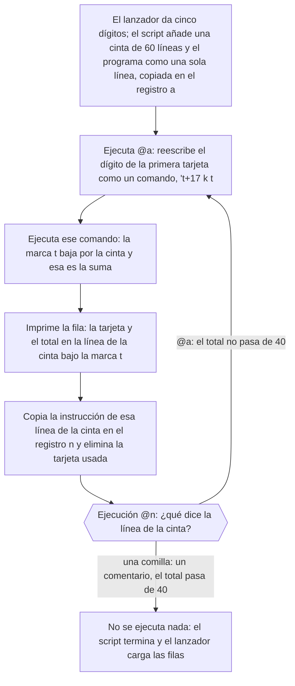

# Ex: un programa que puedes editar

**Te enseña:** que los registros de un editor pueden contener un programa: una línea de texto se copia en un registro y se ejecuta con @, y las marcas y las direcciones de línea del propio editor hacen la aritmética.

> **DEMO ONLY.** Tarjetas de horas ficticias, escritas en un archivo SQLite temporal dentro de `$XDG_DATA_HOME/ExWeird/`.
> Nada de esto toca el registro de horas real.

`ex` es el lenguaje de comandos del editor `vi`. Es un editor de líneas como [`ed`](../ed-weird/README.md), con poderes extra: **registros con nombre** que guardan texto, un **comando `@` que ejecuta un registro como comandos Ex**, **marcas** que recuerdan una línea y varios comandos en una sola línea, separados por barras. Esta entrada usa esos poderes para construir algo que `ed` no puede: un programa guardado como texto, copiado en un registro y ejecutado. Ese programa decide su propio paso siguiente: copia una línea de *datos* en un registro y también la ejecuta.

```text
$ ex -s dice.txt < timecards.ex
Meetings 17 17
Coding 13 30
Debugging 19 49
```

El programa no tiene ningún comando global, ninguna prueba de expresión regular, ninguna sentencia de bucle y ningún error. El bucle es un registro que se ejecuta a sí mismo.

## Ejecútalo

Necesitas un **Ex**: **nvi** (un ex/vi POSIX de 4.4BSD; se probó la versión 1.81.6, que es la que tiene el entorno aislado (*sandbox*) que limita el acceso al sistema anfitrión) o **Vim** en modo Ex (se probó la versión 9.1). El `ex` propio de Ubuntu es Vim. También necesitas un intérprete de comandos (*shell*) POSIX, el programa que ejecuta los comandos que escribes, `tr`, `head`, `fold`, `date` y `sqlite3`.

```bash
cd src/ex-weird
sh timecards.sh                          # run the demo (the launcher finds out which ex you have)
DICE="7 3 9 0 5" sh timecards.sh         # force the five dice (digits 0-9; the hours are 10 plus the digit)
EX=nex sh timecards.sh                   # pick the editor: nex is nvi's ex
printf '7\n3\n9\n0\n5\n' > /tmp/dice.txt; ex -s -u NONE /tmp/dice.txt < timecards.ex      # only the program; with nvi: ex -s
./check.sh                               # every rule below, against the ex you have
```

Los registros van a `$XDG_DATA_HOME/ExWeird/demo-timecards.db` (por defecto, `~/.local/share/ExWeird/`).

## Ejecútalo en un contenedor

Requisito previo: Docker, instalado una sola vez como se describe en [`SANDBOX-SETUP.md`](../../SANDBOX-SETUP.md#docker).

```bash
sandbox/container/run-image.sh src/ex-weird
```

Construye el [`Dockerfile`](Dockerfile) de esta carpeta y ejecuta el resultado sin red, con un sistema de archivos de solo lectura y con el usuario `nobody`. La imagen contiene nvi y sqlite3 sobre un Ubuntu mínimo.

## Flujo del programa



**Qué muestra:** Ex guarda el estado fuera del texto, en marcas. También puede ejecutar un registro como comando. La posición de la marca `t` en una cinta *es* el total acumulado. La línea de la cinta que está debajo contiene la siguiente instrucción: `@a` (que significa "da otra vuelta") o una comilla, que Ex lee como comentario.

**Por qué importa este mecanismo:** este es código que se modifica a sí mismo. El programa escribe el comando que hace su aritmética, y la regla de parada es el lugar de la cinta donde `@a` se convierte en un comentario. Nada en el programa dice "40" en ninguna parte, salvo en cómo está dispuesta la cinta.

## Cómo funciona el truco

Lee [`timecards.ex`](timecards.ex) de principio a fin. Sus comentarios dicen qué hace cada parte.

### Los registros son marcas

`ed` guarda su estado en el *texto* del búfer. Ex también tiene estado fuera del texto: las **marcas**. `k t` pone una marca llamada `t` en una línea, y `'t` es esa línea como dirección. La marca sigue a su línea cuando se agregan o se quitan líneas por encima de ella. La aritmética de direcciones funciona con marcas, así que `'t+17` es "diecisiete líneas debajo de la marca `t`". El comando `'t+17k t` pone la marca ahí. Eso es **t = t + 17**, sin ningún número en ninguna parte salvo en el texto de la dirección.

### La cinta

Debajo de las cinco tarjetas el programa añade una cinta de sesenta líneas. Cada línea es `total instruction`:

```text
0 @a
1 @a
...
40 @a
41 "
42 "
...
59 "
```

La posición de la marca `t` en la cinta *es* el total acumulado. El texto de la línea que está debajo es el total en dígitos decimales y una *instrucción siguiente*. Mientras el total no pase de 40, la instrucción es `@a`: continúa. Cuando el total pasa de 40, la instrucción es una comilla, que Ex lee como un comentario: no hace nada. **El límite de 40 es el lugar de la cinta donde se detiene `@a`.** Nada en el programa dice "40".

### El programa

El programa es una línea de texto. El script la agrega al búfer después de la cinta, la copia en el registro `a` (`'s+1ya a`) y la elimina (`'s+1d`). Luego `@a` la ejecuta. Las barras son saltos de línea. En orden:

| Paso | Qué hace |
|---|---|
| `1t$` | Copia la primera tarjeta, `Meetings 7`, al final del búfer |
| `$s/^.* \([0-9]\)$/'t+1\1k t/` | Reescribe la copia como un *comando*: `'t+17k t`. El dígito de la tarjeta se convirtió en texto que Ex puede ejecutar |
| `$ya d`, `$d` | Copia el comando en el registro `d` y quítalo del búfer |
| `1s/ \([0-9]\)$/ 1\1/` | Convierte el dígito de la tarjeta en horas: `Meetings 17` |
| `@d` | **Ejecuta el registro `d`.** La marca `t` baja 17 líneas por la cinta. Esta es la suma |
| `1t$`, `'tt$`, `$s/ .*$//`, `$-1,$j`, `$p` | Copia la tarjeta. Copia la línea de la cinta bajo la marca `t`. Conserva solo su total. Une las dos (la orden join de Ex pone un espacio entre ellas). Imprime la fila: `Meetings 17 17` |
| `'tt$`, `$s/^[0-9]* //`, `$ya n`, `$d` | Copia de nuevo la línea de la cinta al final del búfer. Quita el total inicial y su espacio, copia la instrucción restante en el registro `n` y borra la línea temporal |
| `1d` | La tarjeta se ha agotado. La siguiente tarjeta pasa a ser la línea 1 |
| `@n` | **Registro de ejecución `n`.** En la cinta dice `@a`, así que el programa se ejecuta otra vez. Con más de 40 dice `"` y no se ejecuta nada |

| Tarea | Hecho por |
|---|---|
| Bucle | El registro `n` contiene `@a`, así que el programa se llama a sí mismo |
| Orden de las categorías | Direcciones de línea (`1s`, `2s`, ...), como en la entrada de ed |
| Horas aleatorias | El lanzador entrega cinco dígitos a Ex. Una sustitución convierte cada uno en un comando |
| Total acumulado | La marca `t`, movida por un comando que el propio programa escribió |
| Total decimal | El texto de la línea de la cinta que está bajo la marca |
| Regla de parada | La cinta: la primera línea cuya instrucción es un comentario |
| Salida | `$p` |
| Persistencia | `sqlite3`, con restricciones `CHECK` |

El lanzador, [`timecards.sh`](timecards.sh), tiene cuatro tareas: generar cinco dígitos aleatorios, ejecutar Ex, cargar las filas en SQLite con la semana y mostrarlas. No tiene aritmética, `awk`, `sed` ni bucle. También revisa cada línea que imprime Ex: cualquier cosa que no sea una fila de tarjeta es un error, salvo una nota conocida de nvi (consulta las trampas comunes).

### Qué cambia respecto de la entrada de ed

| | [`ed-weird`](../ed-weird/README.md) | `ex-weird` |
|---|---|---|
| Estado | Texto: filas de marcas `x` | La marca `t` (una posición) y una cinta de líneas |
| Suma | Une dos líneas para que las marcas queden una al lado de la otra | Mueve una marca mediante una dirección |
| Control | Un comando global; un `s` fallido es un "si" | Un registro que se ejecuta a sí mismo; la cinta indica si hay que ejecutarlo de nuevo |
| Texto del programa | El script | El script *y* el texto que el programa escribe y luego ejecuta |
| Regla de parada | Una expresión regular sobre las marcas (`x\{41,\}`) | Una línea de datos en la cinta |
| Salida decimal | Diez reglas de reescritura que convierten marcas en dígitos | La cinta ya tiene los dígitos |

## Por qué es raro

`ex` se creó para editar texto. No tiene funciones, `if` ni bucles. Lo que sí tiene es **código que es solo texto**. Un registro puede guardar un comando y `@` lo ejecuta. Así, un programa puede escribir su propia instrucción siguiente, como una cadena de texto y ejecutarla. Es la misma idea que `eval` en un lenguaje de scripts, construida con un editor de texto. También es una tabla de saltos: el siguiente paso se busca por *dirección*, en los datos.

### Una sesión interactiva y una ejecución por lotes

Normalmente usas Ex así: escribes un comando y miras el resultado. Te mueves por el texto, ves líneas y cambias de opinión. La entrada ejecuta los mismos comandos **sin que nadie mire**. `-s` significa "silencioso: no muestres los mensajes habituales". Los comandos vienen de un archivo por la entrada estándar, así que cada paso debe ser correcto a la primera. Por eso los comentarios del script importan más que en una edición puntual.

## Qué impone `check.sh`

`check.sh` se ejecuta con cualquier `ex` que tengas e indica cuál encontró.

- **La restricción es real.** `timecards.sh` no tiene aritmética, ni `awk`, ni `sed`, ni `expr` ni bucle. Inicia el editor una vez. `timecards.ex` **no tiene ningún comando `g` ni `v`**, ni escape al intérprete de comandos (*shell*, el programa que recibe y ejecuta comandos del sistema), ni comando de archivos. La cinta tiene 41 filas go y 19 filas stop. El programa termina con exactamente un `@n`, y `@a` se inicia una vez.
- **Las reglas del reto.** 25 ejecuciones aleatorias: categorías en orden, de 10 a 19 horas, totales correctos, una parada en el primer total que pasa de 40 con la tarjeta que lo cruza conservada, `DEMO ONLY` en todas partes, estado de salida 0 y nada en stderr.
- **Una simulación independiente.** Un modelo aparte (un programa corto en awk) da las filas de cada secuencia de dados. La entrada coincide en las 1024 secuencias formadas con los dígitos 0, 4, 5 y 9 y también en 400 secuencias aleatorias.
- **Perturbaciones.** Mueve el límite de la cinta a 30 y la ejecución se detiene después de 30. Muévelo a 45 y los dados de once horas dan cinco tarjetas. Intercambia dos líneas de categoría y las categorías se intercambian. Elimina el último `@n` y se ejecuta solo una tarjeta. Convierte cada instrucción de la cinta en un comentario y se ejecuta solo una tarjeta.
- **Dialectos.** Cinco diferencias medidas entre las implementaciones de Ex (abajo), comprobadas para la que tengas.
- **El esquema.** SQLite rechaza una fila que no sea de demostración, 9 horas y una quinta categoría. El lanzador rechaza cuatro dados y un carácter que no sea un dígito.

## Trampas que conviene conocer

- **¿Qué Ex?** No existe un único Ex. Ejecutamos el programa en **nvi 1.81.6** (un descendiente del editor de 4.4BSD en el que se basa la descripción de `ex` en POSIX) y en **Vim 9.1** en modo Ex (`ex -s -u NONE -N`). Ambos dan las mismas respuestas. Eso es **permitido por la implementación**: probamos estos dos y no probamos la conformidad con el estándar. `@` (ejecutar un búfer), `k` (marcar), `ya` (copiar al registro, *yank*), `t` (copiar líneas), `j` (unir), la barra y el comentario `"` están descritos para Ex en POSIX, hasta donde podemos saber al leerlo (no ejecutamos un conjunto de pruebas de conformidad). El programa usa estos y nada más.
- **Dónde termina POSIX Ex y dónde empieza Vim.** El programa no usa ninguna extensión de Vim. `-u NONE` y `-N` son opciones de Vim para mantener tu `.vimrc` fuera de él. El lanzador las agrega cuando detecta Vim. No llames "Ex" a Vim: es un editor más grande que tiene un modo Ex.
- **Cinco diferencias que el programa evita.** La comprobación mide cada una.
  1. **Orden del registro.** nvi ejecuta un registro de varias líneas **de la última línea a la primera**. Vim lo ejecuta de la primera a la última. Por eso el programa es de **una línea**, con barras.
  2. **Comandos globales anidados.** Un comando global dentro de un registro que se inició desde un comando global funciona en nvi y Vim lo rechaza. El programa no tiene ningún comando global.
  3. **Impresión.** En nvi una dirección sola (`2`, `+1`) imprime la línea a la que se mueve. Vim no imprime nada. El programa mueve su marca con `k`, que nunca imprime.
  4. **Errores.** Tras el primer error, nvi deja de leer el script y sale con estado 1. Vim continúa y sale con estado 1 al final. El programa no provoca ningún error a propósito, porque una búsqueda fallida o un rango de direcciones hacia atrás terminaría el programa en nvi.
  5. **Rangos hacia atrás.** `'t,2` con la marca debajo de la línea 2 es un error en nvi (`The second address is smaller than the first`). Vim no imprime nada y no se detiene.
- **nvi escribe en la salida estándar.** Sus mensajes van a stdout, no a stderr. Cuando no tiene terminal (una tubería o un contenedor) imprime primero `Error: stderr: Inappropriate ioctl for device`. El lanzador descarta esa única línea conocida y falla con cualquier otra línea que no sea una fila de tarjeta.
- **nvi necesita una carpeta de recuperación.** No arranca si no puede escribir en `/var/tmp/vi.recover`. Las imágenes del entorno aislado enlazan esa carpeta con `/tmp`, porque la raíz del entorno aislado es de solo lectura. Es un hecho sobre las imágenes y es el único cambio que necesitaron para esta entrada.
- **La unión de Ex añade un espacio.** `$-1,$j` junta `Meetings 17` y `17` como `Meetings 17 17`. En `ed`, `j` no añade ninguno. Ambos comportamientos están especificados: es una diferencia entre los dos lenguajes, no una rareza.
- **Un comentario es una instrucción.** La instrucción "parar" de la cinta es una comilla. Funciona porque Ex lee `"` como un comentario, tanto en un registro como en un archivo.
- **Una marca que está en una línea borrada desaparece.** El programa nunca borra la línea bajo la marca `t`. Borra solo la línea de la tarjeta (línea 1) y sus propias líneas de trabajo al final del búfer.
- **La cinta es de datos y es larga.** Sesenta líneas, una por cada total posible de 0 a 59. La ejecución más larga termina en 40 + 19 = 59. Un límite distinto necesita otra cinta. Nada calcula una.

---

Consulta el [README raíz](../../README.md#los-resultados-hasta-ahora) para ver cómo se compara esta entrada con las otras y consulta [`RETO.md`](../../RETO.md) si quieres escribir la tuya.
