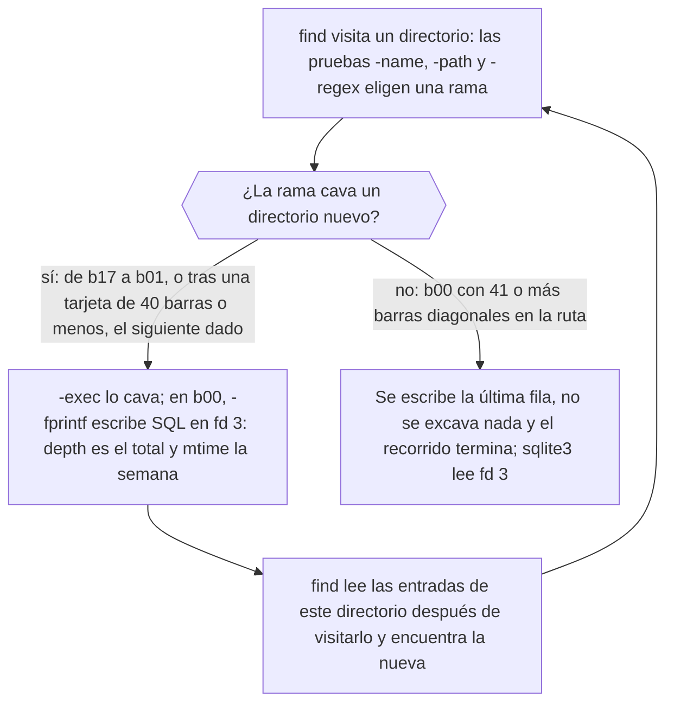

# GNU find: deja que find haga la aritmética

**Te enseña:** que los extras de GNU para find (profundidad de ruta, marcas de tiempo de los archivos, expresiones regulares y un perfilador integrado) pueden reemplazar una tabla entera de ramas, y que el optimizador de find no tiene nada que reordenar cuando cada rama termina en un efecto secundario.

> **DEMO ONLY.** Tarjetas de horas ficticias, escritas en un archivo SQLite temporal bajo `$XDG_DATA_HOME/FindGnu/`.
> Nada de esto toca el reporte real de horas.

Este es el mismo truco que [`find-posix`](../find-posix/README.md): un `find`, y el recorrido cava el árbol de directorios que está recorriendo. La diferencia es que esta entrada puede usar cualquier cosa que ofrezca GNU find. Resulta que eso elimina la mayor parte del trabajo. La línea mide unos 3 KB, algo más de la mitad del tamaño de la portable. En una ejecución perfilada de cada una, find evaluó unas 2950 pruebas aquí y unas 57 000 allá.

```
# DEMO ONLY run 1
Meetings	13	13	2026-W47	DEMO ONLY
Coding	19	32	2026-W47	DEMO ONLY
Debugging	12	44	2026-W47	DEMO ONLY
# committed total=44 entries=3 DEMO ONLY
Runtime error near line 12: CHECK constraint failed: stop rule fired: total exceeds 40 (19)
```

## Ejecútalo

Necesitas **GNU find** (se probó la versión 4.9; hasta donde sabemos, el find de BSD y el de macOS no tienen `-fprintf`, así que no pueden ejecutarlo), un intérprete de comandos (*shell*, el programa que ejecuta tus comandos) POSIX, `mktemp` y `sqlite3`.

```bash
cd src/find-gnu
./timecards.sh                      # run the demo
FIND_O=0 ./timecards.sh             # pick the optimizer level, -O0 to -O3 (default 3)
FIND_D=rates ./timecards.sh         # also print find's own profile of the program (stderr)
./check.sh                          # random runs at every -O level, forced dice, the rules below
python3 build-line.py               # print the find line (check.sh compares it with timecards.sh)
```

Los registros van a `$XDG_DATA_HOME/FindGnu/demo-timecards.db` (por defecto, `~/.local/share/FindGnu/`).

## Ejecútalo en un contenedor

Requisito previo: Docker, configurado una sola vez como se describe en [`SANDBOX-SETUP.md`](../../SANDBOX-SETUP.md#docker).

```bash
sandbox/container/run-image.sh src/find-gnu
```

Compila el [`Dockerfile`](Dockerfile) de esta carpeta y ejecuta el resultado sin red, con un sistema de archivos de solo lectura y con el usuario `nobody`. La imagen contiene GNU findutils, coreutils y sqlite3 sobre un Ubuntu mínimo.

## Flujo del programa



**Qué muestra:** el mismo truco que [`find-posix`](../find-posix/README.md), con extras de GNU que eliminan el trabajo de contabilidad. `-fprintf` puede escribir en su propio descriptor de archivo, `%d` es la profundidad del directorio y `%TG-W%TV` da formato a la hora de modificación como semana ISO. Así, la profundidad *es* el total y no hace falta aritmética dígito por dígito.

**Por qué importa este mecanismo:** la regla de parada es una expresión regular sobre la ruta: "al menos 41 barras". GNU find también tiene un optimizador que puede reordenar las pruebas. Un efecto fija el orden, así que el programa da la misma respuesta en cada nivel de optimización. Eso se comprueba con pruebas; no es una promesa.

## Cómo funciona el truco

Lee primero [cómo funciona la entrada portable](../find-posix/README.md#how-the-stunt-works). Explica por qué el recorrido entra en el directorio que `-exec` acaba de crear y por qué `*` en un patrón puede contar. Esta página cubre solo lo que cambian las extensiones de GNU.

**Un directorio es una hora, sin contabilidad adicional.** En la entrada portátil una ruta tiene tres tipos de directorio y el total acumulado se escribe dígito por dígito. Aquí la primera hora de una tarjeta es el propio directorio de dados (seis caracteres aleatorios) y las horas restantes van desde `b17` hasta `b00`. Así, la profundidad de un directorio *es* el número de horas hasta ese punto.

| Tarea | Hecha por |
|---|---|
| Bucle | el recorrido, como antes |
| Aleatoriedad | `mktemp -d`; `-name '?????[abcdef]'` lee el último carácter. Y y Z se vuelven a sortear con el carácter anterior, exactamente como en la entrada portable |
| Cuenta regresiva | `-name b12 -exec mkdir {}/b11 \;`, una rama por valor (de `b17` a `b01`). Los nombres son exclusivos de la cuenta regresiva, así que no hace falta un patrón de ruta |
| Total acumulado | **`-fprintf ... '%d,'`**. `%d` es la profundidad del archivo y la profundidad es el total |
| Semana ISO | **`%TG-W%TV`**: la hora de modificación del directorio nuevo, con formato de año y semana ISO. Sin `date`, porque crear un directorio toca su reloj |
| Orden de las categorías | **`-regex '(.*/[^/]{6}){2}.*'`**: "al menos dos nombres de seis caracteres en la ruta" equivale a "al menos la segunda tarjeta". Una expresión regular por categoría |
| Regla de parada | **`-regex '([^/]*/){41}.*'`**: "al menos 41 barras" significa "el total pasa de 40". Cuando hay una coincidencia, no se excava nada más y el recorrido termina |
| Salida | **`-fprintf /dev/fd/3`**: el SQL va al descriptor de archivo 3. `mktemp` sigue imprimiendo cada ruta que crea, pero eso va a stdout. El anfitrión envía stdout a `/dev/null`. La entrada portátil necesita un truco de comentario para esto |
| Persistencia | `sqlite3` lee el fd 3 a través de una tubería y mantiene las restricciones `CHECK` |

La línea del anfitrión es `find ... 3>&1 >/dev/null`: fd 3 pasa a ser la tubería y stdout pasa a ser el sumidero de bits.

`-exec` ejecuta solo dos programas, `mkdir` y `mktemp`. Ni `date` ni `printf`.

### El optimizador

GNU find tiene un optimizador basado en costo (de `-O1` a `-O3`) que reordena las pruebas: primero las de bajo costo, primero los fallos probables en una cadena de `-a` y primero los éxitos probables en una cadena de `-o`. El manual promete que nunca cambia el resultado y que nunca reordena un efecto secundario respecto de otro. Esta entrada lo pone a trabajar y luego intenta sorprenderlo en un error.

- `check.sh` ejecuta toda la demostración en `-O0`, `-O1`, `-O2` y `-O3`, con 15 ejecuciones aleatorias y 7 escenarios de dados forzados en cada uno. Las respuestas son siempre correctas.
- `-D tree` imprime el árbol de expresiones después de la optimización. Para esta línea, el árbol en `-O0` y en `-O3` es **idéntico**: 3610 líneas, sin ninguna diferencia. El optimizador no tiene nada que mover, porque cada rama es una prueba seguida de un efecto (`-name b00 -fprintf ...`) y un efecto fija el orden.
- También buscamos un caso que el manual no detalla: una prueba pura escrita *después* de un `-exec` (`-exec printf ... \; -type f -name a`). En cada nivel, `-exec` se ejecutó en cada archivo, así que las pruebas no se movieron delante del efecto.

Así que no encontramos ninguna forma de lograr que el optimizador cambie la respuesta. Una nada bien demostrada sigue siendo un hallazgo.

### El perfilador

`FIND_D=rates ./timecards.sh` pasa `-D rates` a find, y find imprime, para cada prueba del programa, con qué frecuencia tuvo éxito *de verdad*. Es el perfil propio de find para tu programa. Las estimaciones del optimizador son uniformes (se supone que cada `-path` o `-regex` tiene éxito en cerca del 80 % de los casos) y las tasas reales están lejos de ese valor.

## Qué impone `check.sh`

`check.sh` necesita GNU find. La línea debe ser exactamente un `find`, sin `for`, `while`, `until`, `case` ni `if` en ningún lugar de `timecards.sh`. Sus primarios deben ser exactamente `-O`, `-exec`, `-fprintf`, `-name`, `-o`, `-path`, `-regex` y `-regextype`. `-exec` solo puede ejecutar `mkdir` y `mktemp`. No puede haber `-delete`, `-print`, `-printf`, `-ok`, `-execdir` ni `-ls`. La línea debe ser lo que imprime `build-line.py`.

Luego, en cada nivel de optimización de `-O0` a `-O3`, ejecuta la demo 15 veces y comprueba las horas de 10 a 19, las categorías en orden, los totales acumulados, `DEMO ONLY` en cada fila, una semana ISO que coincida con `date`, una parada justo cuando el total pasa de 40, un solo error de la regla de parada en stderr y nada más, filas de SQLite que coincidan con las impresas, y una carpeta temporal vacía al final. En las 60 ejecuciones deben aparecer al menos ocho valores de horas distintos.

En cada nivel, además, fuerza los dados primero con un `mktemp` falso en `PATH`: siete escenarios que cubren las cifras de las decenas y de las unidades, un total de exactamente 40 (que debe continuar) y los caminos de nueva tirada. Las respuestas no deben depender del nivel de `-O`. Después, `FIND_D=rates` debe imprimir tasas de éxito y dejar las respuestas sin cambios. Por último, SQLite debe rechazar una fila que no sea de demostración.

## Trampas que conviene conocer

- **Solo GNU.** `-fprintf`, `%d`, `%T`, `-regex` con `-regextype posix-extended` y `-D` son extensiones de GNU, y ejecutamos esta entrada solo con GNU find 4.9. Todo lo de aquí está **permitido por la implementación**, y el truco de entrar en los directorios nuevos sigue **aprovechado por accidente**, como en la entrada portable.
- **`-quit` haría que find terminara antes y no se usa.** Cuando find se detiene con `-quit`, sale de inmediato y omite el resumen de `-D rates` (lo medimos: con `-quit` salen cero líneas; sin él, dos). Así que la regla de parada aquí es "no excavar más", y find agota el árbol por sí mismo.
- **`/dev/fd/3` debe ser una tubería.** find abre un archivo de salida y lo trunca. Si fd 3 fuera el archivo de captura de tu terminal, cada ejecución borraría lo que había antes. El anfitrión siempre lo envía por una tubería. Dos llamadas a `-fprintf` con el mismo nombre de archivo comparten un solo flujo, así que las partes de una sentencia SQL se mantienen en orden.
- **`-regextype` es posicional.** Solo se aplica a las pruebas `-regex` que vienen después, por eso la línea lo pone primero.
- **`%d` cuenta desde el directorio de inicio.** El directorio de inicio `t` tiene profundidad 0 y el primer directorio de dados tiene profundidad 1. Por eso, la profundidad de la última hora de una tarjeta es exactamente el total.
- **`-newer` no se usa, a propósito.** El manual dice que `-newer` lee la hora de su archivo de referencia *una sola vez*, cuando analiza la línea de comandos. Un archivo de referencia que `-exec` cambie después no se volvería a ver, así que no puede ser un contador en vivo.
- **`-files0-from` no se usa.** Permitiría que un `find` pasara su lista a otro, pero este programa no tiene ninguna lista que pasar: los datos son el árbol, y el árbol se construye a medida que avanza el recorrido.
- **La línea sigue siendo larga.** Mide unos 3 KB, con la cuenta regresiva (17 ramas) y los dados (21 ramas) escritos por completo. GNU find tampoco tiene variables.

---

Consulta el [README raíz](../../README.md#the-results-so-far) para ver cómo se compara esta entrada con las demás, y [`RETO.md`](../../RETO.md) si quieres escribir la tuya.
