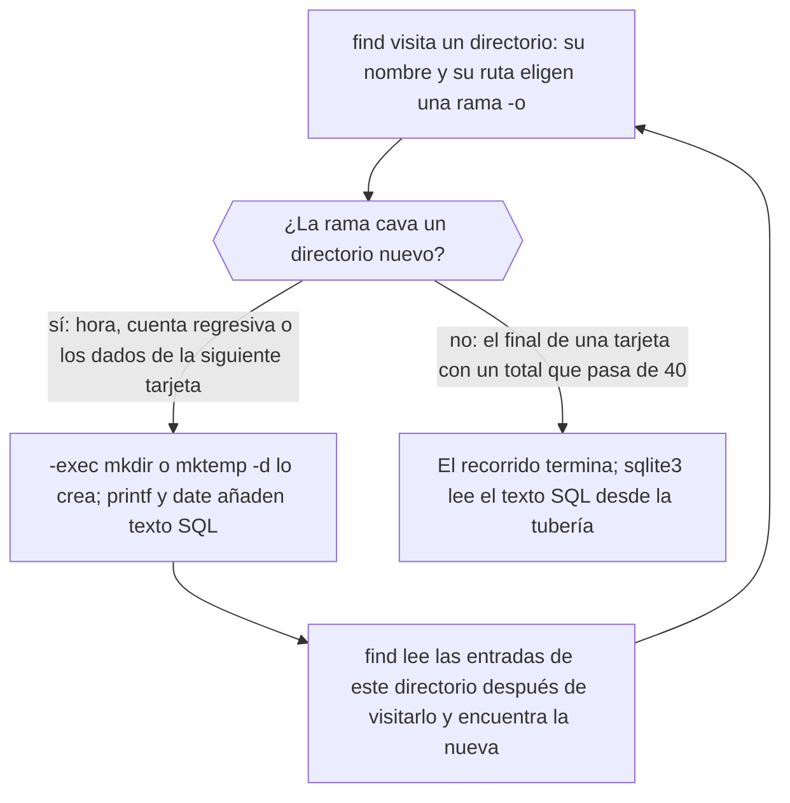

# POSIX find: el recorrido excava el árbol que está recorriendo

**Te enseña:** que un recorrido de directorios puede ser un bucle y un programa: find cava el árbol que está recorriendo, y la ruta al directorio actual es toda la máquina.

> **DEMO ONLY.** Tarjetas de horas ficticias, escritas en un archivo SQLite temporal dentro de `$XDG_DATA_HOME/FindPosix/`.
> Nada de esto toca el reporte real de horas.

Un solo comando `find` es todo el programa. No tiene variables ni aritmética. Sí tiene un recorrido de árbol, patrones `-name` y `-path`, `-o` (o) y `-exec`. Esta entrada pregunta: **¿puede una búsqueda de archivos ser un generador de tarjetas de horas?** Puede, si el recorrido sigue creando directorios nuevos delante de sí mismo y los nombres de esos directorios le sirven para contar.

La misma salida que las otras entradas:

```
# DEMO ONLY run 1
Meetings	19	19	2026-W47	DEMO ONLY
Coding	10	29	2026-W47	DEMO ONLY
Debugging	19	48	2026-W47	DEMO ONLY
# committed total=48 entries=3 DEMO ONLY
Runtime error near line 15: CHECK constraint failed: stop rule fired: total exceeds 40 (19)
```

La línea de `find` mide unos 5,7 KB. (La versión hermana solo para GNU, [`find-gnu`](../find-gnu/README.md), hace el mismo trabajo en unos 3 KB con `%d`, `%T` y `-regex`.) No es un error tipográfico. find no tiene variables, así que cada "tabla" de esa línea se escribe completa como `-o` ramas. [`build-line.py`](build-line.py) es la fuente legible de esas tablas y `check.sh` se asegura de que ambas coincidan.

## Ejecútalo

Necesitas un intérprete de comandos (*shell*) POSIX, es decir, el programa que ejecuta los comandos que escribes, además de `find`, `mktemp`, `date`, `printf`, `mkdir` y `sqlite3` (`sudo apt install sqlite3`). Nada más.

```bash
cd src/find-posix
./timecards.sh      # run the demo
./check.sh          # random runs, forced dice and the rules below, on every find it can see
python3 build-line.py   # print the find line (check.sh compares it with timecards.sh)
```

Los registros van a `$XDG_DATA_HOME/FindPosix/demo-timecards.db` (por defecto `~/.local/share/FindPosix/`). `check.sh` prueba GNU find, bfs y busybox find, los que tengas instalados. Para elegir los tuyos: `FINDS="gnu=/usr/bin/find busybox=/usr/bin/busybox" ./check.sh`.

## Ejecuta el programa en un contenedor

Requisito previo: Docker, configurado una sola vez como se describe en [`SANDBOX-SETUP.md`](../../SANDBOX-SETUP.md#docker).

```bash
sandbox/container/run-image.sh src/find-posix
```

Compila el [`Dockerfile`](Dockerfile) de esta carpeta y ejecuta el resultado sin red, con un sistema de archivos de solo lectura y con el usuario `nobody`. Después imprime la salida y una vista de solo lectura de las filas que escribió. La imagen incluye GNU findutils, coreutils y sqlite3 sobre un Ubuntu mínimo.

## Flujo del programa



**Qué muestra:** el bucle es un recorrido de árbol que sigue creciendo. find lee las entradas de un directorio *después* de visitarlo, así que un directorio que `-exec` crea dentro del actual se recorre a continuación. La ruta desde el inicio es el historial, y el nombre del directorio es el estado. Es la pila de llamadas de una recursión, dibujada en el sistema de archivos.

**Por qué importa este mecanismo:** la regla de parada es la ausencia de un hijo nuevo: al final de una tarjeta, cinco dígitos de hora `0` en la ruta (o cuatro y un último dígito distinto de cero) significan que el total pasa de 40, y ninguna rama cava. El total acumulado es el número de directorios de hora en la ruta, y no hay aritmética en ninguna parte. Esto depende del orden en que find lee y visita, que es accidental en find y no una promesa de POSIX.

## Cómo funciona el truco

La entrada de Make preguntó cuánto trabajo podía hacer la sintaxis propia de Make. Su bucle era que Make se volvía a ejecutar a sí mismo, y su estado era qué archivos existen. Esta entrada juega el mismo juego con find. El truco es este: **find lee las entradas de un directorio después de visitarlo.** Así que si `-exec` crea un directorio nuevo dentro del que find está visitando, find entra en él a continuación. El recorrido sigue mientras `-exec` siga cavando.

### La máquina: una ruta es un contador de programa

Cada paso crea un directorio. El **nombre** del directorio es el estado y la **ruta** desde el inicio es el historial. Hay tres tipos de directorio:

| Nombre | Significado | Quién lo crea |
|---|---|---|
| seis caracteres aleatorios, como `L45lDR` | los dados de una tarjeta | `mktemp -d` |
| un carácter, `0`-`9` | una hora. Es el último dígito del total acumulado, que cuenta 1, 2, ... 9, 0, 1, ... | `mkdir` |
| de `b18` a `b00` | horas que aún faltan en esta tarjeta | `mkdir` |

Una tarjeta se ve así en la ruta (abreviada):

```
t/wuq4YW/1/b18/2/b17/3/b16/ ... /9/b01/0/b00/L45lDR/1/b17/ ... /b00
         |  |               |        |      |
         |  |               |        |      +-- the next card's dice
         |  |               |        +-- last hour of this card
         |  +-- hours left: 18
         +-- the first hour (digit 1 of the running total)
```

Esta es la pila de llamadas de una función recursiva, dibujada sobre el sistema de archivos. La ruta es la pila, y el recorrido baja un nivel por paso.

### Cada tarea y quién la hace

| Tarea | Quién la hace |
|---|---|
| Bucle | el recorrido, que desciende al directorio que su propio `-exec mkdir` acaba de crear |
| Ramificación | `-o` encadena. `-a` tiene mayor precedencia que `-o`, así que `A -a B -o C -a D` es un if/else-if. Cada directorio corresponde a exactamente una rama |
| Aleatoriedad | `mktemp -d {}/XXXXXX` genera los dados. El último carácter elige las horas (ver más abajo) |
| Horas de 10 a 19 | 60 de los 62 caracteres de mktemp, en diez grupos de seis. `-path '*/[!/][!/][!/][!/][!/][abcdef]/?'` significa "los dados muestran el grupo 0", así que imprime `10,` y busca `b09` |
| Cuenta regresiva | `b18` produce `b17` y así sucesivamente. El nombre siguiente es un literal en `-exec mkdir`. No se resta nada |
| Total acumulado | el número de directorios de horas en la ruta. El último dígito es el nombre de la última hora. El dígito de las decenas es cuántos directorios llamados `0` tiene la ruta, porque los dígitos siguen el ciclo 1 ... 9, 0 |
| Orden de categorías | cuántos nombres de seis caracteres hay en la ruta: `-path '*/[!/]...*/[!/]...*'` significa "al menos dos tarjetas" |
| Regla de parada (`total > 40`) | al final de una tarjeta, "cinco `0`s en la ruta, o cuatro `0`s y el último dígito no es 0". Un total de exactamente 40 continúa, como en las otras entradas |
| semana ISO y el final de la fila | `-exec date "+'%G-W%V');"`. `date` es el reloj y la calculadora de la semana ISO a la vez |
| Salida | `-exec printf`. find imprime texto SQL: una sentencia `INSERT`, que se construye por partes a medida que avanza el recorrido |
| Persistencia | `sqlite3` lee ese texto desde una tubería. SQLite contiene las restricciones `CHECK` y imprime el informe |

La línea no tiene `-delete`, `-printf` ni `-regex`, ni nada fuera de cuatro primarios: `-name`, `-path`, `-o` y `-exec`. Y `-exec` ejecuta solo cuatro programas: `printf`, `mkdir`, `mktemp` y `date`. Sin `sh`, sin `expr`, sin `awk`. `check.sh` busca todo esto con grep.

### Por qué `-path` es la unidad aritmética

En un patrón `-path`, `*` también coincide con `/`. Por tanto, `-path '*/0/*/0/*'` significa "la ruta tiene al menos dos directorios llamados exactamente `0`". Eso es un contador que puedes leer. `-path '*/7/b00'` significa "los dos últimos nombres son `7` y `b00`". Eso es una tabla de consulta con diez filas. La línea larga se compone de filas como esas.

### Los dos trucos que no puedes omitir

- **El nombre de un directorio nuevo va a stdout.** `mktemp -d` imprime la ruta que creó, y esa ruta caería en medio del SQL. Por eso la línea imprime primero ` -- `, y la ruta se convierte en un comentario de SQL. La línea es su propio filtro.
- **Y y Z se descartan.** mktemp usa 62 caracteres y 62 no es divisible entre diez. Si el último carácter es `Y` o `Z`, el recorrido lee el anterior. Si los dos son `Y` o `Z` (uno de cada 960), las horas son 10. Es un sesgo minúsculo, y `check.sh` tiene un escenario de dados forzados para ese sesgo.

### Cómo se vería la versión ordinaria

Diez líneas de código para el intérprete de comandos:`while [ $total -le 40 ]; do hours=$((10 + RANDOM % 10)); total=$((total + hours)); ... done`. El objetivo de esta entrada es que el recorrido, los nombres y los patrones hagan todo eso, y que el intérprete de comandos solo inicie find.

## Qué impone `check.sh`

`check.sh` comprueba que la proeza es real. `timecards.sh` puede contener exactamente un `find` y ningún `for`, `while`, `until`, `case` ni `if` en ninguna parte. El `find` solo puede usar `-exec`, `-name`, `-o` y `-path`. `-exec` solo puede ejecutar `date`, `mkdir`, `mktemp` y `printf`. La línea `find` debe ser exactamente lo que imprime `build-line.py`.

Luego, para cada implementación de find que pueda ver, ejecuta la demo 25 veces. Cada ejecución debe tener horas de 10 a 19, categorías en orden (la quinta tarjeta vuelve a ser Meetings), totales acumulados correctos, `DEMO ONLY` en cada fila, la semana ISO de `date` y una parada exactamente cuando el total pasa de 40. El error de la regla de parada debe aparecer en stderr exactamente una vez y nada más puede aparecer. Las filas de SQLite deben coincidir con las impresas. La carpeta temporal debe haber desaparecido al final y, en las 25 ejecuciones, deben aparecer al menos ocho valores de horas distintos.

Luego fuerza los dados. Un `mktemp` falso, el primero en `PATH`, entrega los nombres elegidos, así que siete escenarios ejercitan las tablas a propósito. Cubren cada dígito de las decenas de 1 a 5, muchos dígitos de las unidades, un total de exactamente 40 (que debe continuar) y las rutas de nueva tirada para un último carácter `Y` y para `YZ`. Las filas esperadas se calculan con aritmética simple de bash. Por último, SQLite debe rechazar una fila que no es de demostración.

## Trampas que conviene conocer

- **Entrar en lo que acabas de crear es *aprovechado por accidente*.** POSIX no dice qué hace find cuando un directorio cambia durante el recorrido. GNU find 4.9, bfs 3.1.2 y busybox 1.36.1 visitan todos el directorio nuevo, y eso es todo lo que sabe esta entrada. Nadie lo prometió.
- **`*` en `-path` cruza `/` y arruinó la primera versión.** Los primeros nombres de la cuenta regresiva eran `b9` y `b10`. El patrón `*/1/b*` coincidía con un `1/b...` *anterior* en la ruta, así que el dígito se quedaba en 2 durante toda la tarjeta. La solución: los patrones terminan la coincidencia con nombres de ancho fijo (`b00`, `b18`), así que el último segmento siempre queda exactamente donde crees.
- **Un `mkdir` que falla hace ruido, así que no hay mutex.** El primer diseño creaba varios dados y dejaba que el primer dado válido ganara por medio de `mkdir` de un directorio de afirmación. Los perdedores imprimían errores. Ahora el diseño crea un dado por tarjeta y lo vuelve a tirar dentro del nombre.
- **`{}` dentro de una palabra más larga depende de la implementación.** La línea usa `mkdir {}/b09` y `mktemp -d {}/XXXXXX`. POSIX deja sin especificar `{}` cuando forma parte de un argumento más largo. GNU find, bfs y busybox lo reemplazan en las ejecuciones probadas. El grado de garantía global de la entrada sigue a la dependencia necesaria más débil: el descenso a los directorios creados durante el recorrido, que no está prometido.
- **No lo ejecutamos en BSD ni en macOS.** No tenemos ninguna máquina de ese tipo. La línea usa `-path` (POSIX 2008), `-name`, `-o`, `-exec` y las utilidades `printf`, `mkdir` y `date '+%G-W%V'`. `mktemp` no es POSIX, pero está en todos los sistemas BSD y Linux. Si lo pruebas en un BSD, `./check.sh` te dirá qué falla. Nos gustaría saberlo.
- **busybox ejecuta `mktemp` dentro de sí mismo.** Un `mktemp` falso en `PATH` nunca se invoca, así que los escenarios de dados forzados se omiten para busybox. Sus 25 ejecuciones aleatorias siguen pasando.
- **Un árbol se queda hasta el final.** El recorrido deja una ruta con más de cien nombres de profundidad. `timecards.sh` la crea en una carpeta temporal y elimina la carpeta al salir, incluso con Ctrl-C.
- **El optimizador no cambia la respuesta y te delata.** En GNU find 4.9 ejecutamos la línea 15 veces con cada uno de `-O0`, `-O1`, `-O2` y `-O3`: todas las ejecuciones fueron correctas. El manual lo promete, porque find nunca cambia el orden de una prueba respecto de otra que tiene efectos secundarios, y cada rama termina aquí en `-exec`. `-D rates` imprime cuántas veces tuvo éxito realmente cada prueba. En una ejecución la línea hizo unas 57 000 evaluaciones de pruebas para 106 directorios, que es el precio de no tener variables: cada directorio se comprueba contra toda la tabla. El optimizador supuso que cada `-path` tiene éxito el 80 % de las veces. En esa ejecución las tasas reales fueron 33 % y 50 %, y 1 de cada 106 para el directorio inicial.
- **La línea es larga a propósito.** Cada elección entre diez opciones son diez ramas `-o`, y cada una de ellas está escrita por completo. No hay forma de hacer un bucle dentro de una expresión find, salvo al recorrer los directorios.

---

Consulta el [README raíz](../../README.md#los-resultados-hasta-ahora) para ver cómo se compara esto con las otras entradas, y [`RETO.md`](../../RETO.md) si quieres escribir el tuyo.
