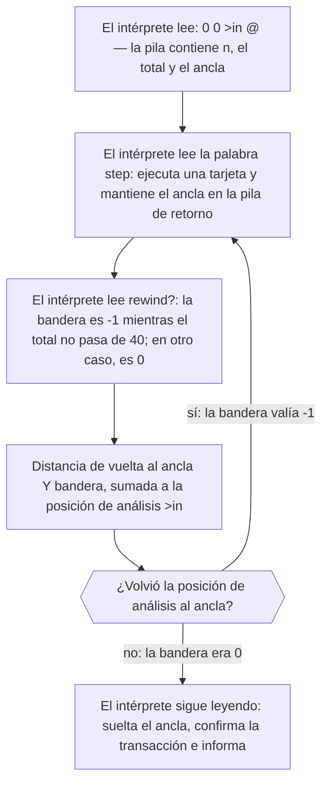

# Forth, más raro todavía

**Te enseña:** que, en el intérprete de texto, la posición de análisis es un contador de programa si lo permites, y que la pila de datos puede ser la única memoria de un programa.

> **DEMO ONLY.** Tarjetas de horas ficticias en un archivo SQLite temporal. Sin conexión con ningún sistema real de registro de horas.

Esto es raro, incluso para los aficionados a Forth.

El programa es una máquina de dos registros:

- la **memoria** es la pila de datos: no hay ni un solo `variable` en el archivo;
- el **contador de programa** es `>in`, la posición de análisis del intérprete de texto dentro de la línea actual.

No hay `begin`, `until`, `while`, `if`, `do`, `case` ni recursión en ninguna parte. El "bucle" es una línea de código fuente que el intérprete lee y luego lee *otra vez* porque una palabra movió `>in` hacia atrás.

## Ejecútalo

Necesitas Gforth (`gforth`, versión 0.7.3 o posterior) y `sqlite3`.

```bash
cd src/forth-weird
gforth timecards.fs
./check.sh                  # set GFORTH=/path/to/gforth if it is not on your PATH
```

Los registros se guardan en `$XDG_DATA_HOME/ForthWeird/demo-timecards.db` (por defecto, `~/.local/share/ForthWeird/`). Una ejecución se ve así:

```text
# DEMO ONLY run 1794674811797273
Meetings	19	19	2026-W46	DEMO ONLY
Coding	11	30	2026-W46	DEMO ONLY
Debugging	19	49	2026-W46	DEMO ONLY
# committed total=49 entries=3 DEMO ONLY
# no loop word anywhere: the text interpreter was rewound until the total passed 40
```

## Flujo del programa



**Qué muestra:** el bucle es el intérprete de texto, el bucle que nunca ves y el salto es un cambio en `>in`, el número que indica hasta dónde ha leído. Asignar un valor anterior a `>in` hace que el intérprete lea otra vez las mismas palabras. No existe `if`: una bandera de Forth es `-1` o `0`, así que `AND` convierte la distancia en sí misma o en nada.

**Por qué importa este mecanismo:** el contador de programa es una variable, y un programa puede reescribirla. El estado son dos números en la pila de datos, y sobreviven al retroceso porque nada más los toca. Esto funciona porque las palabras se leen de una línea de entrada, y no funciona igual dentro de una definición. Para el bucle ordinario, consulta [`forth`](../forth/README.md).

## Cómo funciona el truco

El intérprete de texto de Forth es un bucle que nunca ves: lee la siguiente palabra de la línea de entrada, la ejecuta y se repite. `>in` es una variable que guarda *hasta dónde ha leído*. Léela con `>in @` y modifícala con `>in !`. Asígnale un valor anterior y el intérprete volverá a leer alegremente las mismas palabras.

El programa completo es esta única línea en el nivel superior, fuera de cualquier definición:

```forth
0 0 >in @ step rewind?
```

Léelo de izquierda a derecha, como lo hace el intérprete:

1. `0 0` empuja el estado inicial: tarjeta número 0, total acumulado 0.
2. `>in @` empuja la posición de análisis, que en este momento está *justo después de `@`*. Esa es el **ancla**: "el lugar al que volver a saltar". Ahora la pila es `( n total anchor )`.
3. `step` ejecuta una tarjeta. Mueve el ancla a la pila de retorno (`>r`), llama a `card` y vuelve a poner el ancla, de modo que `card` nunca la ve.
4. `rewind?` decide si saltar. `over 41 <` comprueba si el total todavía no pasa de 40 y deja una bandera. La línea siguiente es el salto en sí:

   ```forth
   over >in @ - and  >in @ + >in !
   ```

   Una bandera de Forth es **-1** (todos los bits activados) para verdadero y **0** para falso, así que funciona como máscara de bits. `anchor - >in` es la distancia de vuelta hasta el ancla; `and` con la bandera conserva esa distancia si la bandera era verdadera y la pone en cero si era falsa; al sumarla a `>in` se obtiene el ancla o "quédate donde estás". No hay `if`. El salto es aritmético.
5. La línea termina. Si `>in` se rebobinó, la siguiente palabra del intérprete es otra vez `step` y la pila queda exactamente como la dejó la última pasada. Si no, continúa con la línea siguiente: `drop` (descarta el ancla), confirma la transacción, informa.

### Dónde va el estado

| Qué | Dónde vive |
| --- | --- |
| Número de tarjeta y total acumulado | En la pila de datos, a través de los rebobinados: `( n total )` |
| El destino del salto | También la pila de datos, como `anchor` |
| Las horas de una tarjeta | En la pila mientras dura un `card` y luego se incorporan al total |
| `run-id`, `sqlite` | Los `value` se fijan una vez al iniciar y nunca cambian |
| El texto de la semana ISO | Un búfer que se llena una sola vez al arrancar. `%G-W%V` siempre tiene ocho caracteres, así que tampoco se guarda su longitud |

`card` tiene el efecto de pila `( n total -- n' total' )`: toma las horas, calcula el nuevo total con `tuck +`, imprime la fila, envía `INSERT` y deja `n+1` y el nuevo total. `3dup` copia el registro de tres números `( n h t )` para que tanto `.row` (al terminal) como `.insert` (a SQLite, mediante `outfile-execute`) puedan consumir uno.

## Qué exige `check.sh`

Al quitar los comentarios y las cadenas de texto `."`, no aparece ninguno de `begin until while repeat again if then else do loop case of recurse exit leave`; no se declara ningún `variable` ni `buffer:`; `>in @` aparece al menos dos veces (una para el ancla y otra en el salto); y las filas de la base de datos coinciden con las filas impresas en 25 ejecuciones.

## Trampas que conviene conocer

- **Solo funciona en el nivel superior o en texto procesado con `evaluate` o `included`.** `>in` es la posición de análisis sintáctico *de la línea de entrada actual*. Una definición con dos puntos que mueve `>in` (como `rewind?`) funciona porque se ejecuta mientras el intérprete analiza la línea que la llamó. Compila el bucle *dentro de* una palabra y no hay ninguna línea que rebobinar.
- **El bucle y los datos están en una sola línea.** Si mueves `0 0` *después de* `>in @` (`>in @ 0 0 step rewind?`), obtienes un programa de apariencia correcta que reinicia el estado en cada pasada y nunca se detiene. Ahora el ancla queda antes de `0 0`, así que cada retroceso apila un par nuevo. (Moverlo a la línea anterior es inofensivo: el ancla sigue estando después de ella.)
- **El ancla es un número de caracteres, no una dirección.** Edita la línea y el ancla se recalcula en tiempo de ejecución, porque `>in @` la lee al pasar.
- **`random` es `0..n-1`**, así que `10 random 10 +` da un valor de 10 a 19 horas; Gforth usa `utime` como semilla.
- **`3dup` no existe en Gforth 0.7.3.** Se define al principio con `2 pick` tres veces.
- **Palabras específicas de Gforth.** `outfile-execute`, `open-pipe` y `utime` son extensiones de Gforth.
- **No es un patrón.** Una bandera como máscara de bits es un truco antiguo y respetable. Rebobinar el analizador sintáctico para crear un bucle es una acrobacia.

## Ejecuta el programa en un contenedor

Requisito previo: Docker, configurado una sola vez como se describe en [`SANDBOX-SETUP.md`](../../SANDBOX-SETUP.md#docker).

```bash
sandbox/container/run-image.sh src/forth-weird
```

Construye el [`Dockerfile`](Dockerfile) de esta carpeta y ejecuta el resultado sin red, con un sistema de archivos de solo lectura y el usuario `nobody`, y luego muestra la salida y una vista de solo lectura de las filas que escribió. La imagen contiene Gforth y sqlite3 sobre un Ubuntu mínimo. No tiene compilador ni gestor de paquetes.
