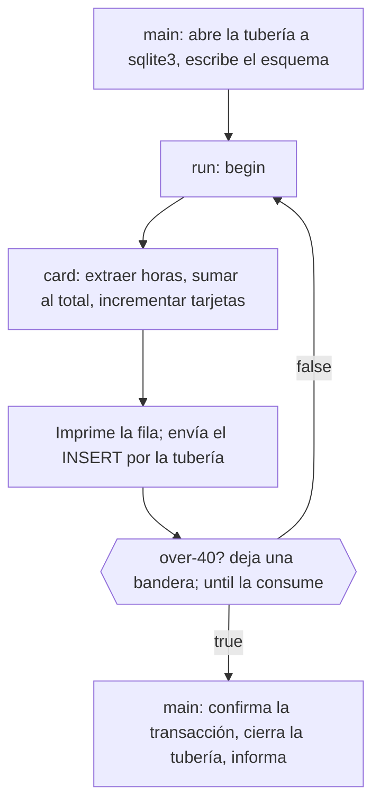

# Forth

**Te enseña:** que un lenguaje de pila necesita un `begin ... until` y una tubería para ser un programa completo.

> **DEMO ONLY.** Tarjetas de horas ficticias en un archivo SQLite temporal. Sin conexión con ningún sistema real de registro de horas.

El reto ("agrega tarjetas de 10 a 19 horas cada una hasta que el total pase de 40") es una sola palabra (`run`) y ocupa una sola línea: `begin card over-40? until`. Todo lo demás en [`timecards.fs`](timecards.fs) es una palabra pequeña que hace una sola cosa y se define antes de usarla.

## Ejecútalo

Necesitas Gforth (`gforth`, versión 0.7.3 o posterior) y `sqlite3`.

```bash
cd src/forth
gforth timecards.fs
./check.sh                  # set GFORTH=/path/to/gforth if it is not on your PATH
```

Los registros van a `$XDG_DATA_HOME/Forth/demo-timecards.db` (por defecto, `~/.local/share/Forth/`). Una ejecución se ve así:

```text
# DEMO ONLY run 1794674715672985
Reuniones	19	19	2026-W46	DEMO ONLY
Programación	15	34	2026-W46	DEMO ONLY
Depuración	14	48	2026-W46	DEMO ONLY
# committed total=48 entries=3 DEMO ONLY
```

## Flujo del programa



**Qué muestra:** Forth tiene un solo bucle ordinario, `begin ... until`. El cuerpo del bucle ejecuta `card` y después `over-40?` deja una bandera (un valor booleano) en la pila para que `until` la tome. El estado vive en dos variables, `total` y `cards`, y la pila de datos lleva valores entre palabras.

**Por qué importa este mecanismo:** la regla de parada es una bandera, no una condición en el encabezado del bucle. La bandera se calcula después de la tarjeta, así que la tarjeta con la que el total pasa del límite se conserva. El hermano raro [`forth-weird`](../forth-weird/README.md) no tiene `begin` ni `until`.

## Cómo funciona el truco

Forth casi no tiene sintaxis: el intérprete lee una palabra delimitada por espacios, la busca y la ejecuta. Una definición con `:` es una palabra nueva. Las palabras se pasan valores a través de una **pila**. Cada definición del archivo lleva un *comentario de pila* como `( hours -- )`, que significa "toma un número y no deja nada". Lee esos comentarios primero y casi todo el archivo se explica solo.

El archivo se construye de abajo hacia arriba, así que cada palabra se define con palabras que están más arriba:

1. **Estado.** Dos variables declaradas con `variable`: `total` y `cards`. `x @` lee, `n x !` guarda, `n x +!` suma.
2. **Categorías.** Cuatro palabras de una línea (`meetings`, `coding`, …) dejan cada una una cadena de texto en la pila como una dirección y una longitud (`c-addr u`). `create categories ' meetings , …` construye una tabla con sus *tokens de ejecución* (`'` se lee "tick": el token de la palabra siguiente). `category$` elige uno con `4 mod` y lo ejecuta con `execute`. Esa es la sentencia *switch* de Forth: un arreglo de funciones.
3. **La mecánica de la salida.** `.num`, `tab`, `quoted` y `comma` son pequeños auxiliares de salida. Así el SQL y las filas que se muestran se leen como listas de ingredientes y no como cadenas de texto con caracteres de escape.
4. **SQLite.** `open-sqlite` inicia `sqlite3` con `open-pipe` y guarda el descriptor en `sqlite`. `>sqlite` toma un token de ejecución y lo ejecuta con `outfile-execute`, que **redirige toda la salida a ese archivo** mientras se ejecuta esa palabra. Ese es el truco de la versión directa: `.schema`, `.insert` y `.commit` son palabras ordinarias que usan `cr` para pasar a una línea nueva y `."` para imprimir texto, y la tubería convierte ese texto en SQL.
5. **Una tarjeta.** `card` extrae las horas, las suma a `total`, incrementa `cards`, imprime la fila y envía la inserción. Fíjate en `dup .row`: `.row` consume las horas, así que se guarda una copia para `.insert`, que se ejecuta *dentro de* `outfile-execute` sobre la misma pila.
6. **El bucle.** `: run  begin card over-40? until ;`. `until` consume una bandera de `over-40?` y repite el cuerpo hasta que la bandera sea verdadera. `begin ... until` es el bucle ordinario de Forth y la única estructura de control de flujo del archivo.
7. **`main`.** Prepara todo, escribe el esquema, llama a `run`, confirma la transacción, cierra la tubería e informa.

## Qué impone `check.sh`

`check.sh` comprueba que `timecards.fs` lleva la marca `DEMO ONLY` y no tiene texto que parezca de red. Después ejecuta el programa 25 veces. Cada ejecución debe imprimir un conjunto de registros coherente: categorías en orden, horas de 10 a 19, totales acumulados que suman bien, una marca `DEMO ONLY` en cada fila y una parada exactamente cuando el total pasa de 40. SQLite debe coincidir con las filas impresas. Las 25 ejecuciones deben dejar en la base de datos 25 identificadores de ejecución distintos, y las horas deben mostrar al menos seis valores distintos, para que las extracciones "aleatorias" parezcan realmente aleatorias. Por último, intenta insertar una fila sin la marca de demostración y espera que SQLite la rechace, lo cual prueba que `CHECK(demo_only=1)` es real.

## Trampas que conviene conocer

- **Las palabras de control solo funcionan dentro de definiciones.** Escribir `begin ... until` en el nivel superior es un error en Forth estándar. Por eso `run` es una palabra. (La versión rara hace trampa en sentido contrario.)
- **Las cadenas de texto de `s"` son temporales.** En algunos intérpretes, `s"` fuera de una definición devuelve un búfer que se sobrescribe en la siguiente llamada. Las palabras de categoría son definiciones por esa razón.
- **`random` es `0..n-1`.** `10 random 10 +` da un valor de 10 a 19 horas. Gforth lo inicializa con `seed`; este archivo lo inicializa con `utime` (microsegundos), que también es el id de la ejecución.
- **`close-pipe` devuelve el estado de salida.** `close-sqlite` convierte un estado de salida distinto de cero en un aborto, así que un `sqlite3` fallido no se ignora en silencio.
- **Palabras específicas de Gforth.** `outfile-execute`, `open-pipe`, `utime` y `s\"` son extensiones de Gforth, no de ISO Forth.
- **No existe un formateador.** El estilo se aplica a mano: un comentario de pila por palabra, palabras cortas, sangrías de dos espacios en los cuerpos y un `$` final en las palabras que dejan una cadena de texto.
- **Armar SQL por concatenación es un mal hábito.** Aquí es seguro solo porque cada valor es un número que calcula el programa o una de cuatro palabras fijas. No lo copies.

## Ejecútalo en un contenedor

Requisito previo: Docker, configurado una sola vez como se describe en [`SANDBOX-SETUP.md`](../../SANDBOX-SETUP.md#docker).

```bash
sandbox/container/run-image.sh src/forth
```

El script hace la compilación de la imagen a partir del [`Dockerfile`](Dockerfile) de esta carpeta y ejecuta el resultado sin red, con un sistema de archivos de solo lectura y con el usuario `nobody`. Después muestra la salida y una vista de solo lectura de las filas que escribió. La imagen contiene Gforth y sqlite3 sobre un Ubuntu mínimo. No tiene compilador ni gestor de paquetes.
