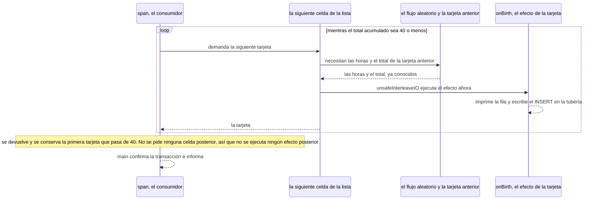

# Haskell bajo los efectos de las drogas

**Te enseña:** que leer una lista perezosa puede dirigir un programa cuando forzar cada elemento tiene un efecto secundario.

> **DEMO ONLY.** Tarjetas de horas ficticias en un archivo SQLite temporal. Sin conexión con ningún sistema real de registro de horas.

Esto es Haskell con esteroides.

El programa construye una **lista infinita de tarjetas**, y *forzar la celda n de esa lista imprime la tarjeta n y envía su `INSERT` a `sqlite3`*. Nada más en el programa escribe una fila. No hay bucle, acumulador, contador ni recursión explícita. La regla de parada es un consumidor, `span`, que deja de pedir la siguiente celda, y los `INSERT`s se detienen con él.

## Ejecuta el programa

Necesitas GHC (`runghc`) y `sqlite3`. Solo se usan paquetes que vienen con GHC.

```bash
cd src/haskell-weird
runghc timecards.hs
./check.sh                  # set RUNGHC=/path/to/runghc if it is not on your PATH
```

Los registros se escriben en `$XDG_DATA_HOME/HaskellWeird/demo-timecards.db` (valor por defecto: `~/.local/share/HaskellWeird/`). Una ejecución tiene este aspecto:

```text
# DEMO ONLY run 1794674995-36735
Meetings	10	10	2026-W46	DEMO ONLY
Coding	11	21	2026-W46	DEMO ONLY
Debugging	13	34	2026-W46	DEMO ONLY
Learning	10	44	2026-W46	DEMO ONLY
# committed total=44 entries=4 DEMO ONLY
# the list of cards is a fixed point of itself, and reading it is what wrote the rows
```

## Flujo del programa



**Qué muestra:** los efectos están ligados a la *lectura* de la lista. La lista está construida para que no se ejecute nada al crearla. Cada celda guarda una promesa, y forzar la celda ejecuta el `onBirth` de esa tarjeta. Así, el número de filas impresas es igual al número de `INSERT`, que es igual al número de tarjetas leídas.

**Por qué importa este mecanismo:** este es un flujo de control dirigido por la demanda y con efectos secundarios, y solo es seguro por cómo están enlazadas las celdas. `unsafeInterleaveIO` se llama *unsafe* por una razón: el orden de los efectos ahora depende del orden de la demanda. La misma evaluación perezosa sin efectos aparece en la entrada simple de [`haskell`](../haskell/README.md).

## Cómo funciona el truco

Hay tres trucos, apilados unos sobre otros.

### 1. Una lista definida en términos de sí misma (`fix`)

```haskell
rolls seed = map toHours (tail (fix (\xs -> seed : map next xs)))
```

`fix f = f (fix f)`: entrega a una función *su propio resultado*. Aquí `xs` es la lista que se define, así que `xs = seed : map next xs`: el primer elemento es la semilla y cada elemento posterior es el resultado de aplicar `next` al anterior. Funciona porque `map` solo necesita un elemento de `xs` a la vez. Este es el flujo aleatorio sin `iterate` y sin recursión.

### 2. Un nudo a través de las propias tarjetas (`fixIO`)

```haskell
sheet onBirth seed = fixIO $ \cards ->
  let before = 0 : map runningTotal cards
      born (c, h, t) = let card = Card c h (t + h) in card <$ onBirth card
   in lazily (map born (zip3 (cycle [minBound ..]) (rolls seed) before))
```

`cards` es la lista en construcción, y `before` es `0` seguido del total acumulado de cada tarjeta de esa lista. Así, el total de la tarjeta n es sus horas más el total leído de la tarjeta n-1, un elemento de la propia lista en construcción. `fixIO` es `fix` para IO: da a la acción una referencia a su propio resultado futuro.

### 3. Efectos que esperan a que los pidan (`unsafeInterleaveIO`)

```haskell
lazily = fix $ \self actions -> unsafeInterleaveIO $ case actions of ...
```

`sequence` convierte una lista de acciones de IO en una sola acción que devuelve una lista. Pero **ejecuta todas ellas primero**, así que nunca retorna con una lista infinita. `lazily` hace el mismo trabajo con `unsafeInterleaveIO` alrededor de cada celda, lo que significa "ejecuta esta acción solo cuando se demande su resultado". Después de que `sheet` retorna, no se ha ejecutado nada. Cada celda es una promesa.

`onBirth` es el efecto asociado a una tarjeta: imprime la fila y escribe el `INSERT` en la tubería. La regla de parada de `untilOver40` es entonces solo un `span`, una función pura que lee tarjetas hasta que una pasa de 40. Leer la tarjeta n es lo que ejecuta `onBirth` para la tarjeta n. El total de lecturas es igual al total de `INSERT` y al número de filas impresas, por construcción.

## Trampas que conviene conocer

- **La evaluación perezosa muerde dos veces.** El primer borrador contaba las tarjetas con `let entries = length cards` y el programa imprimió `# committed total=Meetings 12 12 …` y luego falló con "handle is closed". Un enlace `let` es perezoso en sí mismo. Por eso nada exigió las tarjetas hasta que se imprimió la línea de resumen. Eso ocurrió después de `COMMIT` y después de que se cerró la tubería. Los efectos de las tarjetas se dispararon *durante* la salida de `show`. La solución es `entries <- evaluate (length cards)`, que fuerza el conteo *antes* de confirmar. Con E/S perezosa, "¿cuándo se exige?" forma parte del significado de tu programa.
- **Por qué es `unsafe`.** El evaluador decide el orden de los efectos, no el texto del programa. Aquí el orden es seguro porque no se puede forzar la tarjeta n antes que la tarjeta n-1 (su total depende de ella).
- **`lazily` debe posponer su propia coincidencia de patrones.** `case` está *dentro de* `unsafeInterleaveIO`. Si la coincidencia de patrones sobre la lista de acciones se hiciera cuando se llamara a `lazily`, forzar esa lista necesitaría `before`, que necesita `cards`, que todavía no existe: `<<loop>>`.
- **`take 1 over` dispara un efecto más.** El programa tiene que leer la tarjeta que cruza para ver que cruza, así que escribe su fila. Por eso el programa conserva la tarjeta en lugar de descartarla.
- **El código de producción no debería hacer esto.** La E/S perezosa (*lazy IO*) es la razón por la que `hGetContents` de `System.IO` tiene un comportamiento famoso por sorprendente; este programa convierte esa sorpresa en el algoritmo.

## Qué impone `check.sh`

Sin las líneas de comentario: las tarjetas se construyen con `fixIO $ \cards ->`; hay exactamente un uso de `unsafeInterleaveIO`; no aparece ninguno de `scanl iterate foldr foldl unfoldr until go mapM forM forever replicateM foldM zipWithM sequence`; el tipo `sheet` es `(Card -> IO ()) -> Word64 -> IO [Card]`; y cada una de las 25 ejecuciones se detiene cuando debe, con la base de datos de acuerdo con la salida.

## Da formato y analiza con linter

El código fuente está formateado a mano al estilo de [Ormolu](https://github.com/tweag/ormolu) (sangría de dos espacios, comas al inicio de línea e importaciones ordenadas) y compila limpio con `ghc -Wall -Wcompat`. **No** se ha ejecutado con los binarios `ormolu` ni `hlint`; no estaban disponibles donde se escribió, así que espera que encuentren pequeñas diferencias.

## Ejecútalo en un contenedor

Requisito previo: Docker, configurado una sola vez como se describe en [`SANDBOX-SETUP.md`](../../SANDBOX-SETUP.md#docker).

```bash
sandbox/container/run-image.sh src/haskell-weird
```

Construye el [`Dockerfile`](Dockerfile) de esta carpeta y ejecuta el resultado sin red, con un sistema de archivos de solo lectura y el usuario `nobody`, y luego imprime la salida y una vista de solo lectura de las filas que escribió. En una etapa de compilación, GHC compila el script en un solo binario. La imagen contiene solo ese binario y sqlite3, sin GHC.
