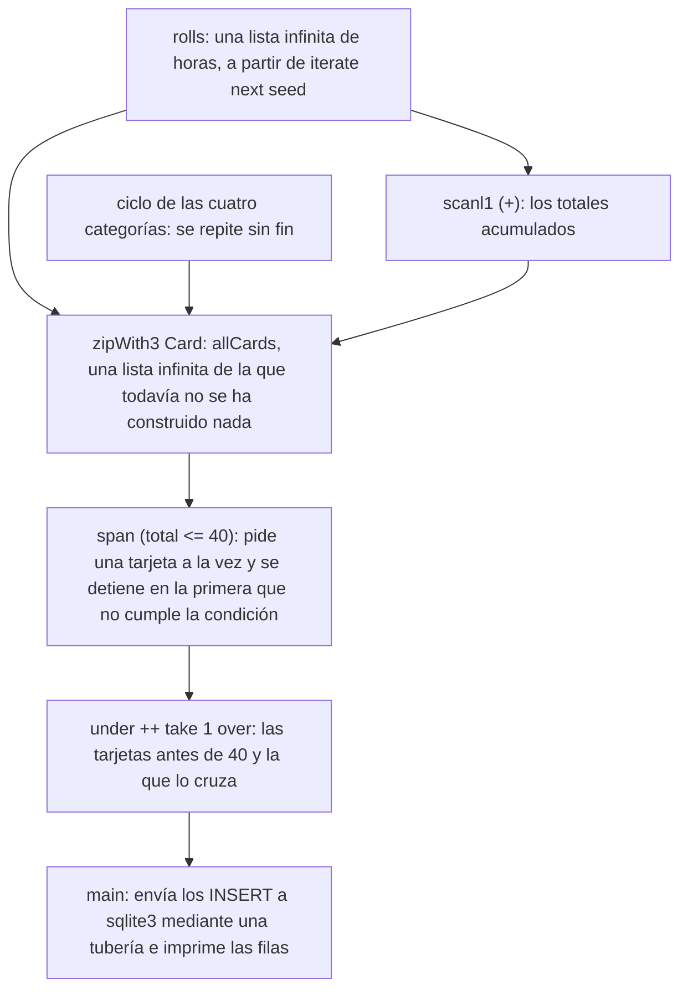

# Haskell

**Te enseña:** que una lista perezosa y un solo `span` son toda la regla de parada.

> **DEMO ONLY.** Tarjetas de horas ficticias en un archivo SQLite temporal. Sin conexión con ningún sistema real de registro de horas.

Este es Haskell sencillo: el reto es una sola función pura, `timecards`, y `main` se ocupa de cómo viaja el dato a su alrededor.

## Ejecútalo

Necesitas GHC (`runghc`) y `sqlite3`. Solo se usan paquetes que vienen con GHC (`base`, `time`, `process`, `directory`, `filepath`, `unix`).

```bash
cd src/haskell
runghc timecards.hs
./check.sh                  # set RUNGHC=/path/to/runghc if it is not on your PATH
```

Los registros van a `$XDG_DATA_HOME/Haskell/demo-timecards.db` (por defecto `~/.local/share/Haskell/`). Una ejecución se ve así:

```text
# DEMO ONLY run 1794674911-35631
Meetings	15	15	2026-W46	DEMO ONLY
Coding	12	27	2026-W46	DEMO ONLY
Debugging	10	37	2026-W46	DEMO ONLY
Learning	12	49	2026-W46	DEMO ONLY
# committed total=49 entries=4 DEMO ONLY
# the whole challenge is one pure function, timecards; main is just plumbing
```

## Flujo del programa



**Qué muestra:** las listas son descripciones, no datos. No se calcula nada hasta que `span` pide una tarjeta, y `span` deja de pedir en la primera tarjeta que no pasa la prueba. Por eso el programa construye solo unas pocas tarjetas, aunque las listas son infinitas.

**Por qué importa este mecanismo:** la regla de parada no es una condición de bucle. Es *cuánto de una lista eliges leer*. La demanda fluye hacia atrás, desde `span` hasta las listas, mientras que los datos fluyen hacia adelante. Esto es evaluación perezosa como forma de escribir un bucle sin escribir un bucle.

## Cómo funciona el truco

El archivo se lee de arriba abajo como cuatro pasos, cada uno una función pequeña con una firma de tipo.

1. **`rolls :: Word64 -> [Int]`** es una lista *infinita* de horas de 10 a 19. GHC no incluye ningún paquete de números aleatorios, así que esto es un generador congruencial lineal de 64 bits. `iterate next seed` produce `seed, next seed, next (next seed), …`; `tail` descarta la semilla misma; los bits altos (`shiftR 33`) son los buenos. Como la aritmética de `Word64` da la vuelta al desbordarse, el "mod 2^64" que necesita el algoritmo sale gratis.
2. **`allCards :: Word64 -> [Card]`** son todas las tarjetas que podrían existir, también infinitas. `cycle [minBound ..]` repite `Meetings, Coding, Debugging, Learning` para siempre (el tipo `Category` deriva `Enum` y `Bounded`, así que puede listarse a sí mismo). `scanl1 (+) hs` es una *suma acumulada*: `[10, 11, 12]` se convierte en `[10, 21, 33]`. `zipWith3 Card` une las tres listas infinitas en tarjetas.
3. **`timecards :: Word64 -> [Card]`** es el reto: `span ((<= 40) . runningTotal) (allCards seed)` divide la lista en la primera tarjeta cuyo total pasa de 40, y `under ++ take 1 over` conserva todo lo que va antes de ella más esa tarjeta.
4. **Salida.** `insert` y `row` convierten una tarjeta en una sentencia SQL y en una línea de terminal; `main` pasa el SQL por una tubería a `sqlite3` e imprime las filas.

### ¿Por qué es segura una lista infinita?

Haskell es perezoso: un valor se calcula solo cuando algo lo necesita. `span` examina una tarjeta a la vez y se detiene en la primera que no pasa la prueba, así que solo se construye un puñado de tarjetas. Las listas "infinitas" son *descripciones*, no datos. Esa es la lección del archivo: la regla de parada no es una condición de bucle, sino *cuánto de una lista eliges leer*.

## Qué exige `check.sh`

`check.sh` primero comprueba que el reto de verdad es una función pura: `timecards :: Word64 -> [Card]` debe existir, así que su tipo no tiene `IO`, y no puede colarse ninguna importación de `System.Random`, de red ni de HTTP. El archivo también necesita la marca `DEMO ONLY`. Después ejecuta el programa 25 veces. Cada ejecución debe imprimir un conjunto de registros razonable: categorías en orden, horas de 10 a 19, totales acumulados que cuadran, una marca `DEMO ONLY` en cada fila y una parada exactamente cuando el total pasa de 40. SQLite debe coincidir con las filas impresas. Las 25 ejecuciones deben ser 25 ejecuciones distintas, y las horas deben mostrar al menos seis valores distintos, para que los sorteos "aleatorios" parezcan realmente aleatorios. Por último, intenta insertar una fila que no es de demostración y espera que SQLite la rechace, lo que demuestra que `CHECK(demo_only=1)` es real.

## Trampas que conviene conocer

- **`takeWhile` no basta.** `takeWhile (<= 40)` descarta la tarjeta que cruza la línea, y el reto la necesita. `span` devuelve ambas mitades.
- **Funciones parciales.** `head`, `last` y `!!` fallan con una lista vacía. Nada aquí las usa: el total es un `sum` y el conteo es un `length`.
- **`Int` vs `Integer` vs `Word64`.** Las horas y los totales son pequeños, así que `Int`. El estado del generador necesita exactamente 64 bits sin signo, así que `Word64`; su desbordamiento cíclico es una característica. Con `Integer` tendrías que escribir `mod 2^64` por tu cuenta.
- **`quote` duplica los `'` incrustados.** Aquí las entradas de datos son palabras y números fijos, así que nunca se activa. Pero el SQL armado por concatenación de cadenas de texto debería pasar siempre por una sola función de escape.
- **`getXdgDirectory XdgData`** respeta `$XDG_DATA_HOME` y, en caso contrario, recurre a `~/.local/share`, que reemplaza una rutina `lookupEnv` escrita a mano.
- **El generador es solo para demos.** Los LCG sirven para horas ficticias y no sirven para nada más.

## Da formato y analiza el código

El código fuente está formateado a mano al estilo de [Ormolu](https://github.com/tweag/ormolu) (sangría de dos espacios, comas al inicio de línea e importaciones ordenadas) y compila limpio con `ghc -Wall -Wcompat`. **No** se ha ejecutado con los binarios `ormolu` ni `hlint`; no estaban disponibles donde se escribió, así que espera que encuentren pequeñas diferencias.

## Ejecútalo en un contenedor

Requisito previo: Docker, configurado una sola vez como se describe en [`SANDBOX-SETUP.md`](../../SANDBOX-SETUP.md#docker).

```bash
sandbox/container/run-image.sh src/haskell
```

Construye el [`Dockerfile`](Dockerfile) de esta carpeta y ejecuta el resultado sin red, con un sistema de archivos de solo lectura y el usuario `nobody`, y luego imprime la salida y una vista de solo lectura de las filas que escribió. En una etapa de compilación, GHC compila el script en un solo binario. La imagen contiene solo ese binario y sqlite3, sin GHC.
