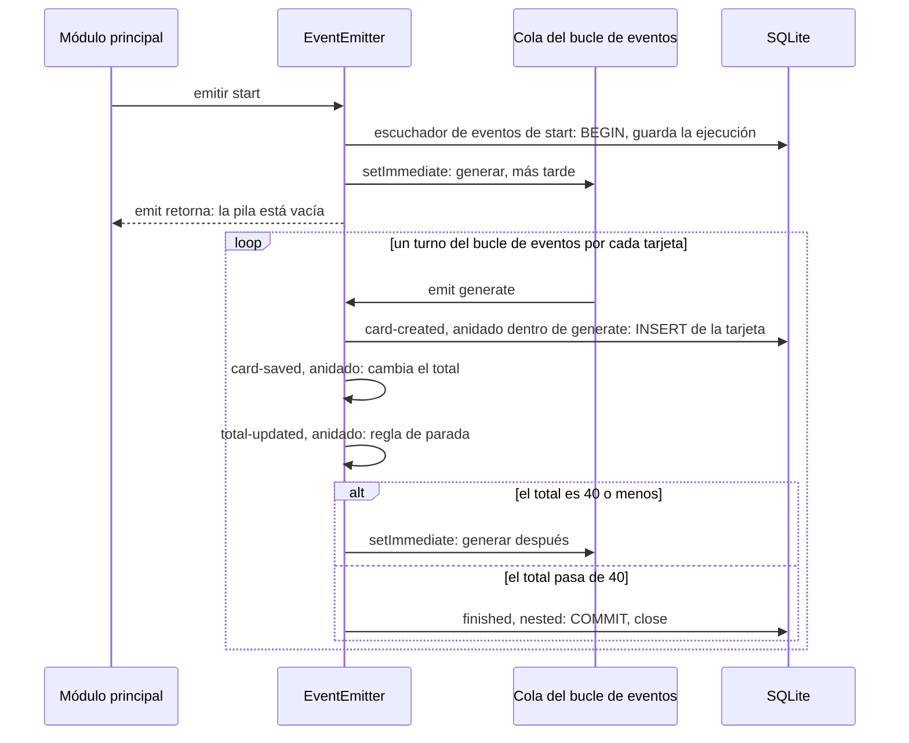

# JavaScript, orientado a eventos: una línea de trabajo, un programa entero en los escuchadores de eventos

**Te enseña:** que un programa puede ser un conjunto de escuchadores de eventos, cada uno con una sola tarea pequeña que termina emitiendo el evento que espera el siguiente; y que emit() llama a sus escuchadores de inmediato, así que solo un límite de planificación explícito da un turno al bucle de eventos.

> **DEMO ONLY.** Tarjetas de horas ficticias, escritas en un archivo SQLite temporal dentro de `$XDG_DATA_HOME/JavaScriptEvents/`.
> Nada de esto toca el registro real de horas.

La [entrada convencional](../javascript/README.md) es una sentencia `for` con cuerpo vacío. La [entrada con clausuras](../javascript-weird/README.md) usa tres clausuras (*closures*), funciones que conservan las variables del lugar donde se crearon, y un iterador las extrae. Esta entrada **no tiene sentencia de bucle ni canalización**. El arranque visible es una sola línea:

```js
program(realWorld()).emit('start');
```

Todo lo demás es un escuchador de eventos (*listener*): una función pequeña que Node llama cuando llega un evento. El escuchador de eventos `start` abre la base de datos. El escuchador de eventos `generate` crea una tarjeta. El escuchador de eventos `card-created` la guarda. Y así sigue hasta que el escuchador de eventos `finished` cierra el programa. El programa es el conjunto de escuchadores de eventos y el bucle es la forma en que los eventos se encadenan.

```text
$ node timecards.mjs
# DEMO ONLY run 1
Meetings	12	12	2026-W47	DEMO ONLY
Coding	17	29	2026-W47	DEMO ONLY
Debugging	17	46	2026-W47	DEMO ONLY
# committed total=46 entries=3 DEMO ONLY

Total simulated hours: 46.0
Saved locally for the modernization exercise.
```

Con la misma semilla, las tres entradas de Node imprimen las mismas tarjetas (`SEED=42`). Léelas como un conjunto de tres: una [cláusula `for`](../javascript/README.md), una [demanda (pull) perezosa](../javascript-weird/README.md) y esta, una cadena de eventos. La [lección sobre eventos](../../lessons/informatica/10-eventos-retrollamadas-y-flujo-de-control-reactivo.md) explica las ideas en que se basa esta.

## Ejecútalo

Necesitas **Node.js 24 o posterior**: ya incluye `node:sqlite`. `node:events` también viene incluido. No hay `npm install`.

```bash
cd src/javascript-events
node timecards.mjs                       # run the demo (SEED=42 replays one exact run)
node --test check.mjs                    # the event lab: 14 tests that prove what this page says
./check.sh                               # everything below (needs sqlite3 and GNU date, and `script` for the terminal tests)
```

Los registros van a `$XDG_DATA_HOME/JavaScriptEvents/demo-timecards.db` (por defecto, `~/.local/share/JavaScriptEvents/`).

## Ejecútalo en un contenedor

Requisito previo: Docker, configurado una sola vez como se describe en [`SANDBOX-SETUP.md`](../../SANDBOX-SETUP.md#docker).

```bash
sandbox/container/run-image.sh src/javascript-events          # the plain, CI-style output
sandbox/container/run-image.sh --tty src/javascript-events    # with a terminal: watch the DEMO ONLY line pulse
```

Compila el [`Dockerfile`](Dockerfile) de esta carpeta y ejecuta el resultado sin red, con un sistema de archivos de solo lectura y el usuario `nobody`.

## Flujo del programa



**Qué muestra:** dos tipos de flecha. Un `emit` es una llamada: el escuchador de eventos se ejecuta *dentro* de ella, encima del llamador, y `emit` solo regresa cuando el escuchador de eventos termina. Las flechas `setImmediate` son solicitudes: el siguiente `generate` espera en la cola del bucle de eventos hasta que la pila quede vacía. Cada tarjeta es un turno del bucle y cuatro emisiones se anidan dentro de ese turno. Una excepción lanzada en cualquier escuchador de eventos emite `failed`, que revierte, informa una sola vez y elimina todos los escuchadores de eventos.

**Por qué importa este mecanismo:** el programa no tiene sentencias de bucle ni recursión. El ciclo es "total-updated le pide al bucle de eventos otro generate". Sin ese límite, los mismos eventos se anidarían un nivel más por cada tarjeta. La escritura en la base de datos termina dentro de `card-created`, antes de que el total cambie en `card-saved`.

## Cómo funciona el truco

### Los eventos

[`timecards.mjs`](timecards.mjs) registra diez escuchadores de eventos en un solo `EventEmitter`. Nueve son los pasos de la máquina de estados. El décimo convierte un evento `error` suelto en `failed` (mira más abajo). Lee la tabla de arriba abajo y el programa de arriba abajo: coinciden.

| Evento | El escuchador de eventos hace | Luego |
|---|---|---|
| `start` | Abre la base de datos, inicia una transacción y guarda la ejecución | Pide la primera tarjeta **en un turno posterior** (`setImmediate`) |
| `generate` | Sortea las horas y elige la categoría | Emite `card-created` (ahora) |
| `card-created` | **Guarda la tarjeta** en SQLite | Emite `card-saved` (ahora) |
| `card-saved` | Solo ahora: actualiza el total acumulado e imprime la fila | Emite `total-updated` (ahora) |
| `total-updated` | **La regla de parada.** ¿El total pasa de 40? | Si es así, emite `finished` (ahora). Si no, pide la siguiente tarjeta **en un turno posterior** |
| `finished` | Confirma la transacción, imprime el resumen y cierra la base de datos | Termina o inicia el temporizador de pulso en una terminal |
| `frame` | Un tic del pulso. Lo llama el temporizador | Después del último tic, emite `done` |
| `done` | Elimina todos los escuchadores de eventos y termina el proceso con normalidad | |
| `failed` | Revierte, cierra y avisa al usuario una sola vez | Elimina todos los escuchadores de eventos y termina con estado 1 |

### Dos tipos de "luego"

La documentación de Node.js dice lo mismo en dos lugares: [`events`](https://nodejs.org/api/events.html) para `emit()` y la guía sobre el [bucle de eventos, los temporizadores y `process.nextTick()`](https://nodejs.org/en/learn/asynchronous-work/event-loop-timers-and-nexttick) para `setImmediate()`.

Esta es la lección. La tabla dice *ahora* en algunas filas y *en un turno posterior* en otras, y no son lo mismo.

- **`emit()` es una llamada.** `events.emit('card-created', card)` llama a todos los escuchadores de eventos de `card-created`, en el orden en que se registraron, y *retorna solo después de que todos han retornado*. El escuchador de eventos se ejecuta encima de quien lo llamó, en la **pila de llamadas**. Si el escuchador de eventos emite otro evento, eso es un nivel más. Esto está documentado y `check.mjs` lo demuestra: la salida de un escuchador de eventos aparece antes de la línea que sigue a `emit()`.
- **`setImmediate()` es una solicitud.** Pone una función en la cola del bucle de eventos y regresa de inmediato. Node ejecuta la función después de que termine la pila de llamadas actual. Para entonces, cada `emit` de esta tarjeta ya ha regresado y la pila está vacía.

¿Por qué importa? Supón que `total-updated` llamara directamente a `events.emit('generate')`. Entonces el `generate` de la primera tarjeta seguiría en la pila cuando empezara el `generate` de la segunda tarjeta, y así sucesivamente. Cada tarjeta añadiría unos cuantos marcos más, y una ejecución lo bastante larga terminaría con `RangeError: Maximum call stack size exceeded`. Con 40 horas no hay riesgo. Con un límite de un millón es una caída. `check.mjs` muestra las dos mitades: un emisor que se llama a sí mismo se desborda (y se captura, así que la prueba es segura), y el programa real se mantiene en la *misma* profundidad de la tarjeta 1 a la tarjeta 2000.

```text
turn 1:  start ................................... asks for generate, returns
turn 2:  generate > card-created > card-saved > total-updated ... asks for generate, unwinds
turn 3:  generate > card-created > card-saved > total-updated ... asks for generate, unwinds
...
turn N:  generate > card-created > card-saved > total-updated > finished > done
```

El `>` es "llamadas, dentro". Un turno es todo lo que ocurre entre dos regresos al bucle de eventos. El laboratorio también registra cada `emit` cuando empieza y cuando retorna, así que el anidamiento es un hecho que puedes leer, no un cuento.

### El guardado ocurre antes de que cambie el total

`node:sqlite` funciona de forma síncrona. `insert.run()` ya escribió la fila cuando retorna. Por eso `card-created` guarda primero la tarjeta y solo después emite `card-saved`. El total acumulado cambia en el escuchador de eventos de `card-saved`, nunca antes. Nada posterior puede ver una tarjeta que no esté en la base de datos, y un guardado fallido no deja nada a medias. `check.sh` tiene un mutante que anuncia la tarjeta antes de guardarla, y el laboratorio lo detecta.

### Cuando un escuchador de eventos lanza una excepción

Un escuchador de eventos que lanza una excepción la envía *hacia arriba*, a través de `emit()`, hasta quien lo llamó. Aquí sería una función de devolución de llamada (*callback*): una función que se entrega a otro código para que la invoque después. Nadie la espera, así que la excepción terminaría el proceso. Por eso cada escuchador de eventos va envuelto: el envoltorio captura la excepción y emite `failed`. El escuchador de eventos de `failed` revierte la transacción, cierra la base de datos, detiene el temporizador, imprime **un** mensaje y elimina **todos** los escuchadores de eventos, incluido él mismo. Un segundo fallo no encuentra a nadie a quien avisar, así que un fallo se informa exactamente una vez.

Node trata el nombre de evento `error` de forma especial: `emit('error', e)` sin ningún escuchador de eventos *lanza* `e`. Este programa registra un escuchador de eventos que convierte un `error` suelto en `failed`, así que solo tiene una forma de fallar. Después de que el programa elimina todos los escuchadores de eventos, un `error` que nadie escucha lanza de nuevo, y el laboratorio también lo comprueba.

### Sin restos

Un escuchador de eventos, un temporizador o un inmediato que sigue registrado mantiene vivo el proceso o provoca una fuga. El programa termina al quitar todos los escuchadores de eventos, cerrar la base de datos y (en una terminal) detener su único temporizador. El laboratorio compara `process.getActiveResourcesInfo()` antes y después de una ejecución y no encuentra ninguna diferencia. Una ejecución redirigida no inicia ningún temporizador, así que Node no tiene nada más que esperar y termina de inmediato.

| Tarea | Realizado por |
|---|---|
| Bucle | Una cadena de eventos: `total-updated` pide el siguiente `generate` a través del planificador |
| Horas aleatorias | `rng`, una clausura (*closure*: función que conserva las variables de su entorno) sobre la semilla (Park-Miller): la misma de las otras dos entradas de Node |
| Total acumulado, número de tarjetas | Un objeto `s`, que solo tocan los escuchadores de eventos |
| Regla de parada | El escuchador de eventos `total-updated`: `total > limit` |
| Persistencia | El escuchador de eventos `card-created`, luego una confirmación de la transacción en `finished` |
| Fallo | El escuchador de eventos `failed`, al que se llega desde cada escuchador de eventos envuelto y desde `error` |
| Salida | `out()`, `raw()` y `err()` del objeto world |

### ¿Dónde vive el programa y qué hace que se ejecute el siguiente paso?

| | JavaScript, `for` sin cuerpo | JavaScript, clausuras | JavaScript, eventos |
|---|---|---|---|
| Dónde vive el programa | En las tres cláusulas de un `for` | En tres clausuras y una expresión | **En diez escuchadores de eventos pequeños** |
| Dónde vive el estado | Propiedades de un literal de objeto | Variables capturadas | **Un objeto que solo tocan los escuchadores de eventos** |
| Qué hace que se ejecute el paso siguiente | La sentencia `for` | La demanda del consumidor: `next()` | **Un evento y después el planificador** |
| Qué lo detiene | Una condición que es falsa | Una clausura (*closure*, una función que conserva las variables del lugar donde se creó) que dice `done` | **Un escuchador de eventos que no pide la siguiente tarjeta** |
| El orden del trabajo se ve en | El orden de las cláusulas | La forma de la canalización | **Los nombres de los eventos y las llamadas a emit** |

### El mundo es un argumento

`program(world)` recibe un objeto: los números aleatorios, el planificador, la forma de abrir la base de datos, las funciones de salida y el temporizador. `realWorld()` crea el real. Una prueba entrega el suyo: horas fijas en lugar de aleatorias, un planificador que solo pone en cola, una base de datos temporal, un temporizador que la prueba hace avanzar a mano. El programa no cambia y por eso el laboratorio prueba el programa que se ejecuta.

## Qué impone `check.sh`

- **Las restricciones son reales.** `check-static.mjs` analiza el código fuente con los comentarios y las cadenas de texto borrados. No hay `for`, `while` ni `do`; tampoco `forEach`, `eval`, `async`, `await`, `nextTick` ni `setTimeout`. No hay más importaciones que `node:events`, `node:fs`, `node:os`, `node:path`, `node:sqlite` y `node:url`. El archivo termina con exactamente un `emit('start')`. Existen exactamente diez escuchadores de eventos, y a `generate` solo se llega a través del planificador. Se rechazan nueve mutantes (un `for`, un `while`, `forEach`, `eval`, `child_process`, `async`, un `emit('generate')` directo, un segundo `emit('start')`, `nextTick`).
- **El laboratorio de eventos (`check.mjs`).** Catorce pruebas. Una ejecución guarda solo filas de demostración y el informe coincide con ellas. Se detiene justo en la tarjeta correcta (un total de exactamente 40 continúa). `emit('start')` retorna antes de que exista ninguna tarjeta. Los eventos se anidan dentro de un turno como una pila de llamadas. `emit()` es síncrono y `setImmediate()` es un turno posterior. La pila mantiene la misma profundidad con 2000 tarjetas. Un emisor que se llama a sí mismo se desborda. Una inserción que falla y una confirmación de la transacción que falla informan una vez cada una y revierten. `error` se enruta. No queda ningún escuchador de eventos, temporizador ni inmediato. El pulso es un temporizador que se detiene solo. La semilla se reproduce. La semana ISO es correcta en Año Nuevo.
- **El laboratorio falla ante los mutantes.** Siete cambios en el programa (parar con un total de 40 en lugar de con más de 40, sin `ROLLBACK`, escuchadores de eventos que quedan tras un fallo y tras el final, una tarjeta anunciada antes de guardarse, sin frontera de planificación, otro generador aleatorio) hacen que el laboratorio falle, cada uno por separado.
- **Las reglas del reto.** 25 ejecuciones aleatorias: categorías en orden, de 10 a 19 horas, totales acumulados correctos, una parada justo después del primer total que pasa de 40, `DEMO ONLY` en todas partes, nada en stderr, ningún código de escape en la salida redirigida y ningún archivo en la carpeta de datos salvo `demo-timecards.db`. En SQLite: solo filas de demostración, el usuario actual y cada `running_total` igual a la suma de las horas hasta ese momento.
- **Semillas.** Usar `SEED=42` dos veces da las mismas tarjetas, y las mismas que producen las otras dos entradas de Node. Doce semillas coinciden con un modelo aparte del generador escrito en awk, y una semilla cuyas primeras cuatro tarjetas suman exactamente 40 debe recibir una quinta.
- **La semana ISO** coincide con GNU `date` en diez fechas y **el pulso** se comporta bien en un pseudoterminal, con `NO_COLOR`, con `TERM=dumb` y cuando se redirige.
- **Errores y esquema.** Una carpeta de datos en la que no se puede escribir termina con un estado distinto de cero y exactamente un mensaje. SQLite rechaza una fila o una ejecución que no sea de demostración, 9 horas y una quinta categoría.

## Por qué es raro

Un `EventEmitter` sirve para un programa que *reacciona*: un servidor oye una petición y una ventana oye un clic. Aquí nada fuera del programa envía nada. El programa emite cada evento hacia sí mismo, así que los escuchadores de eventos no reaccionan. Son *pasos*, y el emisor es una centralita que los conecta. El grafo de flujo de control que una sentencia `for` mantiene en un solo lugar queda repartido entre diez funciones y diez nombres de evento, y tienes que leer las llamadas a `emit` para verlo.

## Cuándo no debes hacer esto

- **Cuando una llamada a función simple dice lo mismo.** `card-created` tiene exactamente un escuchador de eventos, y siempre es el mismo. Reemplaza el evento por una llamada y el programa queda más corto y un depurador puede recorrerlo paso a paso. Un evento se justifica cuando *más de una* parte puede tener interés, o cuando el emisor no debe saber quién escucha.
- **Cuando necesitas que el orden sea evidente.** El orden del trabajo vive en los nombres de los eventos y en el orden en que se registraron los escuchadores de eventos. Un lector debe buscar cada `emit` para saber qué sigue a qué.
- **Cuando los errores importan.** Un error lanzado en un escuchador de eventos llega a quien llama a `emit()`. Ese llamador puede ser una función de devolución de llamada (*callback*, una función que pasas a otro código para que la llame después) que nadie espera. Para evitarlo, este programa necesita un envoltorio alrededor de cada escuchador de eventos.
- **Cuando el productor es más rápido que el consumidor.** Los eventos no tienen contrapresión: un emisor sigue emitiendo. Este programa es seguro porque cada tarjeta espera a la anterior. Una fuente de eventos real necesita una cola con límite o un *stream*.
- **Cuando los escuchadores de eventos pueden agregar o quitar escuchadores de eventos.** Los escuchadores de eventos que cambian quién escucha, en medio de un `emit`, hacen que el orden sea difícil de predecir. Este programa quita sus escuchadores de eventos solo al final de todo.

## Trampas que conviene conocer

- **Lo que promete el lenguaje.** Node documenta que `emit()` llama a sus escuchadores de eventos de forma síncrona y en el orden en que se registraron. También documenta que `setImmediate()` se ejecuta después de la operación actual: marcamos la entrada como **garantizado**. El *orden relativo* de `setImmediate` y `setTimeout(fn, 0)` no está prometido en todas partes, así que el programa no depende de él. Solo usa `setImmediate`.
- **`node:sqlite` funciona de forma síncrona.** El guardado termina cuando `run()` retorna. Con un controlador asíncrono, el escuchador de eventos `card-created` tendría que esperar a la escritura antes de emitir `card-saved`, y toda la cadena necesitaría `async` y `await`. Los eventos y las promesas son herramientas distintas.
- **`EventEmitter` no es un bucle de eventos.** El emisor no tiene cola ni bucle. Es una tabla de escuchadores de eventos y una función que los llama. La cola y el bucle son de Node, y `setImmediate` es la forma en que este programa los usa.
- **`removeAllListeners()` dentro de un `emit` es seguro.** Node copia la lista de escuchadores de eventos antes de llamarlos, así que los del evento en curso se ejecutan igualmente. El laboratorio depende de eso para `done`.
- **El temporizador de pulso es la única fuente asíncrona real.** Existe solo en una terminal. Es lo único que mantiene vivo a Node después de la última tarjeta, y se detiene solo.
- **Probamos con Node 24.15.** `node:sqlite` necesita Node 22.5 o una versión posterior, mientras que las otras entradas necesitan Node 24. Esta también necesita Node 24, para que las tres entradas vayan al mismo paso.

---

Consulta el [README raíz](../../README.md#los-resultados-hasta-ahora) para ver cómo se compara con las otras entradas, y [`RETO.md`](../../RETO.md) si quieres escribir la tuya.
