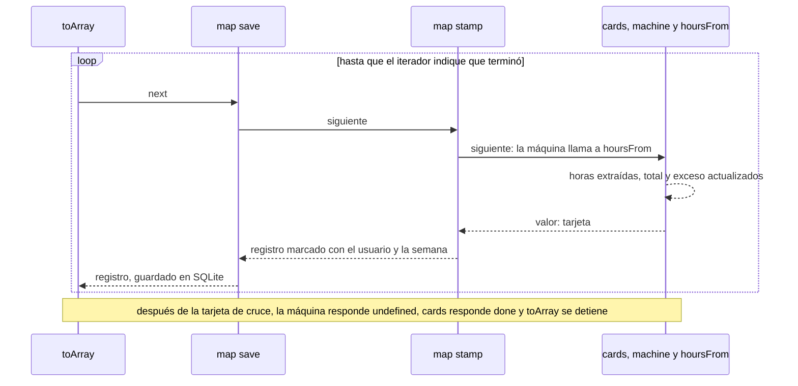

# JavaScript, más raro: clausuras hasta el fondo

**Te enseña:** que una clausura es una máquina de estados: una función más las variables junto a las que se creó, que un iterador hace avanzar un paso a la vez, con reduce como el único pliegue que no puede detenerse.

> **DEMO ONLY.** Tarjetas de horas ficticias, escritas en un archivo SQLite temporal bajo `$XDG_DATA_HOME/JavaScriptWeird/`.
> Nada de esto toca el registro de horas real.

La [entrada convencional](../javascript/README.md) es una sentencia `for` con cuerpo vacío. Esta entrada no tiene **ninguna sentencia de bucle en absoluto**, ni `this`. El algoritmo son tres clausuras pequeñas en [`core.mjs`](core.mjs) y el programa en [`timecards.mjs`](timecards.mjs) es una expresión que demanda tarjetas a través de ellas:

```js
const records = Iterator.from(cards(machine(hoursFrom(seed))))   // three closures, nested
  .map(stamp(user, week))                                          // a closure that makes a card into a record
  .map(save)                                                       // a closure that saves it
  .toArray();                                                      // the demand: pull cards until there are none
```

```text
$ node timecards.mjs
# DEMO ONLY run 1
Meetings	12	12	2026-W47	DEMO ONLY
Coding	17	29	2026-W47	DEMO ONLY
Debugging	17	46	2026-W47	DEMO ONLY
# committed total=46 entries=3 DEMO ONLY

Total simulated hours: 46.0
Saved locally for the modernization exercise.
```

Esta es la entrada **rara** de un par. Lee el par como tres pasos: el [original en C#](../ModernChallenge1/README.md), el [`for` sin cuerpo en Node](../javascript/README.md) y esta.

## Ejecútalo

Necesitas **Node.js 24 o más reciente**: incluye `node:sqlite` y los métodos auxiliares de iteradores (*iterator helpers*: `Iterator.from`, `map`, `some`, `take`, `toArray`), ambos integrados. No hay `npm install`.

```bash
cd src/javascript-weird
node timecards.mjs                       # run the demo (SEED=42 replays one exact run)
node --expose-gc --test check.mjs        # the closure lab: 12 tests that prove what this page says
./check.sh                               # everything below (needs sqlite3 and GNU date, and `script` for the terminal tests)
```

Los registros van a `$XDG_DATA_HOME/JavaScriptWeird/demo-timecards.db` (por defecto `~/.local/share/JavaScriptWeird/`).

## Ejecútalo en un contenedor

Requisito previo: Docker, configurado una sola vez como se describe en [`SANDBOX-SETUP.md`](../../SANDBOX-SETUP.md#docker).

```bash
sandbox/container/run-image.sh src/javascript-weird          # the plain, CI-style output
sandbox/container/run-image.sh --tty src/javascript-weird    # with a terminal: watch the DEMO ONLY line pulse
```

Compila el [`Dockerfile`](Dockerfile) de esta carpeta y ejecuta el resultado sin red, con un sistema de archivos de solo lectura y con el usuario `nobody`.

## Flujo del programa



**Qué muestra:** la demanda fluye *hacia arriba* por la canalización y las tarjetas fluyen *hacia abajo*. No se saca nada hasta que `toArray()` lo pide, y cada petición hace pasar una tarjeta por todo el recorrido: sacada, sellada, guardada. El bucle es el consumidor que vuelve a pedir. Una clausura es una función que conserva las variables del lugar donde se creó. Las tres clausuras (`cards`, `machine`, `hoursFrom`) forman aquí una sola columna, porque cada una es llamada por la anterior.

**Por qué importa este mecanismo:** el estado vive en clausuras: el número del generador y el conteo, el total y la bandera de parada de la máquina. Nada más puede acceder a él. La regla de parada es una variable capturada, `over`, que se asigna en la misma llamada que crea la tarjeta que cruza. Compara [`javascript`](../javascript/README.md), donde una sentencia `for` impulsa el mismo trabajo, y [`javascript-events`](../javascript-events/README.md), donde lo hacen los escuchadores de eventos.

## Cómo funciona el truco

### Tres clausuras

Una **clausura** es una función junto con las variables junto a las que se creó. [`core.mjs`](core.mjs) tiene tres, cada una creada por otra función:

```text
 hoursFrom(42)                  machine(hoursFrom(42))                cards(machine(...))
 +----------------+             +-------------------------+           +-------------------------+
 | state = 42     |<--calls-----| nextHours  (the left box)|<--calls--| next                    |
 | () => 10+...   |             | n = 0   total = 0       |           | [Symbol.iterator]()     |
 +----------------+             | over = false            |           |   -> { next() }         |
                                | () => card | undefined  |           +-------------------------+
                                +-------------------------+
 Nobody can read state, n, total or over. The only way to move them is to call the function.
```

| Clausura | Variables capturadas | Una llamada hace |
|---|---|---|
| `hoursFrom(seed)` | `state` | Avanza `state` (Park-Miller) y responde de 10 a 19 horas por tarjeta |
| `machine(nextHours)` | `n`, `total`, `over` | Pide las horas, las suma a `total`, establece `over = total > 40` y responde con la tarjeta. Después de la tarjeta que hizo que el total pasara de 40, responde `undefined` para siempre |
| `cards(next)` | ninguno propio: guarda `next` | Envuelve la máquina en el **protocolo de iteración**: `next()` responde `{ value: card, done: false }`, o `{ done: true }` cuando la máquina no tiene tarjeta |

**La regla de parada es `over = total > 40`.** Es una variable dentro de una clausura. Se asigna en la misma llamada que crea la tarjeta que cruza el límite. Así, la tarjeta que cruza el límite es la última y se incluye.

### La demanda es el bucle

No se saca nada hasta que algo lo pide. [`timecards.mjs`](timecards.mjs) construye una canalización de pasos perezosos (`Iterator.from` y luego dos `map`) y la termina con `.toArray()`, que pide todos los valores hasta que el iterador dice `done`. Cada demanda lleva **una** tarjeta por toda la canalización: sacada, sellada, guardada. Luego empieza la siguiente demanda. Reemplaza `toArray()` por `take(1).toArray()` y se saca exactamente una tarjeta. `check.mjs` cuenta las tarjetas sacadas para demostrarlo.

| Tarea | Quién la hace |
|---|---|
| Bucle | La demanda del consumidor: `toArray()` llama a `next()` hasta que `done` |
| Horas aleatorias | `hoursFrom`: una clausura sobre un número |
| Total acumulado, orden de las categorías, regla de parada | `machine`: una clausura sobre `n`, `total` y `over` |
| Convertir una tarjeta en un registro | `.map(stamp(user, week))`: una clausura sobre el usuario y la semana |
| Guardado | `.map(save)`: una clausura sobre la sentencia preparada. Guarda y devuelve el registro, así que puede ir en una canalización |
| La suma final | `reduce`, sobre la lista terminada |
| Salida | `console.log` y un pulso de `setInterval` en una terminal |

### Qué hacen exactamente `map` y `reduce` aquí

- **`map` (dos veces)** deriva registros a partir de las tarjetas y luego guarda cada uno. Se ejecuta de forma *perezosa*: los métodos auxiliares de un iterador procesan un valor a la vez, así que el programa sella y guarda una tarjeta antes de que exista la siguiente.
- **`reduce`** suma las horas de la lista *terminada*. No se usa para detenerse. `reduce` no puede detenerse: recorre todos los elementos (`check.mjs` cuenta las llamadas). Por eso va después de `toArray()`.
- **Sin `flatMap`.** No hay nada que expandir. No añadimos uno solo para tener uno.

### Cinco formas de detenerse (cada una probada)

| Forma | ¿Se detiene antes? | Qué muestra `check.mjs` | ¿Se usa aquí? |
|---|---|---|---|
| `reduce` con una bandera "done" | **No.** La función de devolución de llamada (*callback*), la función que pasas a otra para que esta la invoque, se ejecuta para cada elemento | Cinco elementos, cinco llamadas, aunque la respuesta quedó decidida después de tres | Solo después de que la lista esté completa |
| Un límite sorteado de antemano (`Array.from({ length: 5 }, machine)`) | Adivinando | Se piden cinco casillas y dos quedan vacías. El programa sortearía más de lo que usa | No |
| `some` / `find` en el iterador | **Sí.** Preguntan solo mientras la respuesta es "no" | Tres extracciones para tres tarjetas | No (la máquina ya termina el flujo) |
| La fuente dice `done` (un iterable personalizado) | **Sí**, y el consumidor no necesita saberlo | La máquina responde `undefined` después de la tarjeta que cruza el límite; nunca pide más horas | **Sí** |
| `throw` desde la función de devolución de llamada (*callback*: una función que pasas a otra para que esta la llame después) | Sí, y es la herramienta equivocada | `reduce` termina con una excepción que algo debe capturar. Flujo de control por error | No |

### ¿Dónde vive el programa y qué hace que se ejecute el paso siguiente?

| | C# original | JavaScript, `for` sin cuerpo | JavaScript, clausuras |
|---|---|---|---|
| Dónde vive el programa | En las tres cláusulas de un `for` | En las tres cláusulas de un `for` | En tres clausuras y una expresión |
| Dónde vive el estado | Campos de un objeto anónimo | Propiedades de un literal de objeto | **Variables capturadas**, a las que nada más puede acceder |
| Qué hace que se ejecute el siguiente paso | La sentencia `for`: condición, cuerpo, iterador | La sentencia `for` | **La demanda del consumidor**: `next()` |
| Qué lo detiene | Una condición falsa | Una condición falsa | Una clausura que dice `done` |
| Cuando se crea una tarjeta | Cuando se ejecuta la cláusula del iterador | Cuando se ejecuta la cláusula del iterador | Cuando algo lo pide |
| ¿Puedes ejecutarlo de nuevo? | Ejecuta el programa de nuevo | Ejecuta el programa de nuevo | Una máquina nueva lo repite; la anterior está agotada |

La cuestión de **evaluación perezosa frente a evaluación ansiosa** tiene la misma forma que en otras dos entradas. En [`LinqChallenge1`](../LinqChallenge1/README.md) una consulta es una *descripción* que se ejecuta cuando algo la enumera, y enumerarla dos veces la ejecuta dos veces. En [`haskell`](../haskell/README.md) una lista se crea bajo demanda, y una lista infinita no es problema porque solo se fuerza un prefijo. Aquí el iterador se parece más a la lista de Haskell y se diferencia de la consulta de LINQ en un aspecto: **está agotado**. La máquina es una clausura con una posición, así que una segunda pasada la encuentra ya terminada. Para empezar de nuevo, crea una máquina nueva a partir de la misma semilla.

### Clausuras, lambdas, `this` y continuaciones

- **Una clausura no es lo mismo que la sintaxis lambda.** Una clausura es una función que conserva las variables del lugar donde se creó. Una función flecha que no usa ninguna variable externa (`x => x + 1`) no es una clausura interesante. `() => (total += hours)` sí lo es: cambia una variable que sigue viva después de la llamada.
- **Una clausura captura variables, no valores.** Eso también es cierto para una lambda de C#. Si dos clausuras capturan el mismo `let`, lo comparten. Cada llamada nueva a una fábrica (`machine(...)`) crea variables nuevas, así que dos máquinas nunca comparten estado (`check.mjs` intercala dos).
- **`this` no es una variable capturada.** Un método que usa `this.n` pierde su `n` en cuanto lo sacas de su objeto (`check.mjs` muestra el `TypeError`). Una clausura conserva su variable.
- **Una clausura no es una continuación.** Una clausura es una función que conserva las variables del entorno donde se creó. Puedes llamarla otra vez y hace el siguiente paso. No puedes darle un lugar para *reanudar en medio* de algo y no puedes retroceder. Una función generadora o una continuación explícita es una herramienta distinta.
- **El entorno vive mientras se pueda alcanzar la función.** Una función a la que nadie hace referencia se recolecta, y sus variables se van con ella. `check.mjs` demuestra las dos mitades con un `WeakRef` y una recolección de basura forzada (`node --expose-gc`).

### Los efectos se quedan en las hojas

`core.mjs` no importa nada y no tiene `console`, reloj, temporizador ni `process`. Su pureza es la que importa: con las mismas horas siempre crea las mismas tarjetas, y `check-static.mjs` comprueba que no tiene E/S, reloj ni temporizador. `timecards.mjs` contiene las partes impuras: la semilla, la fecha, la base de datos, la pantalla y el pulso. Cada una es una clausura pequeña: una función que recuerda las variables del entorno donde nació. El pulso empieza después de guardar todo, solo en una terminal, y es lo único que mantiene vivo el bucle de eventos: con la salida redirigida no hay temporizador y Node termina de inmediato.

## Qué exige `check.sh`

- **La restricción es real.** `check-static.mjs` analiza los dos archivos tras dejar en blanco los comentarios y las cadenas de texto. No hay `for`, `while` ni `do`, ni `forEach` (un bucle disfrazado), ni `eval`, ni `Function`, ni `this`, ni módulos de red, de proceso ni de vm. `core.mjs` no usa `process`, `console`, `Date`, `Math`, `crypto`, temporizadores ni `import`. `Symbol.iterator`, `Iterator.from`, `map`, `reduce` y `toArray` sí se usan de verdad. Se rechazan ocho mutantes (un `while`, un `for`, `eval`, `console` y el reloj en el núcleo puro, `this`, `forEach`, `node:child_process`).
- **El laboratorio de clausuras (`check.mjs`).** Doce pruebas: el estado capturado persiste y es privado, dos máquinas no comparten estado, una semilla se reproduce y una máquina no se puede rebobinar, la tarjeta que cruza el límite se conserva y un total de exactamente 40 continúa, no se saca nada hasta que algo lo pide, `map` perezoso intercala las etapas mientras que `map` de un arreglo no, `reduce` se ejecuta para cada elemento, `some` se detiene, un `throw` detiene un `reduce`, una iteración no se puede repetir (una máquina nueva sí), la vida útil de una clausura bajo una recolección de basura forzada, clausura frente a `this` y clausura frente a continuación.
- **Las reglas del reto.** 25 ejecuciones aleatorias: categorías en orden, horas de 10 a 19, totales acumulados correctos, una parada justo después del primer total que pasa de 40, `DEMO ONLY` en todas partes, nada en stderr, ningún código de escape en la salida redirigida. En SQLite: solo filas de demostración, el usuario actual y cada `running_total` igual a la suma de las horas hasta ese momento.
- **Semillas.** `SEED=42` dos veces da las mismas tarjetas. Doce semillas coinciden con un modelo aparte del generador en awk, y una semilla cuyas primeras cuatro tarjetas suman exactamente 40 debe recibir una quinta.
- **La semana ISO** coincide con `date` de GNU en diez fechas, y **el pulso** se comporta bien en una pseudoterminal, con `NO_COLOR`, con `TERM=dumb` y cuando se redirige.
- **Errores y esquema.** Una carpeta de datos sin permiso de escritura termina con un estado distinto de cero. SQLite rechaza una fila o una ejecución que no sea de demostración, 9 horas y una quinta categoría.

## Trampas que conviene conocer

- **Los métodos auxiliares de iteradores necesitan Node 22 o posterior.** Son parte de ECMAScript 2025, así que el lenguaje los **garantiza** y garantiza también las clausuras. `node:sqlite` es una API de Node, no parte del lenguaje. Probamos Node 24.15 y 24.22.
- **`map` con efectos es un truco y además deliberado.** Un `map` puro no depende del orden en que se ejecuta. Este guarda un registro en cada llamada, así que el orden perezoso (la tarjeta 1 se guarda antes de sacar la tarjeta 2) es el programa. Con un arreglo, `cards.map(stamp).map(save)` sacaría primero todas las tarjetas y las guardaría después. Las filas serían las mismas, pero el orden de los efectos cambiaría y no habría forma de parar en 40 sin un paso aparte. La comprobación muestra la diferencia.
- **El primer `done` es definitivo.** `{ done: true }` de `next()` termina la iteración, y las funciones auxiliares nunca vuelven a llamar a `next()`. La máquina también es segura si alguien lo hace: responde `undefined` y no pide más horas.
- **`WeakRef` es solo una pista, y la prueba del GC es la única prueba frágil.** Un motor puede conservar un objeto todo el tiempo que quiera. La prueba fuerza una recolección con `--expose-gc` y reintenta unas cuantas veces. Pasó en 25 de 25 ejecuciones en Node 24.15. Trata un fallo ahí como un fallo de la prueba del GC, no como un bicho en el programa.
- **El generador no es un generador.** `cards` es un iterable escrito a mano: un objeto con un método `[Symbol.iterator]` y un método `next`. Un `function*` sería más corto, pero tiene dentro un contador de programa y ocultaría la clausura, las variables que una función conserva del ámbito donde se creó. Ambos están en el libro: este muestra el protocolo.
- **Un iterador no se puede volver a recorrer.** `[...it]` dos veces da las tarjetas y después nada, como en la comprobación. Eso es lo contrario de un arreglo y de una consulta LINQ.
- **`this` no está, a propósito.** Estaba en la entrada convencional solo para que `clearInterval(this)` pudiera detener el temporizador. Aquí lo hace una clausura sobre `id`: una función que conserva las variables del ámbito donde se creó.
- **El temporizador de pulso es la única función de devolución de llamada (*callback*, una función que se pasa a otra para que esta la ejecute después) con estado propio.** Su `frame` y su `id` los captura la función del temporizador y nada más, y ese es justo el objetivo de esta entrada.

---

Consulta el [README raíz](../../README.md#los-resultados-hasta-ahora) para ver cómo se compara esta entrada con las demás, y [`RETO.md`](../../RETO.md) si quieres escribir la tuya.
