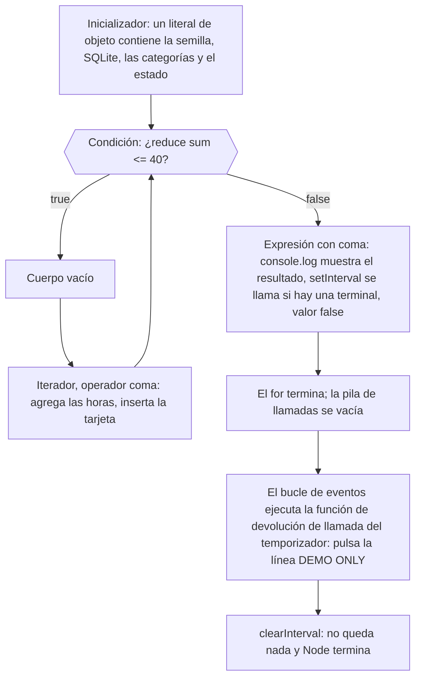

# JavaScript: de vuelta al original, en Node.js

**Te enseña:** que una sentencia for consta de tres expresiones y un cuerpo vacío, y que el orden de evaluación propio de JavaScript, la veracidad de los valores y el operador coma bastan para ejecutar un programa completo a partir de las tres cláusulas.

> **DEMO ONLY.** Tarjetas de horas ficticias, escritas en un archivo SQLite temporal bajo `$XDG_DATA_HOME/JavaScript/`.
> Nada de esto toca el reporte real de horas.

Esta es la versión en Node.js del [reto original en C#](../ModernChallenge1/README.md): una sentencia `for` con el cuerpo vacío y todo lo demás en sus tres cláusulas. Se mantiene tan cerca de C# como lo permite el lenguaje. No hay ventana ni XAML. El programa imprime el resultado en la terminal y, cuando la terminal es una real, la línea **DEMO ONLY** pulsa, igual que la ventana de C# aparecía y se desvanecía.

```text
$ node timecards.mjs
# DEMO ONLY run 1
Reuniones	14	14	2026-W47	DEMO ONLY
Programación	17	31	2026-W47	DEMO ONLY
Depuración	15	46	2026-W47	DEMO ONLY
# committed total=46 entries=3 DEMO ONLY

Total simulated hours: 46.0
Saved locally for the modernization exercise.
```

Esta es una **adaptación** (*port*: la misma acrobacia en otro lenguaje, como las entradas de Java, Kotlin, Python y Go). Su pareja, [`javascript-weird`](../javascript-weird/README.md), resuelve el mismo problema con clausuras (*closures*: funciones que recuerdan las variables de su entorno) y sin ningún bucle. Léelos como un par: el original en C#, después este y después el raro.

## Ejecútalo

Necesitas **Node.js 24 o una versión posterior**. El programa usa `node:sqlite`, que viene integrado, así que no hay `npm install` ni paquetes.

```bash
cd src/javascript
node timecards.mjs                       # run the demo
SEED=42 node timecards.mjs               # replay one exact run
NOW=2026-12-31 node timecards.mjs        # pretend it is another day (for the ISO week)
PULSE_CYCLES=1 node timecards.mjs        # on a terminal: a shorter pulse (default 3 cycles of 1.2 seconds)
./check.sh                               # every rule below (needs sqlite3 and GNU date, and `script` for the terminal tests)
```

Los registros se guardan en `$XDG_DATA_HOME/JavaScript/demo-timecards.db` (por defecto, `~/.local/share/JavaScript/`).

## Ejecútalo en un contenedor

Requisito previo: Docker, configurado una sola vez como se describe en [`SANDBOX-SETUP.md`](../../SANDBOX-SETUP.md#docker).

```bash
sandbox/container/run-image.sh src/javascript          # the plain, CI-style output
sandbox/container/run-image.sh --tty src/javascript    # with a terminal: watch the DEMO ONLY line pulse
```

Construye el [`Dockerfile`](Dockerfile) de esta carpeta y ejecuta el resultado sin red, con un sistema de archivos de solo lectura y con el usuario `nobody`. La imagen contiene Node 24 (una compilación fijada del proyecto original) y sqlite3 sobre un Ubuntu mínimo.

## Flujo del programa



**Qué muestra:** las tres cláusulas de un `for`, donde la condición es una expresión condicional que hace el trabajo final cuando es falsa. La única parte asíncrona es el pulso. Hasta que termina `for`, todo se ejecuta de forma síncrona en una sola pila de llamadas.

**Por qué importa este mecanismo:** el programa tiene un bucle, una parada y una segunda fase, y la segunda fase existe solo porque un temporizador mantiene vivo el bucle de eventos. Sin una terminal no hay temporizador y Node termina en cuanto acaba `for`. Las otras dos entradas de Node se centran en esta planificación: [`javascript-weird`](../javascript-weird/README.md) (clausuras) y [`javascript-events`](../javascript-events/README.md) (escuchadores de eventos).

## Cómo funciona el truco

Abre [`timecards.mjs`](timecards.mjs). Después de cuatro líneas de `import`, el archivo es una sola sentencia. Léelo como tres cláusulas:

| Cláusula | Tarea |
| --- | --- |
| **Inicializador** | Un `let i = ...` construye todo el estado como propiedades de un solo literal de objeto: la lista de horas, el nombre de usuario, los nombres de las categorías, la semilla, el reloj, una función de semana ISO, la base de datos SQLite y banderas para la terminal. También crea las tablas, inicia una ejecución y prepara `INSERT`. El literal de objeto cumple el papel del objeto anónimo de C# |
| **Condición** | `i.hours.reduce(...) <= 40 ? true : (...)`. Mientras el total acumulado sea 40 o menos, la condición vale `true` y el bucle da otra vuelta. Cuando el total pasa de 40, la condición imprime el resultado e inicia el temporizador de pulso en una terminal, y su valor es `false`: el bucle termina. El informe se construye en línea, igual que el C# construyó su ventana en línea |
| **Iterador** | Una expresión con coma de dos partes: genera un número aleatorio de horas (de 10 a 19) y lo agrega al arreglo; después `INSERT` una tarjeta. Este es el único lugar que agrega una tarjeta |

Sin `SEED`, el inicializador obtiene la semilla de su generador Park–Miller del `crypto.getRandomValues` del objeto global Web Crypto. Node también ofrece `randomInt` como exportación de `node:crypto`. Esta entrada usa el método global de Web Crypto.

El cuerpo es `{ /* Intentionally empty. */ }`. **Traza una tarjeta:** el inicializador se ejecuta una vez. Se ejecuta la condición: el total es 0, así que devuelve `true`. El cuerpo no hace nada. Se ejecuta el iterador: suma una tarjeta. Vuelve a la condición: si el total aún no pasa de 40, devuelve `true` otra vez y así sucesivamente. La primera vez que la condición ve un total de más de 40, la tarjeta que cruza el límite ya está en la base de datos. La condición la imprime y devuelve `false`. Así, la tarjeta que cruza el límite de 40 queda incluida, porque el iterador se ejecutó *antes* de esa prueba.

### Qué hizo el C# y qué hace este código

| Original en C# | JavaScript aquí | Una diferencia deliberada |
|---|---|---|
| `for (var i = new { ... }; cond; iter) { }` | `for (let i = ...; cond; iter) { }` | Ninguna. Se conserva el cuerpo vacío |
| El objeto anónimo es la única declaración | Un literal de objeto es la única declaración | Un inicializador `let` no puede ir seguido de más expresiones: la coma inicia el siguiente declarador. Por eso el literal pasa por una función flecha que lo termina con el operador coma. C# permite una lista de sentencias en lugar de una declaración |
| `(from h in i.totalHours select h).Sum() <= 40d` | `i.hours.reduce((sum, h) => sum + h, 0) <= 40` | `reduce` es el pariente más cercano de `Sum` en LINQ. Ambos calculan su resultado durante la prueba de la condición. C# construye una proyección diferida de LINQ que `Sum()` consume de inmediato |
| `... && i.categories.MoveNext() ? true : new Func<bool>(...)()` | `... <= 40 ? true : (console.log(...), ..., false)` | No hay `MoveNext` ni `Func`. Consulta la tabla siguiente sobre las categorías |
| `Double.IsNaN(i.app.Run(new Window { ... }))` | `console.log(...)` y luego `setInterval` en una terminal | No hay ventana. Mira el pulso de abajo |
| `XElement` construye el `DoubleAnimation` | `setInterval` y códigos ANSI | Un temporizador reproduce el guion gráfico |
| EF Core, `DemoTimeCardContext`, `Database.EnsureCreated()` | `node:sqlite`, `CREATE TABLE IF NOT EXISTS` | No hay ORM. node:sqlite forma parte de Node, así que no necesita ningún paquete |
| `i.rnd.Next(10, 20)` (`Random.Shared`) | `10 + i.rnd() % 10` con una clausura de Park-Miller con semilla | `Math.random` no puede recibir semilla. Una clausura sobre la semilla sí puede, así que `SEED=42` repite una ejecución |
| `Environment.UserName` | `os.userInfo().username` | Ninguno |
| `ISOWeek.GetWeekOfYear(DateTime.Now)` | Una flecha escrita a mano, `i.iso` | JavaScript no tiene semana ISO. El jueves de la semana decide el año. `check.sh` la compara con `date` de GNU en diez fechas |
| `Year = DateTime.Now.Year` | El año de la semana ISO | C# guarda el año calendario junto a la semana ISO. Los dos no coinciden cerca de Año Nuevo. Por ejemplo, 2024-12-30 está en el año calendario 2024, pero en la semana ISO 1 de 2025. Y 2021-01-03 está en el año calendario 2021, pero en la semana ISO 53 de 2020. Un año y una semana del mismo sistema siempre coinciden |
| `Mutex`, un `Thread` en segundo plano, `MethodInfo.Invoke` | Nada | Node ejecuta tu JavaScript en un solo hilo y `node:sqlite` es síncrono. El hilo y la reflexión estaban ahí para lucir un estilo de 2008. Aquí el iterador guarda la tarjeta al llamar a `insert.run` |
| `IsDemo = true` | `demo_only`, con una restricción `CHECK` | La misma idea. La base de datos rechaza una fila que no sea DEMO ONLY |

### Qué coincide con el original y qué no (medido)

| Comportamiento | Original en C# | Esta entrada |
|---|---|---|
| Inicio | Abre la base de datos en el inicializador | Igual |
| Cuándo se detiene el bucle | Cuando la suma pasa de 40, **o cuando se agotan las categorías**. El original de 2008 tenía cuatro nombres de categoría, así que cuatro tarjetas de exactamente 10 horas terminaban la ejecución con un total de 40, sin ninguna tarjeta de más de 40. `ModernChallenge1` y las adaptaciones a Java, Go, Kotlin, Python y Rust ahora tienen cinco nombres (`Reuniones` se repite), como esta entrada | Solo cuando la suma pasa de 40. Las categorías se repiten (la quinta tarjeta es `Reuniones`). Un total de exactamente 40 continúa. Es un caso de uno entre diez mil, y `check.sh` tiene una prueba para él: busca una semilla con la que cuatro tarjetas suman un total de 40 y comprueba que sigue una quinta tarjeta |
| La tarjeta que cruza | Incluida | Incluida |
| Campos registrados | `Id`, `Category`, `Hours` (un número de doble precisión), `UserId`, `Year`, `Week`, `IsDemo` | `category`, `hours` (un entero), `user_id`, `year`, `week`, `demo_only`, más `run_id` y `running_total` para las comprobaciones compartidas del libro |
| Qué ves | Una ventana WPF: **DEMO ONLY - no real time system is involved**, **Total simulated hours: 46.0**, **Saved locally for the modernization exercise.**, que aparecen y desaparecen gradualmente | Los mismos tres textos en la terminal: primero el informe, siempre. En una terminal, el primer texto pulsa (primero en negrita y luego atenuado) |
| Espera | La ventana permanece hasta que la cierres | El pulso dura 3 ciclos (unos cuatro segundos) y después el programa termina. En CI, o cuando se redirige, termina de inmediato |
| Errores | Una excepción no controlada termina el proceso con un estado distinto de cero | Lo mismo: una excepción (por ejemplo, una carpeta de datos que no se puede crear) imprime un mensaje y termina con el estado 1 |

### El pulso y el bucle de eventos

La sentencia `for` es síncrona. El programa dibuja todas las tarjetas e imprime el informe antes de que el primer temporizador pueda dispararse. El pulso es `setInterval`: cuando termina el bucle, el **bucle de eventos** de Node ejecuta el temporizador cada 600 milisegundos, escribe una línea (`\r`, y luego una versión en negrita o atenuada del texto) y, tras el último ciclo, cancela el temporizador. Después ya no queda nada por esperar y Node termina.

- **Nunca retrasa el cálculo.** El temporizador solo se inicia en la rama *false* de la condición, después de guardar todo.
- **Está apagado cuando debe estarlo.** El temporizador se inicia solo cuando la salida estándar es una terminal y `TERM` no es `dumb`. Una tubería o un archivo recibe el informe simple y nada más, y el programa termina de inmediato.
- **Se respeta `NO_COLOR`.** Con esa variable definida, la línea parpadea entre `*DEMO ONLY ...` y ` DEMO ONLY ...` y no hay códigos de escape de estilo. (`\r` y el código de borrado de línea se mantienen: controlan el cursor, no el color.)
- La **contrapresión** (*backpressure*) no importa aquí. El programa escribe unos cientos de bytes, así que no espera a que el flujo se vacíe.

## Qué impone `check.sh`

`check.sh` requiere Node 24 o posterior, `sqlite3` y GNU `date`.

- **La restricción es real.** `check-structure.mjs` analiza el archivo, tras vaciar los comentarios y las cadenas de texto. Después de las importaciones debe quedar **una sola sentencia `for`**: exactamente dos puntos y coma en el encabezado, un cuerpo vacío, sin otra sentencia, sin un segundo `for`, sin `while`, sin `do`, sin `forEach`, sin `eval`, sin `Function`. Se rechazan seis mutantes del programa: una sentencia después del bucle, un cuerpo en el bucle, un envoltorio `runEverything`, un `while` oculto, un segundo `for` y `eval`. El programa no importa ningún módulo de red, de proceso ni de hilo.
- **Las reglas del reto.** 25 ejecuciones aleatorias: categorías en orden, horas de 10 a 19, totales acumulados correctos, una parada justo después del primer total que pasa de 40, `DEMO ONLY` en todas partes, nada en stderr, ningún código de escape en la salida redirigida. En SQLite: solo filas de demostración, el usuario actual y cada `running_total` igual a la suma de las horas hasta ese momento.
- **Una semilla repite una ejecución.** Usar `SEED=42` dos veces da las mismas tarjetas. Doce semillas (totales de 41, 42, 50, 51 y 57, con tres a cinco tarjetas) coinciden con un modelo aparte del generador, escrito en awk. Se encuentra una semilla cuyas primeras cuatro tarjetas suman exactamente 40 y esa semilla debe recibir una quinta tarjeta.
- **La semana ISO.** La semana y el año coinciden con GNU `date +%G-W%V` en diez fechas: los primeros días de enero, los años de 53 semanas y los últimos días de diciembre.
- **El pulso.** En una pseudoterminal (creada con `script`): primero se imprime el informe y luego la línea pulsa entre negrita y atenuado. Con `NO_COLOR`: parpadeo simple, sin códigos de estilo. Con `TERM=dumb`: sin códigos de escape. Con la salida redirigida: sin temporizador, y la ejecución termina en menos de 3 segundos.
- **Errores y el esquema.** Una carpeta de datos sin permiso de escritura termina con un estado distinto de cero y un mensaje. SQLite rechaza una fila o una ejecución que no sea de demostración, 9 horas y una quinta categoría.

## Trampas que conviene conocer

- **Node 24 o más reciente.** `node:sqlite` llegó con Node 22.5. No forma parte de ningún estándar. Es más reciente que la mayoría de las API de Node, así que lee su nota de estabilidad en la documentación de Node para tu versión (**permitido por la implementación**: solo lo probamos en las versiones siguientes). La semántica de `for` es un comportamiento **garantizado** por la especificación de ECMAScript. La entrada también se ejecuta en Node 24.15 y 24.22, que son las versiones que probamos.
- **`let` en el encabezado de un `for` crea un enlace nuevo en cada pasada.** La especificación copia la variable del bucle en cada iteración, así que una clausura creada dentro del bucle ve su propia copia. Aquí eso no importa, porque `i` contiene *un objeto* y todas las copias apuntan a él. Si `i` hubiera sido un número, el iterador no habría podido actualizarlo para la condición. Por eso el estado es un objeto.
- **La coma tiene dos significados.** En `let a = 1, b = 2` separa declaradores. En `(x, y)` es un operador que evalúa ambos y produce `y`. Después de la declaración, el inicializador tiene que usar el segundo tipo, y por eso está ahí la función flecha.
- **`this` no es el objeto.** La función de devolución de llamada del pulso (*callback*: una función que entregas a otro código para que la ejecute más tarde) es `function` y no una función flecha, solo porque `clearInterval(this)` necesita el objeto del temporizador que Node pasa como `this`. Todo lo demás usa funciones flecha, que leen `i` del ámbito que las contiene.
- **Un `mkdir` recursivo puede quedarse girando.** En Node 24.15 en Linux, `mkdirSync(path, { recursive: true })` sobre una ruta bajo `/proc` nunca retornó (lo detuvimos después de diez minutos). La comprobación usa un archivo normal como carpeta padre para obtener un error de inmediato. Es un problema de Node, no parte del diseño del programa.
- **Sin `Math.random`.** No admite semilla, así que una clausura con Park-Miller (multiplicador 48271, módulo 2147483647) genera las horas. La distribución es lo bastante uniforme para una demostración, y para nada más.
- **El pulso es una mentira educada.** Es un temporizador que reescribe una línea. Si tu terminal no admite códigos ANSI, el temporizador los imprime como texto. Define `NO_COLOR`, define `TERM=dumb` o redirige la salida.

---

Consulta el [README principal](../../README.md#los-resultados-hasta-ahora) para ver cómo se compara con las demás entradas, y [`RETO.md`](../../RETO.md) si quieres escribir la tuya.
