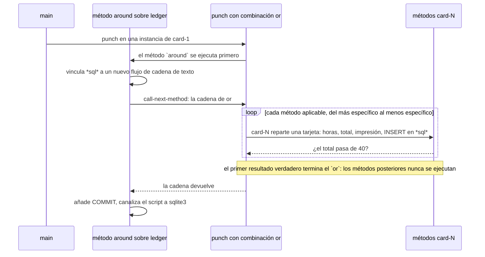

# Common Lisp, más raro

**Te enseña:** que la combinación de métodos de CLOS es una estructura de control: una jerarquía de clases es un bucle y `or` es una regla de parada.

> **DEMO ONLY.** Tarjetas de horas ficticias en un archivo SQLite temporal. Sin conexión con ningún sistema real de registro de horas.

Debajo de la línea marcada con `RUN TIME` en [`timecards.lisp`](timecards.lisp) **no hay bucle, ni `if`, `when`, `cond` ni `case`, ni `mapcar`, ni recursión**. Cada tarjeta es un *método*. Las tarjetas se encadenan mediante una jerarquía de clases. La función genérica que las llama usa la combinación de métodos integrada `or`. Esta ejecuta los métodos uno tras otro y **se detiene en el primero que devuelve verdadero**. Cada método reparte una tarjeta y responde "¿el total ya pasa de 40?". La lista de precedencia de clases es el contador del bucle, y el cortocircuito de `or` es la regla de parada.

La versión directa es [`lisp`](../lisp/README.md).

## Ejecútalo

Necesitas [SBCL](https://www.sbcl.org/) (probado con 2.2.9) y `sqlite3`. No necesitas nada más: ni bibliotecas ni ASDF.

```bash
cd src/lisp-weird
sbcl --script timecards.lisp
./check.sh                  # set SBCL=/path/to/sbcl if it is not on your PATH
```

Los registros van a `$XDG_DATA_HOME/LispWeird/demo-timecards.db` (por defecto, `~/.local/share/LispWeird/`). Una ejecución se ve así:

```text
# DEMO ONLY run 1794860078-QM6YV6
Reuniones	18	18	2026-W47	DEMO ONLY
Programación	18	36	2026-W47	DEMO ONLY
Depuración	15	51	2026-W47	DEMO ONLY
# committed total=51 entries=3 DEMO ONLY
# PUNCH had 5 OR methods and 3 ran: the class precedence list is the loop, and OR is the stop rule
```

La última línea es introspección: le pregunta al **protocolo de metaobjetos** (`sb-mop:compute-applicable-methods`) qué métodos se aplican al libro de registro y cuenta cuántos de los cinco se ejecutaron en realidad.

## Flujo del programa



**Qué muestra:** el bucle es una jerarquía de clases. `card-1` hereda de `card-2` y así sucesivamente. La función genérica `punch` llama al método de cada clase, una tras otra. La clase es todo el mensaje "esta es la tarjeta número N". La combinación de métodos `or` es lo que lo detiene: llama a los métodos hasta que uno devuelva verdadero.

**Por qué importa este mecanismo:** CLOS decide qué se ejecuta y en qué orden. El programa no tiene ninguna sentencia que diga "detente", y los métodos que no se usan simplemente nunca se llaman. El método `:around` envuelve toda la cadena y usa enlace dinámico para enviar cada `format` a un único flujo.

## Cómo funciona el truco

### 1. Combinación de métodos: qué ocurre cuando se aplica más de un método

Cuando llamas a una función genérica, CLOS encuentra todos los métodos cuyos especializadores coinciden, los ordena del más específico al menos específico y luego los **combina**. La combinación predeterminada llama al método más específico y ese método puede llamar a `call-next-method` para llegar al siguiente. Pero el estándar también ofrece combinaciones integradas (`and`, `or`, `progn`, `append`, `list`, `max`, `min`, `+`, `nconc`) que llaman por ti a *todos* los métodos aplicables y combinan los resultados. Con `or`:

```lisp
(defgeneric punch (ledger)
  (:method-combination or))
(defmethod punch or ((ledger card-3)) ...)    ; "or" here is the method qualifier
```

`punch` se convierte en `(or (method-1 ledger) (method-2 ledger) ...)`, en orden de especificidad. Es el mismo cortocircuito que el del operador especial `or` ordinario: el primer resultado verdadero termina la evaluación y **los métodos posteriores nunca se ejecutan**.

### 2. La jerarquía de clases como contador

```text
card-1 -> card-2 -> card-3 -> card-4 -> card-5 -> ledger
```

`(defcard 3 card-4)` se expande en `(defclass card-3 (card-4) ())` y en un método `punch or` especializado en `card-3`. Por tanto, una instancia de `card-1` tiene la lista de precedencia de clases `(card-1 card-2 card-3 card-4 card-5 ledger ...)`, así que `punch` ejecuta el método de la tarjeta 1, luego el de la tarjeta 2 y así sucesivamente. Las clases no tienen ranuras (*slots*) propias; la clase misma es todo el mensaje "esta es la tarjeta número N". `ledger`, al final de la cadena, guarda el estado (total acumulado, número de entradas, estado aleatorio, id de ejecución).

¿Por qué cinco? Cada tarjeta dura al menos 10 horas, así que cuatro tarjetas suman como mínimo 40 horas. Y 40 no es *más de* 40 (ese es el caso en que todas duran 10 horas). Una quinta tarjeta siempre hace que el total pase de ese tope. Cinco es el máximo que este reto puede necesitar.

### 3. La regla de parada es `or`

`deal` termina con `(> (total ledger) 40)`. Cuando es verdadero, la cadena se detiene. Después de tres o cuatro tarjetas, los demás métodos simplemente nunca se llaman. El programa no contiene ninguna sentencia que diga "detente".

### 4. `:around`, `prog1` y enlace dinámico

Un método `:around` sobre `ledger` envuelve todo el encadenamiento. El método vincula la variable especial `*sql*` a un flujo de cadena de texto nuevo. Es una vinculación dinámica: cada `format *sql*` más abajo en la pila de llamadas, en `deal`, escribe en ese flujo, sin pasar ningún flujo hacia abajo. Luego llama a `call-next-method` (que es el encadenamiento `or`), agrega `COMMIT` y pasa el script por una tubería a `sqlite3`.

### 5. Una lista circular desde el lector

```lisp
(defparameter *week* '#1=("Reuniones" "Programación" "Depuración" "Aprendizaje" . #1#))
```

`#1=` etiqueta la lista y `#1#` apunta de vuelta a ella, así que el lector forma un anillo. `(nth 4 *week*)` es de nuevo `"Reuniones"`: las categorías se repiten sin `mod`. (Nunca la imprimas con `*print-circle*` desactivado.)

### 6. Lugares generalizados

`(incf (total ledger) hours)`: `total` es un accesor de ranura, y todo accesor es un **lugar** donde puede usarse `setf`, así que `incf` funciona con él igual que con una variable.

### 7. Macros en tiempo de compilación

`defcard` es una macro, así que su expansión son cinco formas `defclass` y cinco formas `defmethod` escritas para nosotros en tiempo de compilación. El código que construye los nombres (`intern`, `format`) se ejecuta durante la compilación, dentro de `eval-when`, así que nada de eso es un bucle sobre tarjetas en tiempo de ejecución.

## Por qué es raro

Un programador de Lisp lee `or` como una *forma*. Aquí aparece como un *calificador de un método*, y lo que se combina con *or* es una cadena de clases. El flujo de control se construye con el sistema de objetos: el despacho es la iteración, el orden de especificidad es la secuencia y el valor de retorno es el "break". Ningún envoltorio delgado hace el trabajo: elimina `:method-combination or` y el programa ya no se detiene (consulta la prueba más abajo).

No deberías hacer esto en producción porque el flujo de control es invisible: nada cerca de `punch` dice "esto hace un bucle". Un mantenedor tendría que saber que el orden de `defclass` decide el orden de ejecución, y que insertar una clase en la cadena cambiaría el comportamiento sin tocar ningún método.

## Qué puedes aprender

- La combinación de métodos, los calificadores (`or`, `:around`) y cómo la selecciona `defgeneric ... (:method-combination ...)`. `define-method-combination` te permite escribir la tuya.
- Las listas de precedencia de clases, que se *calculan* (`sb-mop:compute-class-precedence-list`) y se pueden inspeccionar.
- El protocolo de metaobjetos: `sb-mop:compute-applicable-methods` y `method-qualifiers`.
- Etiquetas del lector `#n=` / `#n#` para estructuras circulares y compartidas.
- Enlace dinámico (`defvar` + `let`) como parámetro implícito.
- Por qué importa `(eval-when (:compile-toplevel ...))`: una función usada por una macro debe existir en tiempo de compilación.

## Prueba de que `or` es la regla de parada

`check.sh` reescribe el archivo, reemplaza `or` por `progn` (la combinación que ejecuta *todos* los métodos) y lo ejecuta cinco veces: cada ejecución reparte **las cinco** tarjetas y el total termina en cualquier valor hasta 95. El archivo sin modificar se detiene después de tres o cuatro tarjetas. Nada más cambia entre los dos archivos, así que la combinación es lo que lo detiene.

## Trampas que conviene conocer

- **Solo SBCL.** `sb-mop`, `sb-ext:run-program` y `sb-ext:posix-getenv` son propios de SBCL. Las partes de CLOS (la combinación `or`, `:around` y `defcard`) son Common Lisp estándar.
- **Orden de las definiciones.** Las superclases deben existir antes que las subclases, así que `defcard` va primero por la cola (`card-5`, luego `card-4`, ...). Una referencia hacia adelante funcionaría en algunas implementaciones y generaría una advertencia en otras.
- **El límite está incorporado en la cadena.** Cinco clases manejan "de 10 a 19 horas, se detiene si pasa de 40". Reglas distintas necesitan una cadena más larga o más corta: una limitación de diseño que la versión directa no tiene.
- **`sql-quote` no aplica escape.** Cada valor es un número o una de cuatro palabras fijas; no lo uses con nada más.
- **Formato.** No existe un formateador para Common Lisp; el diseño sigue a mano la sangría de Emacs `lisp-mode`.

## Qué impone `check.sh`

Sin comentarios, debajo del marcador `RUN TIME`: no aparece ninguno de `loop do dolist dotimes mapc mapcar mapcan map maphash reduce if when unless cond case tagbody go block return catch throw handler-case`; `(:method-combination or)` está presente; hay exactamente cinco formas `defcard`; la prueba de más de 40 aparece una vez. Después, el experimento `progn` de arriba y 25 ejecuciones, cada una revisada para comprobar que los registros son coherentes (horas de 10 a 19, categorías en orden, totales acumulados correctos, parada cuando el total pasa de 40), con SQLite de acuerdo con la salida.

## Ejecuta el programa en un contenedor

Requisito previo: Docker, configurado una sola vez como se describe en [`SANDBOX-SETUP.md`](../../SANDBOX-SETUP.md#docker). La imagen base `cc-rt-sbcl` proviene de `sandbox/container/build-bases.sh`.

```bash
sandbox/container/run-image.sh src/lisp-weird
```

La imagen contiene SBCL y sqlite3 sobre un Ubuntu mínimo.
