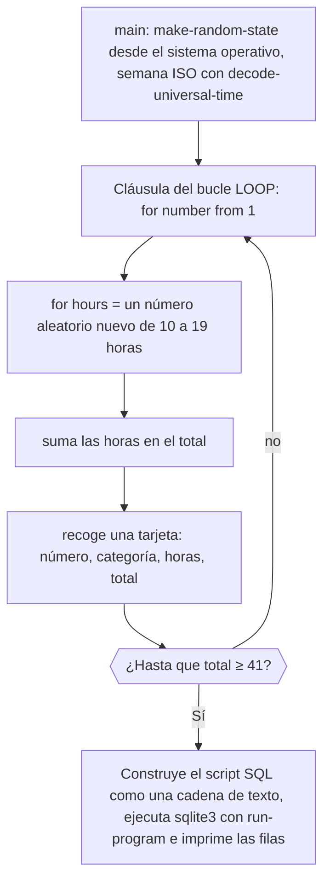

# Common Lisp

**Te enseña:** que `LOOP` de Common Lisp puede expresar un algoritmo completo como cláusulas para contar, tomar valores, sumar, recolectar y parar.

> **DEMO ONLY.** Tarjetas de horas ficticias en un archivo SQLite temporal. Sin conexión con ningún sistema real de registro de horas.

Esta es la versión directa, la que muestra cómo está *pensado* que se escriba Common Lisp. El reto ("añade tarjetas de 10 a 19 horas hasta que el total pase de 40") es una sola forma `LOOP` en `draw-cards`; todo lo demás en [`timecards.lisp`](timecards.lisp) es una función pequeña que hace una sola tarea y tiene un *docstring*. La versión rara es [`lisp-weird`](../lisp-weird/README.md).

## Ejecútalo

Necesitas [SBCL](https://www.sbcl.org/) (probado con 2.2.9) y `sqlite3`. No necesitas nada más: ni Quicklisp, ni ASDF, ni bibliotecas. El programa usa solo lo que incluye el estándar y el propio SBCL.

```bash
cd src/lisp
sbcl --script timecards.lisp                 # a normal run
sbcl --script timecards.lisp 2026-01-01      # pin the date, so the ISO week is predictable
./check.sh                                   # set SBCL=/path/to/sbcl if it is not on your PATH
```

Los registros van a `$XDG_DATA_HOME/Lisp/demo-timecards.db` (por defecto `~/.local/share/Lisp/`). Una ejecución se ve así:

```text
# DEMO ONLY run 1794860153-ONSTYU
Meetings	13	13	2026-W47	DEMO ONLY
Coding	18	31	2026-W47	DEMO ONLY
Debugging	12	43	2026-W47	DEMO ONLY
# committed total=43 entries=3 DEMO ONLY
# one LOOP form with SUM, COLLECT and UNTIL is the whole challenge
```

## Qué hace

El programa saca tarjetas de 10 a 19 horas y recorre en ciclo Meetings, Coding, Debugging y Learning hasta que el total acumulado pasa de 40 (se conserva la tarjeta que cruza el límite). Imprime cada tarjeta y después escribe todas en SQLite en una sola transacción.

## Flujo del programa



**Qué muestra:** `LOOP` es un lenguaje pequeño. Sus cláusulas se ejecutan en el orden en que están escritas, en cada pasada. `for hours =` se vuelve a evaluar cada vez, `sum ... into total` guarda el total en una variable que pertenece al bucle y `until` termina el bucle.

**Por qué importa este mecanismo:** la posición de `until` es la de la regla de parada. Si lo escribes después de `collect`, conserva la tarjeta del cruce. Si lo escribes antes, la última tarjeta se descarta sin ningún error. El hermano raro [`lisp-weird`](../lisp-weird/README.md) no tiene `LOOP`.

## Cómo funciona el truco

Lee el archivo de arriba abajo; cada sección solo usa lo que está antes de ella.

1. **Un paquete y las reglas.** `defpackage` / `in-package` dan al programa su propio espacio de nombres en lugar de volcar símbolos en `CL-USER`. Las reglas del juego tienen nombre: `+min-hours+`, `+max-hours+`, `+limit+` (por convención, las constantes llevan signos `+plus+`; las variables especiales llevan `*earmuffs*`).
2. **Una estructura.** `defstruct card` da sin trabajo extra un registro con tipos, con constructor, accesores (`card-hours`) e impresor. SBCL comprueba los tipos de los *slots*.
3. **El reto.**
   ```lisp
   (loop for number from 1
         for hours = (+ +min-hours+ (random (1+ (- +max-hours+ +min-hours+)) state))
         sum hours into total
         collect (make-card number (category-for number) hours total)
         until (> total +limit+))
   ```
   `LOOP` es un pequeño lenguaje propio. `for number from 1` cuenta; `for hours = ...` vuelve a evaluar su expresión en cada pasada; `sum ... into total` mantiene un total acumulado en una variable que pertenece al bucle; `collect` construye la lista de resultado; `until` termina el bucle. Las cláusulas se ejecutan **en el orden en que están escritas**, así que poner `until` *después de* `collect` es lo que conserva la tarjeta que cruza. Muévelo más arriba y la última tarjeta se descarta sin avisar.
4. Las **categorías** se repiten mediante `(aref *categories* (mod (1- number) 4))`: un vector y `mod`, de la forma sencilla. (La versión rara lo hace con una lista circular.)
5. **El calendario.** Para saber la semana ISO no hacen falta SQLite ni `date(1)`; Common Lisp tiene `decode-universal-time`, que devuelve el día de la semana y el año, y el resto es aritmética (`iso-week`, `weeks-in-year`). `check.sh` lo compara con `date(1)` en fechas difíciles (y un barrido único de 1139 fechas alrededor de los cambios de año coincidió con `isocalendar()` de Python). El argumento opcional de fecha existe para poder probar esta aritmética en fechas difíciles como 2021-01-03 (que está en la semana 53 de **2020**).
6. **SQLite.** SBCL no tiene en su núcleo ninguna biblioteca de bases de datos, así que el programa construye un único script SQL como cadena de texto (`with-output-to-string`, `format` con un `~A` por valor, `sql-quote` que duplica las comillas) y se lo pasa a la herramienta de línea de comandos `sqlite3` con `sb-ext:run-program`. La regla `DEMO ONLY` está en la tabla: `CHECK(demo_only=1)`.
7. **`main`.** El programa crea un `random-state` nuevo con una semilla del sistema operativo (`(make-random-state t)`), sortea, guarda e imprime.

## Por qué esto es idiomático

- **Datos y funciones, no objetos.** Una estructura para los datos, funciones pequeñas sobre ella y una función (`draw-cards`) que es pura, salvo por consumir números aleatorios de un estado que *recibe*, en lugar de tocar una variable global.
- **`LOOP` con cláusulas de acumulación** en lugar de recursión escrita a mano o de un contador `setf`. Así escriben los programadores de Lisp con experiencia "recorrer, acumular, detenerse".
- **Docstrings en todo**, que `(describe 'draw-cards)` muestra en el REPL.
- **Salida mediante directivas `format`** (`~A ~D ~C ~%`) y construcción de cadenas de texto con `with-output-to-string` en lugar de concatenaciones repetidas.
- **Sin macros ingeniosas.** Una macro es la herramienta adecuada cuando una función no puede hacer el trabajo; ninguna de estas necesitó una.
- **Las advertencias son errores.** El archivo compila sin advertencias y sin advertencias de estilo, y `check.sh` lo exige.

## Qué puedes aprender

- El orden de las cláusulas de `LOOP` y `sum ... into`.
- Tipos de *slot* de `defstruct` y `#.` (evaluación en tiempo de lectura) para usar una constante dentro de un tipo.
- Por qué `defconstant` sirve para números y `defparameter` para vectores (un vector no es `eql` a sí mismo después de recargar, y `defconstant` se quejaría).
- Cómo ejecuta SBCL los scripts: `--script` implica `--disable-debugger` y termina las opciones de ejecución, así que `sb-ext:*posix-argv*` es `("sbcl" "2026-01-01")` sin `--script file` dentro.
- Semanas ISO: la semana 1 es la que incluye el primer jueves del año; un año tiene 53 semanas cuando empieza o termina en jueves.

## Trampas que conviene conocer

- **Solo SBCL.** `sb-ext:run-program`, `sb-ext:posix-getenv` y `sb-ext:parse-native-namestring` son propias de SBCL. Otras implementaciones tienen equivalentes (`uiop:run-program`, `uiop:getenv`), pero no son las mismas funciones.
- **Los pathnames no son cadenas de texto.** `*` y `[` en una ruta tienen un significado para un pathname de Lisp, así que el programa convierte con `parse-native-namestring` y vuelve a convertir con `native-namestring`. Un directorio personal con `[` en su nombre se trataría, de lo contrario, como un comodín.
- **`random` no es criptográfico** y el estado por defecto de SBCL es el mismo en cada inicio; `(make-random-state t)` es lo que hace que las ejecuciones difieran.
- **Construir SQL con cadenas de texto** es seguro aquí solo porque cada valor es un número que calculamos o una de cuatro palabras fijas. `sql-quote` está presente de todos modos; no copies esto en entradas de datos no confiables.
- **Formato.** Common Lisp no tiene un formateador estándar. La disposición es la habitual, hecha a mano (cuerpos con sangría de dos espacios, cláusulas `LOOP` alineadas, docstring primero), tal como la indentaría Emacs con `lisp-mode`; no se ejecutó ningún formateador.

## Qué impone `check.sh`

El marcador `DEMO ONLY` está presente y nada parece código de red; `draw-cards` es un `LOOP` que termina en `until (> total +limit+)`; el archivo compila **sin** advertencias; `iso-week` coincide con `date(1)` en 22 fechas de casos límite; y cada una de las 25 ejecuciones imprime un conjunto de registros coherente (horas de 10 a 19, categorías en orden, totales acumulados correctos y parada justo cuando el total pasa de 40) y SQLite coincide con la salida. La tabla rechaza una fila que no sea de demostración.

## Ejecuta el programa en un contenedor

Requisito previo: Docker, configurado una sola vez como se describe en [`SANDBOX-SETUP.md`](../../SANDBOX-SETUP.md#docker). La imagen base `cc-rt-sbcl` proviene de `sandbox/container/build-bases.sh`.

```bash
sandbox/container/run-image.sh src/lisp
```

Construye el [`Dockerfile`](Dockerfile) de esta carpeta y ejecuta el resultado sin red, con un sistema de archivos de solo lectura y el usuario `nobody`. Luego imprime la salida y una vista de solo lectura de las filas que escribió. La imagen contiene SBCL y sqlite3 sobre un Ubuntu mínimo.
