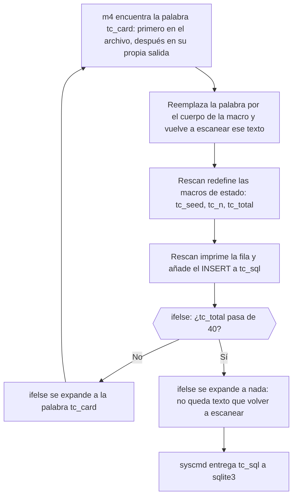

# m4

**Te enseña:** que un procesador de macros es un lenguaje de programación: no tiene sentencia de bucle ni variable, solo texto que se analiza de nuevo.

> **DEMO ONLY.** Tarjetas de horas ficticias en un archivo SQLite temporal. Sin conexión con ningún sistema real de registro de horas.

Hay una sola entrada de m4 y no hay `m4-weird`, porque un programa completo escrito en un procesador de macros ya es la versión rara. El reto ("añade tarjetas de 10 a 19 horas hasta que el total pase de 40") lo resuelve `m4` por sí solo: genera los números aleatorios, mantiene el total acumulado, decide cuándo parar, da formato a las filas y escribe el SQL. [`timecards.m4`](timecards.m4) es el único archivo fuente. Un intérprete de comandos (*shell*) es el programa que recibe y ejecuta comandos escritos. Aquí el intérprete de comandos aparece dos veces, solo en la parte de cómo viaja el dato: para leer el reloj y la reserva de datos aleatorios del sistema operativo, y, al final de todo, para entregar un script SQL terminado a `sqlite3`.

## Ejecútalo

Necesitas GNU m4 (probado con 1.4.19) y `sqlite3`. El intérprete de comandos es `sh`. Para la semilla, el reloj y la carpeta se usan `date`, `od`, `tr` y `mkdir`.

```bash
cd src/m4
m4 timecards.m4
m4 -Dtc_seed=12345 -Dtc_week=2026-W01 timecards.m4    # a pinned, reproducible run
./check.sh                                              # set M4=/path/to/m4 if it is not on your PATH
```

Los registros van a `$XDG_DATA_HOME/M4/demo-timecards.db` (por defecto `~/.local/share/M4/`). Una ejecución se ve así:

```text
# DEMO ONLY run 1794860448-1900361580
Meetings	15	15	2026-W47	DEMO ONLY
Coding	11	26	2026-W47	DEMO ONLY
Debugging	15	41	2026-W47	DEMO ONLY
# committed total=41 entries=3 DEMO ONLY
# no loop statement: tc_card expands itself again until ifelse says stop, and m4 is the whole program
```

## Qué hace

El programa saca tarjetas de 10 a 19 horas y recorre en ciclo Meetings, Coding, Debugging y Learning hasta que el total acumulado pasa de 40 (se conserva la tarjeta que cruza la línea). El programa imprime las filas y las guarda en SQLite en una sola transacción.

## Flujo del programa



**Qué muestra:** m4 no tiene ninguna sentencia de bucle. Su modelo de evaluación es reemplazar y luego volver a explorar. El bucle es la arista desde el último `ifelse` hasta la primera palabra: la expansión de `tc_card` contiene la palabra `tc_card`.

**Por qué importa este mecanismo:** la regla de parada es la ausencia de texto. Cuando `ifelse` se expande a nada, no queda nada que volver a escanear y el programa termina. El estado vive en otras macros, que se redefinen durante el reescaneo.

## Cómo funciona el truco

### m4 en un párrafo

m4 lee texto y lo copia a la salida, salvo que, cuando ve una *palabra* que nombra una macro, sustituye la palabra por la definición de la macro y luego **vuelve a leer el reemplazo** en busca de más macros. Ese paso de "volver a escanear" (reescaneo) es todo el modelo de evaluación. No hay sentencias. Las comillas (`` ` `` y `'` por defecto; `[` y `]` en este archivo) indican "no mires dentro de esto todavía".

### 1. Haz que m4 sea seguro para nuestro texto

```m4
changecom()dnl
changequote([, ])dnl
```

De forma predeterminada, `#` inicia un comentario y un comentario se copia **sin expandir**. Las líneas de salida del programa empiezan con `#`, así que sin `changecom()` las macros de esas líneas no se expandirían en silencio. Además, la comilla de cierre predeterminada es `'`, que los literales de cadena de texto de SQL necesitan, así que las comillas pasan a ser `[` `]`. `dnl` ("descartar hasta la nueva línea") consume el resto de la línea, incluido el salto de línea que, de otro modo, terminaría en la salida. También es la sintaxis de comentarios del archivo fuente.

### 2. Las macros son las variables

`define([tc_total], 0)` crea una macro cuyo texto es `0`; "asignar" es redefinirla: `define([tc_total], eval(tc_total + tc_hours))`. Los argumentos de `define` se expanden antes de que se ejecute `define`, así que primero se hace `eval` y se almacena el *número*. Cada macro empieza con `tc_` para que nunca pueda chocar con una palabra del texto SQL, que m4 expandiría con la mejor intención.

### 3. Un generador de números aleatorios en aritmética de 32 bits

`eval` es la calculadora de m4 y en GNU m4 es de **32 bits** (prueba `eval(2147483647 * 4)`: responde `-4`). Por eso el generador es Park-Miller, `seed = 16807 * seed mod (2^31 - 1)`, calculado con la descomposición de Schrage, `16807 * (s % 127773) - 2836 * (s / 127773)` y luego se suma de vuelta `2^31 - 1` si el resultado es negativo, lo que nunca sale de los 32 bits. Las horas son `10 + seed / 1024 % 10`. `check.sh` compara la salida con una implementación independiente en bash.

### 4. El bucle es una macro que se expande a sí misma

```m4
define([tc_card],
  [tc_next()dnl
define([tc_hours], eval(10 + tc_seed / 1024 % 10))dnl
define([tc_n], incr(tc_n))dnl
define([tc_total], eval(tc_total + tc_hours))dnl
tc_append(tc_insert(tc_category(tc_n), tc_hours, tc_total))dnl
tc_row(tc_category(tc_n), tc_hours, tc_total)
ifelse(eval(tc_total > 40), 1, [], [tc_card()])])
```

Expandir `tc_card()` produce: una fila de texto (la salida), algunas definiciones que cambian el estado y luego el resultado de `ifelse`. Si el total pasa de 40, `ifelse` no produce nada y la expansión termina. En caso contrario, produce el texto `tc_card()`. Como la salida de una macro se vuelve a escanear, ese texto es a su vez una llamada. Es recursión, con la regla de parada como `ifelse`. `check.sh` lo demuestra: quita la autollamada y aparece exactamente una tarjeta.

### 5. `ifelse` y el problema que me mordió al escribir esto

`ifelse(a, b, then, else)` compara `a` con `b`. Con más argumentos continúa **en grupos de tres**: `ifelse(a, b, then, c, d, then2, ..., else)`. Un primer intento natural de un switch de cuatro ramas, `ifelse(n, 0, [Meetings], 1, [Coding], ...)`, es incorrecto: después del primer grupo compara `1` con `[Coding]`, y GNU m4 imprime "excess arguments to builtin `ifelse` ignored". La solución es repetir lo que se prueba en cada grupo (`tc_pick`). Es un bicho muy propio de m4 y una advertencia muy propia de m4.

### 6. Una cadena de texto que crece: `defn`

```m4
define([tc_append], [define([tc_sql], defn([tc_sql])[$1])])
```

`defn(name)` devuelve la definición de una macro *entre comillas*, así que no se vuelve a analizar. Añadir es "redefinir la macro como ella misma más el texto nuevo". Así acumula el script SQL tarjeta por tarjeta. Las desviaciones son la otra forma que tiene m4 de reunir texto (`divert(1)` envía la salida a un búfer numerado y `undivert(1)` la vuelca de nuevo). `divert(-1)` es el "cubo de bits" (un lugar donde la salida simplemente desaparece) que este archivo usa para silenciar las definiciones. El SQL no se reúne en una desviación porque `undivert` no *devuelve* texto. Dentro de una lista de argumentos imprime directamente y el argumento queda vacío. Por eso no se puede pasar una desviación a `syscmd`.

### 7. Las comillas vacías `[]`

En `tc_row`, `$1[]tc_tab` tiene una cadena de texto vacía entre comillas en medio. Sin ella, `Meetings` seguido de `tc_tab` se leería como una sola palabra, `Meetingstc_tab`, que no es una macro. `[]` se expande a nada, pero separa la palabra. Usarás esto cada vez que pegues macros.

### 8. Guardar

```m4
syscmd([d="${XDG_DATA_HOME:-$HOME/.local/share}/M4"; mkdir -p "$d" && sqlite3 "$d/demo-timecards.db" <<'END_OF_DEMO_SQL'
]defn([tc_sql])[COMMIT;
END_OF_DEMO_SQL
])
```

Aquí el entrecomillado alterna entre dentro y fuera de las comillas: la primera y la última pieza son texto literal del intérprete de comandos en `[ ]`; `defn([tc_sql])` queda fuera de las comillas, así que se expande en el script. Un *here-document* del intérprete de comandos con terminador entre comillas lleva el SQL, de modo que el intérprete nunca lo ve más que como datos. `sysval` (el estado de salida) se comprueba después y un fallo aborta con `m4exit(1)`.

### 9. Cómo fijar la semilla

`ifdef([tc_seed], [], [define(...)])` significa "calcula una semilla solo si no se dio ninguna en la línea de comandos con `-D`". Eso hace que una ejecución sea reproducible, y eso permite que las pruebas la comparen con una referencia.

## Por qué es raro

Porque funciona. m4 se diseñó en la década de 1970 para preprocesar texto, como la capa de macros que venía con las herramientas de Unix y que más tarde impulsó `sendmail.cf` y GNU `autoconf`. No tiene bucles ni variables ni aritmética propia más allá de `eval`, ni cadenas de texto en el sentido habitual: todo es texto que se reescribe. El reto necesita estado, repetición, números aleatorios y una regla de parada, y aquí cada uno de ellos se construye con define, el reescaneo y el entrecomillado. Si puedes escribir esto, puedes leer `configure`.

## Qué puedes aprender

- Rescanning: cómo funciona la evaluación de texto a texto y por qué el entrecomillado es el punto central.
- Estado de estilo `define`/`defn`/`pushdef` y recursión como única forma de repetición.
- La regla de agrupación `ifelse`, `dnl`, `[]` y `changequote`.
- Desvíos y lo que `undivert` no hace.
- Ese límite de 32 bits de `eval` es un límite de diseño que debes sortear, no un bicho.
- Por qué los comentarios `#` son peligrosos en un lenguaje donde los comentarios no se omiten.

## Trampas que conviene conocer

- **Extensiones de GNU m4: dos.** `esyscmd` (captura la salida de un comando: semilla, reloj, semana) y `format` (se usa una vez, para crear un carácter de tabulación). Todo lo demás (`define`, `defn`, `ifelse`, `ifdef`, `eval`, `incr`, `divert`, `changecom`, `changequote`, `syscmd`, `sysval`, `dnl`, `-D`) es POSIX. BSD m4 tiene `esyscmd` pero no `format`. Hay otro *comportamiento* específico de GNU que debes conocer: `eval` tiene allí 32 bits, y el generador se construye en torno a ese límite. Otro m4 puede tener un ancho distinto.
- **Profundidad de recursión.** El bucle no se anida. `tc_card` termina con el texto `tc_card()`. m4 vuelve a leer ese texto de su entrada de datos después de que la llamada termina. Por eso cada tarjeta se expande a la misma profundidad (`m4 -t tc_card` muestra profundidad 1 cada vez y `check.sh` muestra que el `-L` mínimo que funciona es el mismo en una ejecución de 3 tarjetas y en una de 5). Solo la llamada *sin corchetes* de [B11](../../lessons/exercises.md#b11-m4-quote-the-recursion-verified) se anida, porque se hace mientras `ifelse` aún recopila sus argumentos. Lo que sí crece con el número de tarjetas es el script SQL: `tc_append` redefine `tc_sql` con un cuerpo más largo en cada tarjeta, así que una regla que necesitara miles de tarjetas necesitaría otra forma.
- **El SQL no está escapado.** Cada valor es un número o una de cuatro palabras fijas. No pases texto del usuario a `tc_insert`.
- **La semilla.** Tres bytes aleatorios de `/dev/urandom`, escalados: unos 24 bits de entropía, de sobra para una demostración. Una semilla fijada debe valer de 1 a 2147483646.
- **El intérprete de comandos se ocupa de cómo viaja el dato.** Si objetas que `syscmd` es una llamada al intérprete de comandos: sí, para guardar el archivo, igual que la entrada de Forth envía su salida por una tubería a `sqlite3`. El cálculo es de m4.
- **Formato.** No hay un formateador para m4. El diseño es este: una macro por párrafo, un bloque de comentarios sobre cada sección y cuerpos con sangría de dos espacios.

## Qué impone `check.sh`

Al quitar las líneas `dnl`: queda exactamente un `syscmd` y exactamente tres `esyscmd`; `tc_card` termina por expandirse a sí mismo. Con una semilla fija, 47 ejecuciones (un conjunto fijo más 41 semillas consecutivas) coinciden tarjeta por tarjeta con una implementación independiente en bash, incluidas la regla de parada y el ciclo de categorías. Si se quita la autollamada, aparece exactamente una tarjeta. Y 25 ejecuciones reales comprueban cada una las filas (horas de 10 a 19, categorías en orden, totales acumulados correctos, la regla de parada) y que SQLite contiene exactamente lo que se imprimió, todo ello marcado con `DEMO ONLY`.

## Ejecuta el programa en un contenedor

Requisito previo: Docker, configurado una sola vez como se describe en [`SANDBOX-SETUP.md`](../../SANDBOX-SETUP.md#docker). La imagen base `cc-rt-m4` viene de `sandbox/container/build-bases.sh`.

```bash
sandbox/container/run-image.sh src/m4
```

La imagen incluye GNU m4 y sqlite3 sobre un Ubuntu mínimo.
