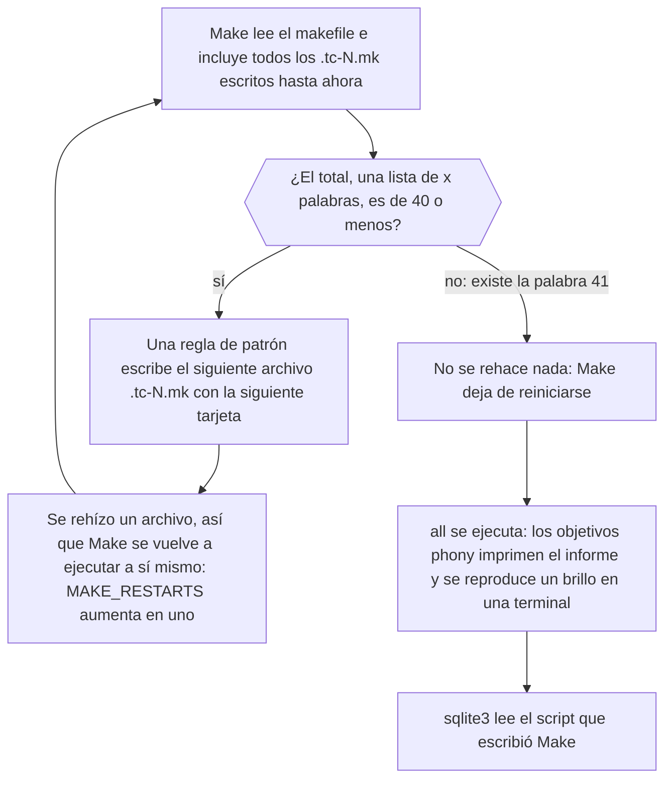

# GNU Make: la herramienta de compilación es el intérprete

**Te enseña:** que GNU Make puede hacer aritmética y bucles con su propia sintaxis, sin un intérprete de comandos para ninguno de los dos. Un intérprete de comandos es el programa que recibe y ejecuta los comandos que escribes.

> **DEMO ONLY.** Tarjetas de tiempo ficticias, escritas en un archivo SQLite temporal dentro de `$XDG_DATA_HOME/MakeChallenge/`.
> Nada de esto toca el registro real de horas.

Coloca `Makefile` en un directorio que no tenga nada más y ejecuta `make`. La salida tiene la misma forma que la de las otras entradas:

```
# DEMO ONLY run 2
Meetings	10	10	2026-W46	DEMO ONLY
Coding	13	23	2026-W46	DEMO ONLY
Debugging	19	42	2026-W46	DEMO ONLY
Runtime error near line 1: CHECK constraint failed: stop rule fired: total exceeds 40 (19)
# committed total=42 entries=3 DEMO ONLY
# make re-executed itself 3 times, once per card
```

La pregunta de esta entrada: **¿cuánto trabajo puede hacer la propia sintaxis de Make?** El `Makefile` no contiene
`$(shell)`, ni `!=`, ni Guile, ni `load`. `check.sh` busca con grep todos ellos.

## Ejecuta el programa en un contenedor

Requisito previo: Docker, configurado una sola vez como se describe en [`SANDBOX-SETUP.md`](../../SANDBOX-SETUP.md#docker).

```bash
sandbox/container/run-image.sh src/make-gnu
```

Compila el [`Dockerfile`](Dockerfile) de esta carpeta y ejecuta el resultado sin red, con un sistema de archivos de solo lectura y con el usuario `nobody`. Después imprime la salida y una vista de solo lectura de las filas que escribió. La imagen incluye GNU Make y sqlite3 sobre un Ubuntu mínimo. El Makefile se ejecuta desde una carpeta privada que al inicio no contiene nada más.

## Flujo del programa



**Qué muestra:** el bucle es la herramienta de compilación que se vuelve a ejecutar a sí misma. Cada pasada incluye los archivos `.tc-N.mk` que existen, y un archivo que se escribe fuerza un reinicio. El estado es *qué archivos existen*. La regla de parada es que la regla se niega a escribir un archivo nuevo.

**Por qué importa este mecanismo:** el motor de dependencias de Make decide qué hacer a continuación según el estado del sistema de archivos. No hay sentencia de bucle ni `$(shell)`: la aritmética es cirugía de listas sobre palabras `x`. El informe es una cadena de objetivos *phony* para que su salida se mantenga en orden.

## Cómo funciona el truco

| Tarea | Hecho por | ¿Intérprete de comandos? |
|---|---|---|
| Entropía | `$(file </proc/sys/kernel/random/uuid)`, letras eliminadas con `$(subst)` anidado; queda el primer dígito decimal | no |
| Horas de 10 a 19 | la cadena de texto `1` pegada a ese dígito. "Mod 10" es elegir un carácter | no |
| Orden de las categorías | `$(word n,Meetings Coding Debugging Learning)` | no |
| Aritmética | los números son listas de `x`; `$(words $(wordlist 1,a,$(U)) $(wordlist 1,b,$(U)))` suma, `$(wordlist b+1,a,…)` resta | no |
| Regla de parada (`total > 40`) | existe la palabra 41 de la lista acumulada: `$(word 41,…)` | no |
| **El bucle** | Make **se vuelve a ejecutar** una vez por tarjeta. Cada pasada incluye los archivos `.tc-N.mk` escritos hasta ahora; una regla de patrón escribe el siguiente mientras el total no pase de 40. Un archivo nuevo significa "makefile rehecho", así que Make se reinicia. `$(MAKE_RESTARTS)` es el contador del bucle. Cuando la regla decide no escribir, no se rehace nada y se ejecuta `all` | no |
| Reloj | `btime` a partir de `/proc/stat` + los segundos enteros de `/proc/uptime`, sumados dígito a dígito con acarreo (`NOW=<epoch>` lo reemplaza en las pruebas) | no |
| Semana ISO | época ÷ 86400 con división larga (÷100 y luego ÷864 dígito a dígito), un recorrido año por año del calendario desde 1970 y después la regla del jueves de la semana | no |
| Informe | `$(info)` con una variable de tabulador; el informe es una cadena de objetivos *phony* (`init`, `rows`, `footer`, fotogramas) para que la salida quede en orden | no |
| Glow | solo en una terminal: 25 objetivos *phony*, uno por fotograma. Cada uno imprime un banner de 256 colores **DEMO ONLY** en un tono de gris más brillante, luego más tenue y luego lo borra (unos 1,5 s). La pregunta "¿stdout es una terminal?" es `$(realpath /proc/self/fd/1)` con valor `/dev/pts/N` | no (los fotogramas se pausan con `sleep 0.06`) |
| Ventana emergente | `make pop` ejecuta `wt.exe` (Windows Terminal) para abrir una ventana que ejecuta la demostración; la ventana se cierra sola cuando `make` termina | **sí** (`wt.exe`) |
| Persistencia | `$(file)` escribe un script `.sql` y luego `sqlite3 db < script` | **sí** |
| Cómo viaja el dato | `mkdir -p`, `rm -f` y `:` (ver abajo) | **sí** |

SQLite también comprueba la regla de parada: la última sentencia inserta `total <= 40` en una tabla cuya única columna tiene
`CHECK(ok=1)`, así que el error de restricción con nombre en stderr es la regla de parada que se anuncia a sí misma, como en las otras entradas.

## Qué impone `check.sh`

`check.sh` comprueba que el truco es real. El Makefile no puede usar `$(shell)`, `!=`, `.ONESHELL` ni `load`; sus recetas solo pueden ejecutar `mkdir`, `sqlite3`, `rm`, `sleep` y la operación nula `:`.

Luego ejecuta `make` 25 veces en un directorio que contiene solo el Makefile, y ese directorio no debe contener nada más después. Cada ejecución debe imprimir tantas filas como entradas tenga e informar de que Make se volvió a ejecutar a sí mismo una vez por entrada. Se aplican las reglas habituales: horas de 10 a 19, categorías en orden, totales acumulados correctos, `DEMO ONLY` en cada fila, una parada exactamente cuando el total pasa de 40, una semana ISO que coincide con la de SQLite y una base de datos que concuerda con la salida. El error de la regla de parada debe aparecer en stderr exactamente una vez y no debe aparecer nada más.

Siguen más pruebas. El calendario hecho solo con Make se compara con `date -u` en instantes límite (`NOW` sustituye el reloj). El brillo debe ser silencioso en una tubería, y en una pseudoterminal debe dibujar 24 cuadros en un lapso de 1 a 3 segundos. `make -n pop` debe imprimir su comando `wt.exe` y no escribir nada. Un `.tc-0.mk` sobrante de una ejecución interrumpida debe rechazarse, y `make clean` debe eliminarlo. Por último, debe rechazarse una fila que no sea de demostración.

## Trampas que conviene conocer

- **Una receta que se expande a nada no cuenta como rehacer el archivo.** El archivo de la tarjeta se escribe mientras la línea
  de la receta se *expande*, pero Make solo se da cuenta (y se reinicia) si un comando se ejecutó de verdad. Por eso cada tarjeta lleva un `@:`,
  la operación nula del intérprete de comandos. Es el único lugar donde el bucle necesita siquiera un intérprete de comandos.
- **Un archivo por pasada, no un archivo reescrito.** El primer diseño reescribió un solo `.state.mk`. Se reinició una vez y luego se detuvo: las marcas de tiempo de los archivos de WSL son tan imprecisas que la reescritura parecía sin cambios. Un archivo que pasa de *ausente* a *presente* es inequívoco.
- **Make expande todas las líneas de una receta antes de ejecutar ninguna de ellas**, así que la salida de `$(info)` aparecería antes del
  encabezado de SQLite. El informe es una cadena de objetivos (`init`, `rows`, `all`) porque Make expande una receta justo
  antes de ejecutar su propio objetivo.
- **`#` inicia un comentario, incluso dentro de una cadena de texto SQL en una variable.** El `'# DEMO ONLY'` del encabezado se escribe como `\#`.
- **No hay forma de crear un directorio ni un archivo SQLite solo con Make.** Por eso existen `mkdir -p` y `sqlite3`.
- **La hora es UTC.** `/etc/localtime` es binario y Make no tiene forma de leerlo. La hora local solo difiere de esta cerca del límite de una
  semana. El calendario es válido hasta 2134 inclusive (la regla mide 60,000 días) y maneja el año no bisiesto
  2100.
- **Los códigos de escape necesitan un byte ESC.** Make no tiene sintaxis de escape, así que el Makefile contiene un `0x1b` literal (en `define ESC`).
- **`wt.exe` trata `;` como su propio separador de subcomandos**, así que la línea de comandos de `make pop` no debe contener uno (un primer
  intento abrió un montón de ventanas con el mensaje "The system cannot find the file specified").
- **`make pop`, `clean` y `check` nunca ejecutan el bucle de tarjetas**; el bucle dejaría tarjetas sobrantes que el
  `make` extraído después rechazaría por obsoletas.
- **Una ejecución que falla deja `.tc-*.mk` atrás.** La siguiente `make` se niega a iniciar (de lo contrario las trataría como
  tarjetas reales); `make clean` las elimina.
- **Caso límite:** cuatro tarjetas de exactamente 10 horas suman un total de exactamente 40, que continúa. Solo hay cuatro categorías,
  así que la quinta tarjeta reutiliza `Meetings`.
- `check.sh` ejecuta `make` 25 veces en un directorio que contiene únicamente `Makefile`, compara la semana ISO con la aritmética de fechas
  de SQLite, compara las filas de SQLite con las filas impresas, contrasta 20 instantes límite (fines de año, años de 53 semanas,
  1970, 2096) con `date -u` y comprueba (mediante un pty) que el resplandor consta de 24 fotogramas en un lapso de 1 a 3 s y no aparece en una tubería.

## Ejecútalo

```bash
make          # one run (glows if stdout is a terminal, silent in a pipe)
make pop      # same, in a new Windows Terminal window that closes itself
make check    # ./check.sh
make clean    # remove leftover state after an interrupted run
```

---

Consulta el [README principal](../../README.md#the-results-so-far) para ver cómo se compara con las otras entradas, y [`RETO.md`](../../RETO.md) si quieres escribir la tuya.
