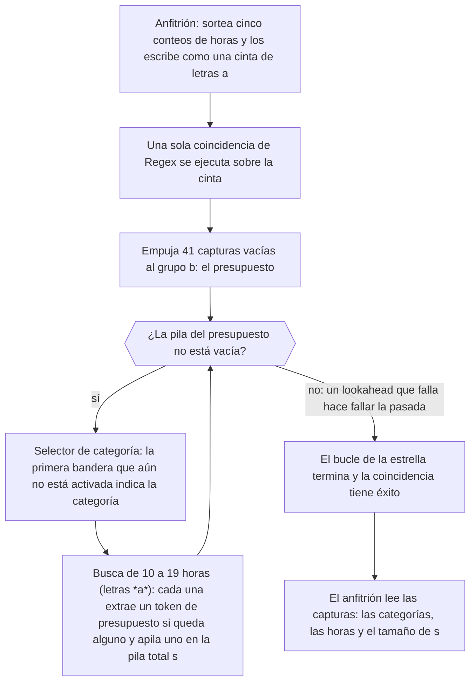

# Reto de regex, ruta 3: grupos de equilibrio de .NET (el intento purista)

**Te enseña:** que una expresión regular puede usar una pila para contar.

Una sola llamada a `Regex.Match`, sin callouts, sin código en línea y sin `MatchEvaluator`. Sigue el plan del reto de regex (ya eliminado; sigue en el historial de git como `plans/regex.md`), que preveía que esta pista chocaría con un muro. Sí chocó con algunos y se listan abajo, pero el núcleo llegó más lejos de lo que el plan predecía. **DEMO ONLY**: los registros son ficticios y van a un archivo temporal, sin conexión con ningún sistema real de registro de horas.

## Ejecútalo

Necesitas el SDK de .NET 10 (multiplataforma; nada de esto es específico de Windows).

```bash
cd src/regex-dotnet
dotnet run -c Release       # run the demo
./check.sh                  # 25 runs, asserts the rules below
```

Los registros se añaden a `$XDG_DATA_HOME/RegexDotnet/demo-timecards.tsv` (por defecto `~/.local/share/RegexDotnet/`). Elimina ese directorio para empezar de nuevo. Una ejecución se ve así:

```text
match returned: true
records at ~/.local/share/RegexDotnet/demo-timecards.tsv (latest run below)
# DEMO ONLY 2026-11-13T16:33:06
Meetings	16	2026-W46	DEMO ONLY
Coding	16	2026-W46	DEMO ONLY
Debugging	18	2026-W46	DEMO ONLY
# captured total=50 entries=3 DEMO ONLY
```

## Ejecuta el programa en un contenedor

Requisito previo: Docker, configurado una sola vez como se describe en [`SANDBOX-SETUP.md`](../../SANDBOX-SETUP.md#docker).

```bash
sandbox/container/run-image.sh src/regex-dotnet
```

Compila el [`Dockerfile`](Dockerfile) de esta carpeta y ejecuta el resultado sin red, con un sistema de archivos de solo lectura y el usuario `nobody`; luego imprime la salida y una vista de solo lectura de las filas que escribió. El SDK de .NET lo compila en una etapa de compilación. La imagen contiene solo la dll compilada sobre el entorno de ejecución de .NET, sin SDK.

## Flujo del programa



**Qué muestra:** el motor de regex es una máquina con pilas. Cada `a` apila una captura en la pila del total `s`. El grupo de equilibrio también desapila un token de presupuesto de `b` mientras quede alguno. La pila de presupuesto es la regla de parada: cuando está vacía, la siguiente pasada no puede empezar.

**Por qué importa este mecanismo:** el estado es la *profundidad* de la pila. Nada cuenta y nada suma. La coincidencia tiene éxito y la respuesta del programa es lo que capturó el motor. Una entrada puede hacer que el total pase de 40 a mitad de camino. Esto ocurre porque el presupuesto se agota en medio de sus horas y los `a` adicionales no extraen nada.

## Cómo funciona el truco

El anfitrión sortea cinco cantidades de horas al azar y construye una *cinta unaria*: `Meetings:aaaaaaaaaaaaaaa;Coding:aaaaaaaaaaaa;...;Meetings:aaaaaaaaaaa;` (un `a` por hora; el quinto nombre es otra vez `Meetings`, para que después de cuatro tarjetas de 10 horas, cuyo total es exactamente 40, pueda venir una quinta). Ejecuta una coincidencia contra la cinta y lee lo que capturó el patrón. El patrón hace el resto:

| Pieza | Función |
| --- | --- |
| `\A(?:(?<b>)){41}` | El **presupuesto**: 41 capturas vacías que se añaden a la pila del grupo `b`. Son 41 porque la regla de parada es "el total *pasa de* 40" |
| `(?: ... )*` | El bucle: cada pasada es una entrada de la tarjeta de horas |
| `(?(b) ... \|(?!))` | La **regla de parada**. Mientras la pila de presupuesto no esté vacía, el patrón toma otra entrada; cuando está vacía, `(?!)` hace fallar la pasada y el `*` termina |
| `(?(fm)(?(fc)(?(fd)(?(fl)(?(f5)(?!)\|(?<f5>)Meetings)\|(?<fl>)Learning)\|(?<fd>)Debugging)\|(?<fc>)Coding)\|(?<fm>)Meetings)` | El **selector de categorías**: cinco grupos de banderas forman una pequeña máquina de estados. La primera pasada encuentra `fm` sin establecer, así que toma Meetings y lo establece; la siguiente ve `fm` y toma Coding; y así sucesivamente. Después del segundo `Meetings`, el último `(?!)` impide una sexta pasada |
| `(?<hrs>(?:(?(b)(?<-b>))(?<s>)a){10,19});` | Las horas de la entrada. Cada `a` extrae una ficha del presupuesto si queda alguna (un **grupo de equilibrio**) y apila una en la pila del total acumulado `s`. El `{10,19}` impone el rango de la demostración |

Una entrada puede hacer que el total pase de 40 en cualquier punto de sus horas (de 10 a 19); el presupuesto simplemente se agota a mitad de la entrada y los `a` sobrantes no extraen nada. Después de la entrada, la regla de parada ve una pila vacía. El estado capturado queda así: las listas de captura `cat` y `hrs` (los registros) y el conteo de capturas de `s` (el total).

Comprobé los casos límite con un prototipo desechable (no está en el repositorio, porque el programa real no tiene forma de inyectar un sorteo fijo): un total de exactamente 40 (cuatro tarjetas de 10 horas, queda un token, que ahora continúa con una quinta tarjeta), un total de 41 en la cuarta entrada y totales de 45 y 57 con parada después de tres tarjetas. Todos dieron el resultado correcto. `check.sh` verifica la regla de parada en cada ejecución aleatoria (el total antes de la última tarjeta es como máximo 40 y el total después de ella pasa de 40, con entre tres y cinco tarjetas) y crea una copia del anfitrión en la que cada tarjeta vale 10 horas, para demostrar que un total de exactamente 40 continúa: cinco filas, la cuarta `Learning`, la quinta `Meetings`, total de 50.

## Qué impone `check.sh`

`check.sh` se asegura de que el anfitrión siga siendo honesto. `Program.cs` no puede tener ninguna palabra clave de bucle ni ninguna de `MatchEvaluator`, `Replace`, `NextMatch` o `Matches`. Debe contener exactamente una llamada a `Regex.Match`. Después ejecuta el programa 25 veces. Cada ejecución debe informar de que la coincidencia devolvió `true` (este recorrido no puede fallar a propósito). Cada ejecución debe imprimir tantas filas como entradas tiene. Las horas deben sumar el total. Cada cantidad de horas debe ser de 10 a 19. La regla de parada debe ser correcta. El total antes de la última tarjeta es como máximo 40 (un total de exactamente 40 continúa). El total después de ella pasa de 40. La ejecución tiene entre tres y cinco entradas. El total nunca puede ser de más de 59. Por último, una copia del anfitrión con todas las tarjetas de 10 horas debe repartir cinco filas, la cuarta `Learning` y la quinta `Meetings`, con un total de 50. La misma cinta con `(?!)` añadido al patrón debe informar de una coincidencia fallida, cero capturas y estado de salida 1. Su TSV sigue conteniendo el informe vacío porque el anfitrión lo añade antes de devolver el control.

## Trampas que conviene conocer

1. **Una regex no puede generar números aleatorios.** El anfitrión tuvo que sembrar los sorteos aleatorios de 10 a 19 horas como cinco cadenas de texto unarias. El plan permite que el anfitrión "siembre los datos iniciales", así que esto cumple las reglas, pero la regex no elige las horas. Solo las acota (`{10,19}`) y las acumula.
2. **El anfitrión escribe después de la coincidencia.** El patrón aporta capturas. El anfitrión las formatea y llama a `File.AppendAllText` una vez, así que la salida depende de las listas de capturas que recibe.
3. **La coincidencia debe tener éxito para producir alguna tarjeta.** Si añades `(?!)` para forzar el fallo, `Match.Success` es falso y se devuelven cero capturas. La prueba de cinta fija comprueba ambos resultados con el patrón real. La garantía aquí es el [comportamiento documentado de los grupos de equilibrio y las capturas de regex de .NET](https://learn.microsoft.com/en-us/dotnet/standard/base-types/grouping-constructs-in-regular-expressions#balancing-group-definitions). Un motor que no tenga esa API necesita otro mecanismo.
4. **Sin pulso.** El pulso de la terminal necesita efectos secundarios durante la coincidencia. Esta pista no tiene ninguno, y un bucle del anfitrión para animarlo rompería las reglas.
5. **Aleatoriedad desenrollada, no un bucle aleatorio.** La cinta siempre contiene cinco sorteos aunque solo se necesiten tres (se ignora cualquier sorteo sobrante cuando se agota el presupuesto). El bucle `*` es real, pero los sorteos se fijan de antemano.

### Letra pequeña, pero honesta

- El anfitrión hace una cosa con forma de iteración: informar. `string.Concat(...Zip(...))` recorre las listas `cat` y `hrs` capturadas para dar formato a las filas. Solo lee el estado final capturado, lo que el plan permite ("imprimir/informar el estado final"). Además, `check.sh` rechaza `MatchEvaluator`, `Replace`, `NextMatch`, `Matches` y cualquier palabra clave de bucle en el anfitrión, y exige exactamente un `Regex.Match`. Aun así, es una pasada de LINQ y prefiero decirlo a ocultarlo.
- El total impreso es el número de capturas de la pila `s`. La expresión regular construyó esa pila. Las horas de cada fila son las longitudes de las capturas `hrs`.
- El patrón no tiene formato a propósito, igual que en las otras variantes.

---

Consulta el [README raíz](../../README.md#los-resultados-hasta-ahora) para ver cómo se compara esto con las otras entradas de regex, y [`RETO.md`](../../RETO.md) si quieres escribir las tuyas.
