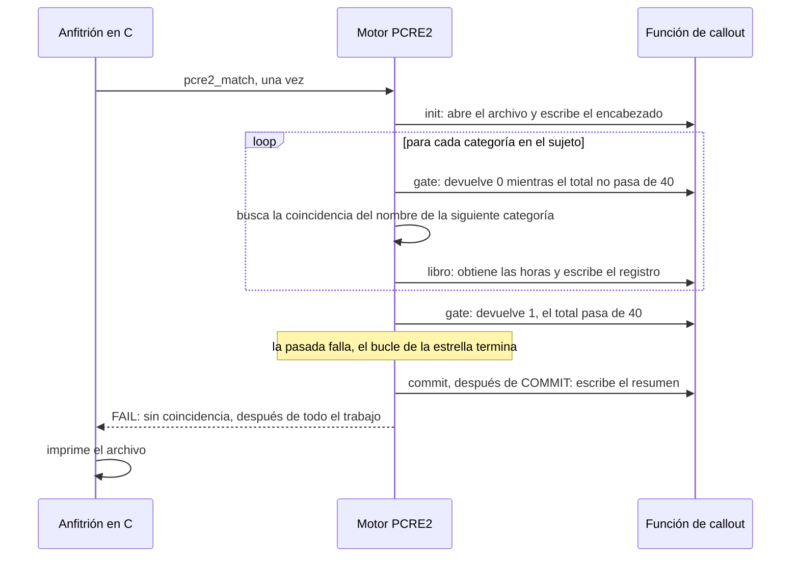

# Reto de regex, ruta 2: callouts de PCRE2 como un DSL minúsculo

**Te enseña:** que los callouts de regex pueden servir como un conjunto diminuto de instrucciones.

Una sola llamada a `pcre2_match` ejecuta toda la demostración de la tarjeta de horas y luego informa **sin coincidencia**. Sigue el plan del reto de regex (ya se eliminó; está en el historial de git como `plans/regex.md`). **DEMO ONLY**: los registros son ficticios y van a un archivo temporal, sin conexión con ningún sistema real de registro de horas.

## Ejecútalo

```bash
sudo apt install -y build-essential pkg-config libpcre2-dev
cd src/regex-pcre2
make run          # build and run the demo
make check        # 25 runs, asserts the rules below
```

Los registros se añaden a `$XDG_DATA_HOME/RegexPCRE2/demo-timecards.tsv` (por defecto, `~/.local/share/RegexPCRE2/`). Elimina ese directorio para empezar de nuevo. Una ejecución se ve así:

```text
pcre2_match returned -1 (no match)
records at ~/.local/share/RegexPCRE2/demo-timecards.tsv (latest run below)
# DEMO ONLY 1794612149
Meetings	19	19	DEMO ONLY
Coding	10	29	DEMO ONLY
Debugging	15	44	DEMO ONLY
# committed total=44 entries=3 DEMO ONLY
```

## Ejecuta el programa en un contenedor

Requisito previo: Docker, configurado una sola vez como se describe en [`SANDBOX-SETUP.md`](../../SANDBOX-SETUP.md#docker).

```bash
sandbox/container/run-image.sh src/regex-pcre2
```

Construye el [`Dockerfile`](Dockerfile) de esta carpeta y ejecuta el resultado sin red, con un sistema de archivos de solo lectura y el usuario `nobody`, luego imprime la salida y una vista de solo lectura de las filas que escribió. El anfitrión en C se compila en una etapa de compilación. La imagen contiene solo el binario y la biblioteca compartida libpcre2, sin compilador ni encabezados.

## Flujo del programa



**Qué muestra:** el anfitrión en C no tiene bucle. Llama a `pcre2_match` una sola vez y el motor vuelve a llamar al anfitrión en cada callout. El nombre del callout es un código de operación. El valor de retorno es la decisión: `0` significa continuar y `1` significa hacer fallar esta rama.

**Por qué importa este mecanismo:** la regla de parada es un callout que devuelve `1`, así que el cuantificador `*` termina por retroceso. `(*COMMIT)` hace que `commit` se ejecute exactamente una vez, y `(*FAIL)` hace que toda la coincidencia falle. Los callouts son llamadas síncronas del motor, no eventos en cola.

## Cómo funciona el truco

El patrón es todo el programa:

```text
^(?C"init")(?:(?C"gate")(Meetings|Coding|Debugging|Learning)(?C"book"))*(*COMMIT)(?C"commit")(*FAIL)
```

El anfitrión en C (`timecards.c`) lo compila, registra un despachador de callouts, llama a `pcre2_match` una vez con `MeetingsCodingDebuggingLearningMeetings` (cinco nombres, para que a cuatro tarjetas de 10 horas, un total de exactamente 40, pueda seguirles una quinta) e imprime el archivo. No tiene `for`, `while`, `do` ni `goto`, ni recursión (`check.sh` los busca con grep). Las cadenas de texto de los callouts son opcodes:

| Opcode | Qué hace | Valor de retorno al motor |
| --- | --- | --- |
| `init` | abre el archivo temporal y escribe el encabezado | 0 (continuar) |
| `gate` | la regla de parada | 1 (falla esta rama) cuando el total pasa de 40, lo que termina el bucle `*`; si no, 0 |
| `book` | sortea de 10 a 19 horas, suma al total, escribe el registro de la categoría que acaba de coincidir (se lee del grupo de captura 1) | 0 |
| `commit` | escribe la línea de resumen y cierra el archivo | 0 |

PCRE2 aporta la iteración (`*`), el recorrido de categorías (la cadena de texto sujeto y la alternancia) y el retroceso. `(*COMMIT)` evita que una coincidencia fallida reintente bucles más cortos, así que `commit` se ejecuta exactamente una vez. Después, `(*FAIL)` hace que toda la coincidencia falle, cuando ya se escribió todo. Esa es la jugada distintiva.

## El pulso

En una terminal real, la coincidencia termina los registros, luego hace pulsar un banner **DEMO ONLY** a través de una rampa de grises durante unos tres segundos (60 fotogramas, 50 ms cada uno) y después lo borra. `pulse` y `settle` son dos opcodes más: el anfitrión añade 60 caracteres `~` al sujeto, y `[A-Za-z]*(?:~(?C"pulse"))*(*COMMIT)(?C"settle")` dibuja un fotograma por tick. El anfitrión sigue sin tener bucle. El segundo `(*COMMIT)` evita que el `(*FAIL)` final haga retroceso hacia conteos de ticks más cortos y vuelva a ejecutar `settle`. No se añade nada cuando stdout no es una terminal, así que las tuberías y `check.sh` lo omiten.

## La advertencia sobre el optimizador, como pide el plan

Los callouts solo tienen sentido si el motor realmente los visita. Este programa se compila con `PCRE2_NO_AUTO_POSSESS | PCRE2_NO_START_OPTIMIZE | PCRE2_NO_DOTSTAR_ANCHOR`, así que el optimizador no puede omitir ni reordenar los puntos de callout. Además, **no** usa el JIT de PCRE2, que no admite callouts en absoluto. `check.sh` verifica que el total confirmado y el número de entradas de cada ejecución coincidan con las filas realmente escritas, y esa es la evidencia de que ningún callout se omitió en silencio. Probé con el PCRE2 del sistema (10.42 en Ubuntu 24.04); no probé sin esas banderas para ver qué callouts eliminaría el optimizador.

## Qué impone `check.sh`

`check.sh` comprueba que el anfitrión en C no tenga ninguna palabra clave de bucle (se excluyen los comentarios). Después ejecuta el programa 25 veces. Cada ejecución debe terminar sin errores e informar `pcre2_match returned -1 (no match)`. Cada ejecución debe imprimir tantas filas como entradas tenga, con al menos tres entradas, horas de 10 a 19, sin parada anticipada (el total debe terminar en más de 40), de tres a cinco entradas y un total de 59 como máximo. También compila una copia del anfitrión en la que cada tarjeta vale 10 horas y comprueba que un total de exactamente 40 continúa: cinco filas, la quinta `Meetings`, total 50.

## Trampas que conviene conocer

- El bucle `*` termina porque `gate` falla en la siguiente iteración o porque se agotan los cinco nombres de categoría. Agotar los nombres solo importa cuando el total todavía no pasa de 40 después de cuatro tarjetas. Después de cinco tarjetas, el total siempre supera ese límite. El motor controla la parada. El código en C solo responde a la pregunta "¿el total pasa de 40?" cuando el motor se lo pregunta.
- El estado (`total`, `entries`, el archivo) vive en una struct de C que comparten los callouts, así que, a diferencia de `local` en Perl, nada de eso se revierte con el retroceso. Eso conviene a este programa: nunca se deshace nada.
- El despachador es una cadena de operadores ternarios, no una tabla, para mantener el anfitrión libre de bucles y de trucos con punteros a función. Los códigos de operación desconocidos (y los errores de E/S) abortan la coincidencia con `PCRE2_ERROR_CALLOUT`, que a propósito es distinto de `-1`, que significa "no hay coincidencia". El anfitrión informa de éxito solo si `commit` se ejecutó de verdad.

---

Consulta el [README raíz](../../README.md#los-resultados-hasta-ahora) para ver cómo se compara esto con las demás entradas de regex, y [`RETO.md`](../../RETO.md) si quieres escribir las tuyas.
