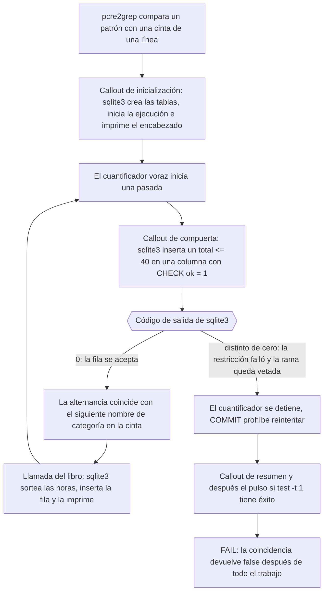

# Reto de regex, pista 2b: `pcre2grep` (sin nada de código personalizado)

**Te enseña:** que los códigos de salida de un programa pueden dirigir el flujo de control.

Aquí el "anfitrión" es un `pcre2grep` estándar y una línea de comandos. No hay C, ni Perl, ni despachador que escribir: las cadenas de texto de callout del patrón nombran los programas que se ejecutan, y los **códigos de salida de esos programas dirigen la coincidencia**. Luego la coincidencia **devuelve falso**. Sigue el plan del reto de expresiones regulares (eliminado desde entonces; está en el historial de git como `plans/regex.md`). **DEMO ONLY**: los registros son ficticios y van a un archivo SQLite desechable, sin conexión con ningún sistema real de registro de horas.

## Ejecútalo

Ubuntu compila su propio `pcre2grep` *sin* scripts de callout, así que necesitas una compilación del proyecto original. En un intérprete de comandos (*shell*) desechable (el programa donde escribes comandos):

```bash
sudo apt install -y build-essential sqlite3
mkdir -p ~/src/pcre2 && cd ~/src/pcre2
curl -fLO https://github.com/PCRE2Project/pcre2/releases/download/pcre2-10.49/pcre2-10.49.tar.bz2
tar xjf pcre2-10.49.tar.bz2 && cd pcre2-10.49
./configure --prefix="$HOME/.local" --disable-shared \
    --enable-pcre2grep-callout --enable-pcre2grep-callout-fork
make -j"$(nproc)" && make install
~/.local/bin/pcre2grep --help | grep -i callout    # "All callout scripts in patterns are supported."
```

Luego:

```bash
cd src/regex-pcre2grep
PCRE2GREP=~/.local/bin/pcre2grep ./timecards.sh    # or put ~/.local/bin first on PATH
PCRE2GREP=~/.local/bin/pcre2grep ./check.sh        # 25 runs, asserts the rules below
```

`timecards.sh` rechaza (termina con código de salida 2 y muestra un mensaje) un `pcre2grep` que no tiene scripts de callout, así que un binario equivocado no puede fallar en silencio. Los registros van a `$XDG_DATA_HOME/RegexPcre2grep/demo-timecards.db` (por defecto `~/.local/share/RegexPcre2grep/`). Elimina ese directorio para empezar de nuevo. Una ejecución se ve así, seguida de un pulso de tres segundos en una terminal real:

```text
# DEMO ONLY run 1
Meetings	16	16	2026-W46	DEMO ONLY
Coding	13	29	2026-W46	DEMO ONLY
Debugging	10	39	2026-W46	DEMO ONLY
Learning	18	57	2026-W46	DEMO ONLY
Error: stepping, CHECK constraint failed: stop rule fired: total exceeds 40 (19)
# committed total=57 entries=4 DEMO ONLY
# the match now returns false, on purpose
```

Esa línea `Error:` va a **stderr** y es la regla de parada que se anuncia a sí misma (consulta más abajo), no un fallo. Aparece exactamente una vez por cada ejecución que termina con más de 40; `check.sh` comprueba eso y que nunca se escribe nada más en stderr.

## Ejecútalo en un contenedor

Requisito previo: Docker, configurado una sola vez como se describe en [`SANDBOX-SETUP.md`](../../SANDBOX-SETUP.md#docker).

```bash
sandbox/container/run-image.sh src/regex-pcre2grep
```

Compila el [`Dockerfile`](Dockerfile) de esta carpeta y ejecuta el resultado sin red, con un sistema de archivos de solo lectura y el usuario `nobody`. Después imprime la salida y una vista de solo lectura de las filas que escribió. La imagen contiene un `pcre2grep` con callouts habilitados (compilado a partir de la versión fijada de PCRE2 en la imagen de la cadena de herramientas) y sqlite3 sobre un Ubuntu mínimo.

## Flujo del programa



**Qué muestra:** una cadena de texto de callout que empieza con una ruta ejecuta un programa. El estado de salida 0 permite que la coincidencia continúe, y cualquier otro estado hace fallar esa rama. Así, cada decisión del programa es un estado de salida de `sqlite3`. Una violación de restricción (el total pasa de 40) es la regla de parada.

**Por qué importa este mecanismo:** `pcre2grep` no es un entorno de ejecución de un lenguaje, pero tiene un límite de proceso dentro del comparador. El motor le hace una pregunta a un programa externo y retrocede según la respuesta. Compara [`regex-pcre2`](../regex-pcre2/README.md), donde la pregunta es una llamada a una función en el mismo proceso.

## Cómo funciona el truco

`pcre2grep` admite dos tipos de cadena de texto de callout. `(?C{|text$n})` repite texto. `(?C{/abs/path/prog|arg|arg})` ejecuta un programa: **el código de salida 0 deja que la coincidencia continúe; cualquier otro código de salida, o un programa que no se puede ejecutar, hace fallar esa rama y el motor retrocede.** El sujeto es una "cinta" de una sola línea: `MeetingsCodingDebuggingLearning` seguido de 60 tonos de gris de tres dígitos.

| Pieza | Rol |
| --- | --- |
| `^(?C{sqlite3 ...})` | Inicializador: crea las tablas (con `CHECK(demo_only=1)` y `CHECK(hours BETWEEN 10 AND 19)`), inicia una fila de ejecución e imprime el encabezado |
| `(?: ... )*` | El bucle. El cuantificador voraz de PCRE2 es la iteración; los nombres de categoría de la cinta son lo que recorre |
| `(?C{sqlite3 ... INSERT INTO stop_rule ...})` | La **compuerta** (la regla de parada). Inserta `(running total <= 40)` en una tabla cuya única columna es `CHECK(ok=1)`, con el nombre "stop rule fired: total exceeds 40". Cuando el total pasa de 40, la inserción falla, `sqlite3` termina con un código distinto de cero y la rama queda vetada, con lo que el bucle termina. El mensaje de error en stderr es el nombre de esa restricción |
| `(Meetings\|Coding\|Debugging\|Learning)` | La categoría: la cinta aporta el orden (`MeetingsCodingDebuggingLearningMeetings`, cinco nombres para que un total de exactamente 40 pueda continuar con una quinta tarjeta) y la alternancia coincide con ella |
| `(?C{sqlite3 ... INSERT INTO demo_timecards ...})` | **Anota** una entrada. SQLite sortea las horas con `random()`, calcula el total acumulado y la semana ISO, inserta la fila y la imprime. `$1` en el SQL es la categoría con la que el patrón acaba de coincidir |
| `(*COMMIT)(?C{sqlite3 ... SELECT printf(...)})` | Una vez que termina el bucle, el retroceso puede no reintentar bucles más cortos; después el programa imprime el resumen |
| `[A-Za-z]*(?:(?C{/usr/bin/test\|-t\|1})(\d{3})(?C{\|$r$e[48;5;$2m ...})(?C{/bin/sleep\|0.05}))*` | El pulso. `test -t 1` es el predicado "¿stdout es una terminal?" (distinto de cero en una tubería, así que el bucle nunca arranca y las tuberías y `check.sh` lo omiten). El programa vuelve a leer el tono de cada fotograma desde la cinta mediante `$2` |
| `(*COMMIT)(?:test -t 1, clear)?+(?C{\|# the match now returns false...})(*FAIL)` | Borra el banner (si había uno); luego, la jugada característica. El `?+` es posesivo a propósito: sin él, `(*FAIL)` retrocede hasta omitir el grupo opcional e imprime el mensaje final dos veces |

El código de salida es todo el truco. El `random()` de SQLite y la aritmética viven en el programa auxiliar. Pero las *decisiones* (dar otra vuelta, parar, emitir un pulso o no) son el patrón que consume los códigos de salida.

## Qué hace cumplir `check.sh`

`check.sh` comprueba que `timecards.sh` no tiene ninguna palabra clave de bucle y ejecuta exactamente un `pcre2grep`. Los callouts solo pueden ejecutar `/bin/sleep`, `/usr/bin/sqlite3` y `/usr/bin/test`, nunca un intérprete de comandos (*shell*, el programa que recibe y ejecuta comandos escritos) ni un intérprete. Si se instala un `pcre2grep` sin soporte de callouts, el script debe rechazarlo con el código de salida 2. Después ejecuta el programa 25 veces. Una copia del script en la que cada tarjeta vale 10 horas debe repartir cinco filas (la quinta `Meetings`, total de 50), lo que demuestra que un total de exactamente 40 continúa. Cada ejecución debe imprimir la línea "returns false", tantas filas como entradas tenga, de 10 a 19 horas y la regla de parada correcta (el total antes de la última tarjeta es como máximo 40, así que un total de exactamente 40 continúa, y el total después de ella pasa de 40; de tres a cinco entradas). El error de la regla de parada debe aparecer en stderr exactamente una vez cuando el total pasa de 40 y nunca en otro caso, y no debe escribirse nada más en stderr. SQLite debe coincidir con la salida, la base de datos debe contener 25 ejecuciones y ninguna fila de prueba, y se debe rechazar una fila que no sea de demostración.

## Trampas que conviene conocer

- **El estado no puede vivir en el patrón.** `pcre2grep` no tiene variables, así que el total acumulado vive en SQLite y cada callout lo vuelve a leer. Así, la aritmética es tarea del programa auxiliar, no de PCRE2; el patrón aporta el bucle, el orden, la ramificación y el fallo.
- **Esta vez no hay transacción.** Cada auxiliar es su propio proceso `sqlite3`, así que cada sentencia se confirma de inmediato y nada se puede revertir. A diferencia de la transacción única del recorrido de Perl, aquí "rama abandonada, los efectos secundarios se quedan" es literal: las filas ya están en la base de datos antes de que falle la coincidencia.
- **Los callouts necesitan rutas absolutas.** `pcre2grep` usa `fork` y `execv`, que no buscan en `PATH`. Un `true` o `sleep` sin ruta es en silencio un callout fallido, indistinguible de una rama vetada. Por eso `check.sh` fija la lista de programas.
- **Salvaguarda.** Los callouts solo pueden ejecutar `/usr/bin/sqlite3`, `/usr/bin/test` y `/bin/sleep`, cada uno con una lista fija de argumentos. `check.sh` falla si aparece cualquier otro programa, en particular un intérprete de comandos (*shell*, el programa que lee comandos escritos y los ejecuta) o un intérprete. El único valor que se interpola en SQL es `$1`, uno de los cuatro nombres de categoría fijos de la cinta.
- **El anfitrión no es insignificante.** `timecards.sh` busca un `pcre2grep` con soporte de callouts, crea y entra en el directorio temporal de trabajo y pasa la cinta por una tubería a un solo comando `pcre2grep`. No tiene ningún bucle y no decide nada, pero sí contiene una cinta literal de 60 tonos (la rampa de brillo del pulso, precalculada) y una guarda parecida a `if`. La afirmación honesta es "sin código propio", no "sin intérprete de comandos (*shell*, el programa que lee y ejecuta comandos)".
- **No es seguro para la concurrencia.** Una ejecución se identifica como `max(id)` en la tabla `runs`, así que dos ejecuciones simultáneas interferirían entre sí. Es un juguete.
- **La semana ISO se calcula con aritmética de fechas de SQLite**, porque el SQLite de Ubuntu 24.04 (3.45) no tiene `%G`/`%V`. Como en las otras versiones, el año ISO puede diferir del año calendario cerca de Año Nuevo.
- Solo probé la compilación de `10.49` indicada arriba. No probé otras versiones de PCRE2 ni otras opciones de configuración.

---

Consulta el [README principal](../../README.md#los-resultados-hasta-ahora) para ver cómo se compara esto con las otras entradas de regex, y [`RETO.md`](../../RETO.md) si quieres escribir el tuyo.
