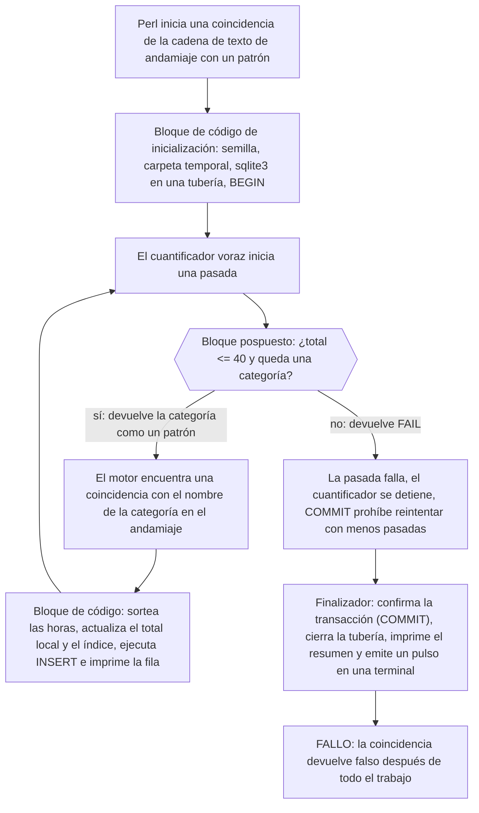

# Reto de regex, ruta 1: Perl (todo el programa es una coincidencia)

**Te enseña:** que Perl puede ejecutar código durante una coincidencia de una expresión regular.

La única sentencia del archivo es una sola coincidencia `=~`. La inicialización de la semilla, los sorteos aleatorios, la transacción de SQLite, el pulso en la terminal y toda la impresión ocurren *dentro* de esa coincidencia, y después la coincidencia **devuelve falso**. Sigue el plan del reto de regex (ya eliminado; está en el historial de git como `plans/regex.md`). **DEMO ONLY**: los registros son ficticios y van a un archivo SQLite desechable, sin conexión con ningún sistema real de registro de horas.

## Ejecútalo

Necesitas Perl 5 y la herramienta de línea de comandos `sqlite3` (`sudo apt install sqlite3`). `POSIX` y `File::Path` son módulos básicos de Perl.

```bash
cd src/regex-perl
perl timecards.pl          # run the demo
./check.sh                 # 25 runs, asserts the rules below
```

Los registros van a `$XDG_DATA_HOME/RegexPerl/demo-timecards.db` (valor predeterminado: `~/.local/share/RegexPerl/`). Elimina ese directorio para empezar de nuevo. Una ejecución se ve así, seguida de un pulso de tres segundos en una terminal real:

```text
# DEMO ONLY run 1794613174-17683
Meetings	10	10	2026-W46	DEMO ONLY
Coding	19	29	2026-W46	DEMO ONLY
Debugging	16	45	2026-W46	DEMO ONLY
# committed total=45 entries=3 DEMO ONLY
# the match now returns false, on purpose
```

```bash
sqlite3 -header -column ~/.local/share/RegexPerl/demo-timecards.db 'select * from demo_timecards'
```

## Ejecuta el programa en un contenedor

Requisito previo: Docker, configurado una sola vez como se describe en [`SANDBOX-SETUP.md`](../../SANDBOX-SETUP.md#docker).

```bash
sandbox/container/run-image.sh src/regex-perl
```

Construye el [`Dockerfile`](Dockerfile) de esta carpeta y ejecuta el resultado sin red, con un sistema de archivos de solo lectura y el usuario `nobody`. Luego imprime la salida y una vista de solo lectura de las filas que escribió. La imagen contiene Perl (de la base de Ubuntu) y sqlite3. No tiene compilador ni gestor de paquetes.

## Flujo del programa



**Qué muestra:** una sola coincidencia de regex es todo el programa. El cuantificador es el bucle, y un bloque de código que devuelve un *patrón* es la regla de parada: devuelve el nombre de la siguiente categoría o `(*FAIL)` para que la pasada falle. Los bloques de código son los únicos lugares donde se hace el trabajo.

**Por qué importa este mecanismo:** el retroceso puede deshacer las variables `local`, pero no los efectos secundarios. El motor abandona una rama, mientras que `INSERT` y `print` siguen ejecutados. Por eso la coincidencia puede terminar en fallo y los datos siguen guardados. La transacción SQL es real. Solo la *coincidencia* miente.

## Cómo funciona el truco

Debajo de las líneas `use`, `timecards.pl` es una línea: una cadena de texto de andamiaje constante `=~` un patrón. Ningún código anfitrión siembra datos, ejecuta bucles ni imprime. `check.sh` exige que el archivo sea una sola sentencia, con exactamente una coincidencia y sin palabras clave de bucle.

| Pieza | Tarea |
| --- | --- |
| `^(?{ ... })` | Inicializador: fija el estado inicial, crea el directorio temporal, inicia `sqlite3` en una tubería, crea la tabla (con una restricción `CHECK(demo_only=1)`) y abre una transacción |
| `(?:  ...  )*` | El bucle. El cuantificador voraz de Perl es la iteración; la cadena de texto de andamiaje le da a cada pasada algo que consumir |
| `(??{ $::t<=40 ? $::c[$::n] // '(*FAIL)' : '(*FAIL)' })` | La regla de parada y el selector de categoría en uno solo: entrega al motor el *nombre de la siguiente categoría como patrón*, o `(*FAIL)` en cuanto el total pasa de 40 o se acaban las categorías (hay cinco nombres: Meetings se repite, así que a cuatro tarjetas de 10 horas, un total de exactamente 40, les sigue una quinta). Una pasada fallida es lo que pone fin al cuantificador |
| `(?{ local $::t = ...; local $::n = ...; print ... })` | Una tarjeta de horas: sortea de 10 a 19, lo suma al total, avanza la categoría, envía un `INSERT` a SQLite e imprime la fila |
| `(*COMMIT)` | Cuando el bucle termina, el retroceso no puede reintentar bucles más cortos (o el finalizador se ejecutaría más de una vez) |
| `(?{ COMMIT; close; print ... })` | Finalizador: confirma la transacción de SQLite, cierra la tubería (lo que espera a que `sqlite3` termine) e imprime el resumen |
| `[A-Za-z]*(?:(?(?{-t STDOUT})~(?{ frame }) \| (?!)))*` | El pulso: un fotograma por cada `~` al final del andamiaje, pero solo si stdout es una terminal (el condicional es un bloque de código), así que las tuberías y `check.sh` lo omiten |
| `(*COMMIT)(?{ settle })(*FAIL)` | Borra el banner y luego hace la jugada característica: la coincidencia se rinde después de hacer todo el trabajo |

`local` es la parte interesante. Perl deshace las asignaciones de `local` cuando el motor retrocede, así que el total acumulado y el contador de categorías se ajustan correctamente al retroceso, pero los `INSERT` y los `print` no se ajustan y no se pueden deshacer. El motor abandona la rama y los efectos secundarios quedan escritos. La transacción de SQLite es real y se confirma; lo que miente es la *coincidencia*.

## Qué impone `check.sh`

`check.sh` comprueba que el archivo es de verdad una sola sentencia. Todo lo que no sea comentarios, líneas en blanco o líneas `use` debe ser una sola línea. Esa línea tiene exactamente una coincidencia de nivel superior y ninguna palabra clave de bucle fuera de los comentarios. A continuación se ejecuta el programa 25 veces. Cada ejecución debe imprimir la línea "returns false" y tantas filas como entradas tenga. Las horas deben ir de 10 a 19. No puede haber parada anticipada: el total debe terminar en más de 40. Debe haber de tres a cinco entradas y un total de 59 como máximo. También se ejecuta una copia del programa en la que cada tarjeta vale 10 horas. En ella se comprueba que un total de exactamente 40 continúa: cinco filas, la quinta `Meetings`, total 50. SQLite debe concordar con la salida, la base de datos debe contener 25 ejecuciones distintas y debe rechazarse una fila que no sea de demostración.

## Trampas que conviene conocer

- El patrón no está formateado. `/x` está activado solo para que el andamiaje se analice de forma razonable; dentro del patrón no hay comentarios, grupos con nombre ni funciones auxiliares. Es deliberado.
- El estado vive en variables de paquete (`$::t`, `$::n`, ...) porque el código dentro de un patrón se ejecuta con las reglas `strict` del archivo y `local` solo funciona con variables globales. Todas se inicializan dentro de la coincidencia.
- La advertencia de iteración nula que Perl emitiría sobre el cuerpo del bucle se silencia con `no warnings 'regexp'`, porque el cuerpo es dinámico y Perl no puede demostrar que consume entrada de datos. Siempre la consume: solo avanza después de coincidir con un nombre de categoría o con un `~`.
- El SQL se construye interpolando valores en cadenas de texto. Aquí eso es seguro solo porque cada valor es un número que calculó la coincidencia o uno de cuatro nombres de categoría fijos; no copies ese hábito.
- Perl ejecuta el código de los patrones como Perl normal. El único programa externo es `sqlite3`, que se inicia sin un intérprete de comandos (*shell*, el programa que lee órdenes de texto y las ejecuta) y con una lista fija de argumentos. Las únicas entradas y salidas son la base de datos temporal y la terminal.
- La semana ISO se calcula con `strftime('%G-W%V')`. Como en las otras versiones, el año ISO puede diferir del año calendario cerca del Año Nuevo.

---

Consulta el [README principal](../../README.md#the-results-so-far) para ver cómo se compara esta versión con las otras entradas de expresiones regulares, y [`RETO.md`](../../RETO.md) si quieres escribir la tuya.
