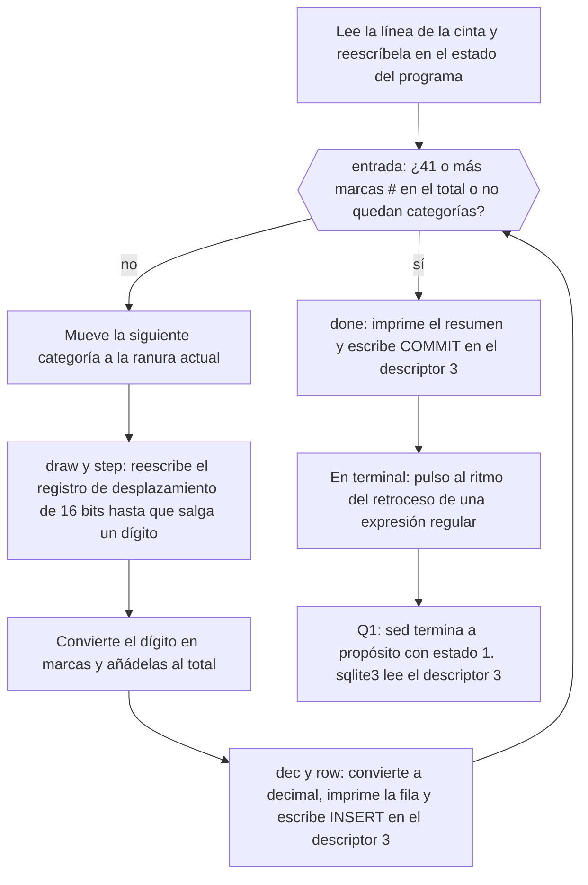

# Reto de regex, ruta 4: GNU sed (el programa es una línea de texto que se reescribe hasta terminar)

Un solo comando `sed` ejecuta toda la demostración de la tarjeta de horas. Escribe los datos en una transacción real de SQLite, hace latir un banner y después **termina con código de salida 1**. No hay variables, números ni aritmética en ninguna parte. Todo el estado del programa es una sola línea de texto, y cada paso es una sustitución con regex sobre esa línea. Esta entrada va más allá del plan original de regex (vive en el historial de git como `plans/regex.md`), pero sigue las mismas reglas. **DEMO ONLY**: los datos son ficticios y van a un archivo SQLite temporal, sin conexión con ningún sistema real de reporte de horas.

## Ejecútalo

Necesitas GNU sed (el predeterminado de Ubuntu), `sqlite3` (`sudo apt install sqlite3`) y el `basenc` de coreutils (9.x en Ubuntu 24.04). En WSL 2:

```bash
cd src/regex-sed
./timecards.sh            # run the demo
TRACE=1 ./timecards.sh    # also dump the program state (the line of text) to stderr at every step
./check.sh                # 25 runs plus static checks, asserts the rules below
```

Los registros se guardan en `$XDG_DATA_HOME/RegexSed/demo-timecards.db` (valor predeterminado: `~/.local/share/RegexSed/`). Elimina ese directorio para empezar de nuevo. Así se ve una ejecución, seguida de un pulso de tres segundos en una terminal real:

```text
# DEMO ONLY run 1794625386-3788
Meetings	15	15	2026-W46	DEMO ONLY
Coding	14	29	2026-W46	DEMO ONLY
Debugging	14	43	2026-W46	DEMO ONLY
# committed total=43 entries=3 DEMO ONLY
# sed now exits with status 1 (failure), on purpose
```

## Flujo del programa



**Qué muestra:** la única memoria es una línea de texto y cada paso es una sustitución en ella. Los saltos (`b` y `t`) y las pruebas de dirección forman un contador de programa. El bucle vuelve de `row` a `entry`. La regla de parada usa una expresión regular que encuentra 41 marcas de conteo.

**Por qué importa este mecanismo:** es un sistema de reescritura, el modelo del algoritmo de Markov. No tiene variables ni números. Las otras entradas de expresiones regulares hacen el trabajo con una sola coincidencia. Esta hace el trabajo con muchas sustituciones y usa una coincidencia lenta solo como reloj.

## Cómo funciona el truco

Las otras entradas de expresiones regulares hacen el trabajo con **una sola coincidencia**. Los cuantificadores del motor y el retroceso forman el bucle. Un lenguaje anfitrión (bloques de código Perl, una estructura de C, SQLite) hace la aritmética. Esta entrada hace lo contrario: **muchas sustituciones pequeñas, una tras otra, en una sola cadena de texto**. Nada fuera de esa cadena guarda estado. Los números aleatorios, la suma, la comparación y el formato decimal salen de reescribir texto. Es un modelo de cómputo antiguo y bien entendido, el algoritmo de Markov.

### Algoritmos de Markov: calcular con buscar y reemplazar

Un **algoritmo de Markov** es un programa que consta solo de una lista ordenada de reglas de reescritura, `pattern → replacement`. Andréi Márkov hijo los llamó *algoritmos normales* a principios de la década de 1950. Es otro Márkov, distinto del de las cadenas de Markov. El programa se ejecuta así:

1. Examina las reglas **en orden** y encuentra la primera cuyo patrón aparezca en cualquier lugar de la cadena de texto.
2. Reemplaza la aparición **más a la izquierda** de ese patrón por el reemplazo de la regla.
3. Si esa regla está marcada como terminal, detente. Si no, vuelve al paso 1 y **empieza otra vez por la primera regla**.
4. Si en la cadena de texto no aparece el patrón de ninguna regla, detente.

Eso es todo el modelo: sin variables, sin más memoria que la cadena de texto y sin más instrucciones que "reemplaza esto por aquello". Y es **Turing-completo**. Con una cadena de texto lo bastante larga, alguna lista de reglas de reescritura puede calcular todo lo que puede calcular una computadora.

#### Un ejemplo pequeño: de binario a unario

Tres reglas convierten un número binario en esa misma cantidad de marcas de conteo:

| # | Regla | Significado |
|---|---|---|
| 1 | `\|0` → `0\|\|` | Una marca se duplica al pasar un `0` que está a su derecha (en binario, mover un dígito un lugar a la izquierda duplica su valor) |
| 2 | `1` → `0\|` | Un `1` se convierte en un `0` con una marca |
| 3 | `0` → *(nada)* | Cuando ya no queden marcas a la izquierda de ningún `0`, elimina cada `0` |

Ejecútalo con `101` (cinco) y vuelve siempre a la regla 1:

| Cadena de texto | Regla aplicada |
|---|---|
| `101` | 2: el primer `1` se convierte en `0\|` |
| `0\|01` | 1: `\|0` se convierte en `0\|\|` |
| `00\|\|1` | 2: no hay `\|0`, así que le toca al siguiente `1` |
| `00\|\|0\|` | 1 |
| `00\|0\|\|\|` | 1 |
| `000\|\|\|\|\|` | 3: no quedan `\|0` ni `1`. Elimina un `0` |
| `00\|\|\|\|\|` | 3 |
| `0\|\|\|\|\|` | 3 |
| `\|\|\|\|\|` | No se aplica ninguna regla. Detente. Quedan cinco marcas |

#### El mismo algoritmo en sed

sed puede ejecutar un algoritmo de Markov casi tal como está escrito. `s` reemplaza la coincidencia más a la izquierda. `t top` ("salta a `top` si la última sustitución encontró una coincidencia") hace que se vuelva a "empezar por la primera regla":

```sed
:top
s/|0/0||/
t top
s/1/0|/
t top
s/0//
t top
```

`echo 101 | sed -f b2u.sed` imprime `|||||`. (Lo ejecuté y `sed --debug` muestra exactamente las nueve cadenas de texto de la tabla anterior.)

#### Cómo se relaciona `timecards.sed` con ese modelo

`timecards.sed` no está escrito como una sola lista plana de reglas de Markov. Eso funcionaría en principio, pero tendría miles de reglas y sería ilegible hasta para esta entrada. Es una **máquina al estilo de Markov con un contador de programa**. La cadena de texto sigue siendo la única memoria y toda operación sigue siendo una sustitución. Las etiquetas y los saltos (`b`, `/regex/b`) deciden qué grupo de reglas se ejecuta después. Dentro de los grupos, el comportamiento puro de Markov aparece por todas partes:

- Las **tablas de consulta** (de bits a dígito, de dígito a marcas de conteo y de marcas de conteo a decimal) son listas ordenadas de reglas. Gana la primera regla con una coincidencia.
- El **XOR** es un sistema de reescritura de tres reglas: se eliminan los `0`, luego una cantidad impar de `1` se convierte en `1` y una cantidad par en `0`.
- Los **bucles** (`/ k:#/b step`) significan "sigue aplicando este grupo mientras haya una coincidencia con su patrón". Es otra forma de reiniciar un algoritmo de Markov.
- Cada **decisión** pregunta "¿aparece este patrón en la cadena de texto?". Es el paso 1 de un algoritmo de Markov, usado como `if`.

### El estado del programa: una línea de texto

`timecards.sh` escribe una línea (la *cinta*) y ejecuta un comando `sed` sobre ella:

```text
run:1794625386-3788 wk:2026-W46 rng:1011001110100101 tty:1 trace:0
```

La primera sustitución valida la línea y agrega el resto del estado. A partir de ahí, el espacio de patrones se ve así y constituye toda la computadora:

```text
run:1794625386-3788 wk:2026-W46 tty:1 trace:0 rng:0101101100111010 cats:Coding,Debugging,Learning,Meetings, tot:############### n:%
```

| Campo | Contenido | Representación |
|---|---|---|
| `run:`, `wk:` | id de ejecución, semana ISO | texto del anfitrión que se copia a la salida |
| `tty:` | si stdout es una terminal (para el pulso) | estado de salida de `tty -s`, `0` = sí |
| `trace:` | ¿Volcar el estado en cada paso? | `0` / `1` |
| `rng:` | el generador de números aleatorios | 16 caracteres `0`/`1`: un registro de desplazamiento |
| `cats:` | categorías aún sin usar | una lista separada por comas que se consume desde el principio |
| `tot:` | el total acumulado | **marcas de conteo**: 15 horas se representan con `###############` |
| `n:` | entradas hasta ahora | marcas de conteo: `%%%` representa 3 |
| `k:`, `x:`, `c:`, `d:`, `D:` | registros auxiliares | aparecen y desaparecen durante una iteración (ver la traza) |
| `ret:` | dirección de retorno de la subrutina que imprime en decimal | el texto `ret:row` o `ret:sum` al principio |

`TRACE=1` imprime esta línea al inicio de cada iteración y después de cada paso del registro de desplazamiento. Para ver todo el proceso, GNU sed puede mostrar cada comando y la cadena de texto que deja:

```bash
echo 'run:1794625386-3788 wk:2026-W46 rng:1011001110100101 tty:1 trace:0' \
  | sed --debug -nE -f timecards.sed 3>/dev/null | less
```

Esa semilla fija siempre produce la ejecución que aparece al principio de este README. La traza de abajo proviene de esa salida de `--debug`.

### Traza una iteración paso a paso

Esta es la **segunda** iteración de esa ejecución: registra *Coding, 14 horas* y el total pasa de 15 a 29. Conviene seguirla porque el programa **rechaza** la primera extracción aleatoria y hace otra. Usa 137 comandos de sed, de los cuales 58 son sustituciones que sí tuvieron una coincidencia. En las instantáneas de abajo, `…` representa el prefijo `run:1794625386-3788 wk:2026-W46 tty:1 trace:0`, que no cambia.

#### Paso 1: inicio del bucle y regla de parada

```text
… rng:0101101100111010 cats:Coding,Debugging,Learning,Meetings, tot:############### n:%
```

```sed
:entry
/ trace:1 /w /dev/stderr
/ tot:#{41}/b done
/ cats: /b done
```

La segunda línea imprime el estado si la traza está activada. La tercera es la **regla de parada**: si el total contiene 41 marcas, pasa de 40 y el programa salta al final. Aquí tiene 15, así que no hay coincidencia. La cuarta detiene el programa si la lista de categorías está vacía. Aquí no lo está. Son dos "comparaciones" y ninguna compara números. Cada una comprueba si aparece un patrón.

#### Paso 2: toma la categoría siguiente

```sed
s/ cats:([A-Za-z]+),(.*)$/ cats:\2 c:\1/
```

La primera categoría sale de la lista y pasa a un campo auxiliar `c:` al final:

```text
… rng:0101101100111010 cats:Debugging,Learning,Meetings, tot:############### n:% c:Coding
```

#### Paso 3: extrae un grupo aleatorio de cuatro bits (cuatro pasos del registro de desplazamiento)

```sed
:draw
s/ rng:/ k:#### rng:/
```

El programa inserta un contador `k:####` (cuatro marcas, cuatro pasos). Luego ejecuta el grupo `:step` una vez por marca. Aquí está el **primer paso** completo:

```sed
:step
s/ rng:([01]{10})([01])([01])([01])([01])([01])([01]) / rng:\1\2\3\4\5\6\7 x:\2\4\5\7 /
```

Esto *copia* los cuatro **bits de realimentación** (caracteres 11, 13, 14 y 16) en un campo auxiliar `x:`. Los bits de realimentación del registro `0101101100111010` son `1`, `1`, `0` y `0`:

```text
… k:#### rng:0101101100111010 x:1100 cats:…
```

```sed
s/ x:0*(1?)0*(1?)0*(1?)0*(1?)0* / x:\1\2\3\4 /
s/ x:(11)*1 / x:1 /
s/ x:(11)* / x:0 /
```

Eso es **XOR mediante reescritura**. Primero, se eliminan los `0` (`x:1100` se convierte en `x:11`). Después, una cantidad impar de `1` se convierte en `x:1` (aquí no hay coincidencia) y una cantidad par se convierte en `x:0` (sí hay coincidencia). El XOR de `1,1,0,0` es `0`.

```sed
s/ rng:([01]{15})[01] x:([01]) / rng:\2\1 /
s/ k:#/ k:/
/ k:#/b step
```

Así funciona el **desplazamiento**: el nuevo bit entra por el principio, el último sale por el final y `x:` desaparece. El programa elimina una marca del contador y, si queda alguna, repite el bucle:

```text
… k:### rng:0010110110011101 cats:…
```

Los tres pasos restantes funcionan igual:

| Paso | Registro antes | Bits de realimentación → `x:` | Sin los `0` | XOR | Registro después |
|---|---|---|---|---|---|
| 1 | `0101101100111010` | `1100` | `11` | `0` | `0010110110011101` |
| 2 | `0010110110011101` | `0111` | `111` | `1` | `1001011011001110` |
| 3 | `1001011011001110` | `0110` | `11` | `0` | `0100101101100111` |
| 4 | `0100101101100111` | `1011` | `111` | `1` | **`1010`**`010110110011` |

Después de cuatro pasos, los cuatro primeros caracteres son cuatro bits nuevos: `1010`, que equivale a 10.

#### Paso 4: rechaza la extracción y haz otra

```sed
s/ k: / /
/ rng:1(01|1)/b draw
```

El programa elimina el contador vacío. Un dígito debe estar entre 0 y 9, así que el programa rechaza el intervalo de `1010` a `1111` (de 10 a 15). En binario, son justo los grupos de cuatro bits que empiezan con `101` o `11`. La regex `1(01|1)` encuentra una coincidencia con esos grupos, como en este caso. **Vuelve a `:draw`** y ejecuta cuatro pasos más:

| Paso | Registro antes | Bits de realimentación → `x:` | Sin los `0` | XOR | Registro después |
|---|---|---|---|---|---|
| 5 | `1010010110110011` | `1001` | `11` | `0` | `0101001011011001` |
| 6 | `0101001011011001` | `0101` | `11` | `0` | `0010100101101100` |
| 7 | `0010100101101100` | `1110` | `111` | `1` | `1001010010110110` |
| 8 | `1001010010110110` | `1010` | `11` | `0` | **`0100`**`101001011011` |

No hay coincidencia entre `0100` y `1(01|1)`, así que la ejecución continúa.

#### Paso 5: convierte los bits en un dígito (una tabla de consulta)

```sed
s/ rng:([01]{4})(.*)$/ rng:\1\2 d:\1/
s/ d:0000$/ d:0/
s/ d:0001$/ d:1/
…
s/ d:1001$/ d:9/
```

El programa copia el grupo de cuatro bits al final como `d:0100` y una tabla de consulta de diez reglas lo reescribe. Las reglas de `0000` a `0011` no tienen coincidencias. Luego `d:0100` se convierte en `d:4` y las reglas restantes tampoco tienen coincidencias:

```text
… rng:0100101001011011 cats:Debugging,Learning,Meetings, tot:############### n:% c:Coding d:4
```

Ahora las horas son *el texto* `1` seguido de `4`. El programa nunca suma 10 a 4.

#### Paso 6: convierte el dígito en marcas de conteo (otra tabla de consulta)

```sed
s/ d:([0-9])$/ d:\1 D:##########\1/
s/ D:(#*)9$/ D:\1#########/
…
s/ D:(#*)4$/ D:\1####/
…
```

Un campo auxiliar `D:` empieza con diez marcas más el dígito (`D:##########4`). La tabla sustituye el `4` final por cuatro marcas más:

```text
… tot:############### n:% c:Coding d:4 D:##############
```

#### Paso 7: la suma es concatenación

```sed
s/ tot:(#*) (.*) D:(#*)$/ tot:\1\3 \2/
s/ n:(%*) / n:\1% /
```

Las 14 marcas de `D:` pasan al final de las 15 de `tot:`. Eso es todo lo que hace la suma. El contador de entradas recibe un `%` más:

```text
… tot:############################# n:%% c:Coding d:4
```

#### Paso 8: guarda el estado y arma la fila de salida

```sed
h
s/^run:([^ ]+) wk:([^ ]+) .* tot:(#+) .* c:([A-Za-z]+) d:([0-9])$/ret:row \4\t1\5\t\3\t\2\tDEMO ONLY\n\1/
b dec
```

sed tiene un búfer auxiliar, el **espacio de retención**. `h` copia allí todo el estado porque la siguiente sustitución destruye el espacio de patrones al convertirlo en la fila de salida. La fila conserva el total en marcas de conteo. El id de ejecución queda después de un salto de línea para usarlo más adelante:

```text
ret:row Coding	14	#############################	2026-W46	DEMO ONLY
1794625386-3788
```

El `ret:row` inicial es una **dirección de retorno**. sed no tiene llamadas ni retornos. Por eso, quien llama escribe en el texto adónde debe volver y luego salta a la subrutina.

#### Paso 9: la subrutina convierte las marcas de conteo a decimal

```sed
:dec
s/#{10}/@/g
s/@([^#@])/@0\1/
s/#########/9/
…
s/#/1/
s/@@@@@/5/
…
s/@/1/
/^ret:row /b row
/^ret:sum /b sum
```

Cada diez marcas se convierten en un `@` (`@@#########`). La segunda regla añade un `0` cuando hay decenas y no quedan unidades, algo que aquí no ocurre. Una tabla de unidades convierte las nueve marcas que sobran en `9` y una tabla de decenas convierte `@@` en `2`:

```text
ret:row Coding	14	29	2026-W46	DEMO ONLY
1794625386-3788
```

Luego la subrutina "retorna": busca una coincidencia de `^ret:row ` en el texto y salta a `:row`.

#### Paso 10: imprime la fila y conviértela en SQL

```sed
:row
s/^ret:row //
P
s/^([A-Za-z]+)\t([0-9]+)\t([0-9]+)\t([^\t]+)\tDEMO ONLY\n(.*)$/INSERT INTO demo_timecards(…) VALUES('\5','\1',\2,\3,'\4',datetime('now','localtime'));/w /dev/fd/3
```

`P` imprime el espacio de patrones solo hasta el primer salto de línea. La pantalla recibe únicamente la fila:

```text
Coding	14	29	2026-W46	DEMO ONLY
```

Después, el mismo texto se convierte en un `INSERT` con el id de ejecución que sigue al salto de línea. La bandera `w` de la sustitución lo escribe en el descriptor de archivo 3, que el anfitrión conectó por una tubería a `sqlite3`:

```sql
INSERT INTO demo_timecards(run_id,category,hours,running_total,iso_week,created_at) VALUES('1794625386-3788','Coding',14,29,'2026-W46',datetime('now','localtime'));
```

#### Paso 11: restaura el estado y vuelve al inicio del bucle

```sed
g
s/ c:[A-Za-z]+ d:[0-9]$//
b entry
```

`g` recupera el estado guardado del espacio de retención. Se borran los campos auxiliares de cada entrada y la ejecución vuelve al inicio. La siguiente iteración empieza con:

```text
… rng:0100101001011011 cats:Debugging,Learning,Meetings, tot:############################# n:%%
```

La tercera iteración registra Debugging 14, para un total de 43. Luego la regla de parada del paso 1 encuentra 41 marcas seguidas y `b done` termina el bucle.

### El cierre: el resumen, el pulso y la salida con estado 1

Después del bucle, `:done` arma la línea de resumen y reutiliza la misma subrutina `:dec` (con `ret:sum`). Después imprime la línea y envía `COMMIT;` por el descriptor de archivo 3. Si sed no llegara hasta ahí, SQLite revertiría toda la ejecución al terminar la entrada de datos. Así, una ejecución a medias no deja filas.

**El pulso** se ejecuta solo si `tty:0`. sed no tiene `sleep`, así que el motor de regex tiene que **sudar** para marcar el tiempo de cada cuadro: se cambia el estado por `aaa…acb` y se prueba `/^(a+)\1*(a+)\2*b/` con ese texto. Nunca puede haber una coincidencia (siempre estorba un `c`), pero el motor de glibc para coincidencias con referencias hacia atrás prueba todas las divisiones posibles de los `a` antes de rendirse. En la máquina de prueba, esto tarda unos 50 ms por cuadro. Luego se restaura el estado, se lee el siguiente tono de la lista de 60 niveles de gris añadida al estado y se vuelve a dibujar el banner in situ con `\x1b[A` (mueve el cursor hacia arriba). El peor caso por el que se critica a los motores de regex, que parece una denegación de servicio, aquí sirve de reloj.

Por último, `Q1` termina con estado de salida 1. Para el intérprete de comandos (*shell*), el programa "falla" después de hacer todo su trabajo. Esa es la versión en sed de la maniobra distintiva.

## Por qué este ejercicio difiere de las otras entradas de regex

- **Las entradas de regex toman prestada una computadora, pero sed es una.** En Perl, PCRE2 y pcre2grep, el patrón aporta el flujo de control (bucles, bifurcaciones y parada), pero la aritmética se hace en Perl, C o SQLite. Aquí no hay adónde más ir. El azar, la suma, la comparación y el formato de números se resuelven al reescribir texto.
- **Es un modelo de cómputo distinto.** Las otras entradas usan *búsqueda con retroceso*: una coincidencia explora caminos y abandona ramas. Esta usa un *sistema de reescritura*. Una sola coincidencia de regex siempre termina porque la entrada de datos es fija y solo puede probar una cantidad limitada de caminos. Reescribir una cadena de texto una y otra vez en un bucle es Turing-completo. Las otras entradas muestran un motor de regex *que dirige* un programa. Esta muestra una sustitución *que es* un programa.
- **Puedes ver toda la máquina.** Perl guarda su estado en variables ocultas y PCRE2 lo guarda en memoria de C. Aquí todo el estado, incluida la dirección de retorno, cabe en una sola línea que se puede imprimir.
- **Hubo que inventar las estructuras de datos.** Los enteros son marcas de conteo y la suma es concatenación. `> 40` equivale a "¿hay una coincidencia con `#{41}`?". XOR consiste en borrar los ceros y comprobar si la cantidad de `1` es impar. Un generador de números aleatorios es una cadena de texto de 16 caracteres y una llamada a una función es una dirección de retorno escrita en el texto.
- **Cada regex es simple, pero lo difícil es combinarlas.** Las entradas de Perl y PCRE2 tienen un patrón monstruoso cada una. Aquí casi cada regex es corta y se entiende por sí sola. Lo desconcertante es que hacen falta 137 seguidas para registrar una tarjeta de horas.

## Qué hace cumplir `check.sh`

`check.sh` comprueba primero el anfitrión: exactamente un comando `sed` y ningún `for`, `while`, `until`, `select`, `if` ni `case`. Luego comprueba el script de sed. El script no puede usar ningún comando `e`, `r`, `R` u `W` ni la bandera `s///e`. Solo puede escribir en el descriptor de archivo 3 (el SQL) y en stderr (la traza). El script debe terminar con estado 1 (la maniobra de "devuelve falso") y con estado 2 si la cinta está mal formada. Una misma semilla siempre debe dar las mismas tarjetas de horas.

Luego demuestra que un total de exactamente 40 continúa: una copia del script cuya extracción siempre da 10 horas debe repartir cinco tarjetas. La quinta es `Meetings` y el total termina en 50. Después ejecuta el script real 25 veces. En cada ejecución, cada total acumulado debe ser igual al anterior más las horas y estas deben ir de 10 a 19 horas. El programa debe detenerse en cuanto el total pasa de 40 y el resumen debe coincidir con las filas. SQLite debe coincidir con la salida y la base de datos debe guardar 25 ejecuciones distintas. Debe haber al menos seis valores distintos de horas, de modo que el registro de desplazamiento no esté atascado. Por último, se debe rechazar una fila ajena a la demostración.

## Trampas que conviene conocer

- **Nunca ejecutes `timecards.sed` sin la redirección `3>`.** El script escribe su SQL con `w /dev/fd/3`. Si lo ejecutas directamente, por ejemplo con `sed -nEu -f timecards.sed < tape` desde un sistema de pruebas que deja cerrado el descriptor de archivo 3, el descriptor número 3 puede corresponder al *propio archivo del script* (sed lo abre primero). Entonces `w /dev/fd/3` lo abre y lo sobrescribe con SQL. Esto ocurrió una vez durante la revisión de las guías de estudio. El script se perdió hasta que se restauró desde Git. Usa `timecards.sh` o dale a sed un destino `3>` explícito, como hace `check.sh` (`3>/dev/null` o una tubería a `sqlite3`).
- **sed tiene un goto.** `b` y `t` hacen saltos, algo que las entradas de Perl y PCRE no tienen. Esas entradas tuvieron que construir sus bucles con cuantificadores y retroceso, lo que podría ser una restricción más estricta. Aquí casi todos los saltos dependen de una dirección (`/regex/b label`), así que una coincidencia de regex sigue determinando cada decisión. Pero la estructura es una máquina de reescritura con un contador de programa en vez de una sola coincidencia.
- **"Devolver falso" tiene un sentido más débil.** En Perl y PCRE, la *propia coincidencia* indica un fallo después de hacer el trabajo. sed no tiene un resultado de coincidencia que abarque todo el programa. Lo más cercano es el estado de salida del proceso.
- **El azar es de juguete.** El anfitrión siembra el registro de desplazamiento con 16 bits de `/dev/urandom` (sed reemplaza internamente una semilla de puros ceros, que atascaría el registro). Después, en cada extracción sed reescribe los `0` y los `1`. Los bits de realimentación (16, 14, 13, 11) dan el periodo máximo de 65 535, pero una misma semilla siempre da las mismas tarjetas de horas. `check.sh` depende de eso. Es un mal generador de números aleatorios, algo apropiado para un programa DEMO ONLY.
- **El anfitrión hace su parte.** `timecards.sh` crea el directorio temporal y determina si stdout es una terminal (`tty -s`, pasado como `tty:0`/`tty:1` porque sed no puede consultarlo). Escribe la cinta, conecta el descriptor de archivo 3 a `sqlite3` y convierte el estado de salida 1 de sed en 0, para que "falló a propósito" no parezca un error. No tiene ningún bucle ni `if`. `check.sh` comprueba ambas condiciones.
- **Sin llamadas al intérprete de comandos.** GNU sed puede ejecutar comandos (`e` y `s///e`) y leer archivos (`r`, `R`). `check.sh` rechaza todo eso y también cualquier destino de `w` que no sea el descriptor de archivo 3 o stderr. Probé que cada infracción introducida hace fallar la comprobación. Las comprobaciones buscan patrones en el script con grep y no constituyen un entorno aislado (*sandbox*) que limite el acceso al sistema anfitrión (`sed --sandbox` también prohibiría el `w` que necesita esta entrada).
- **La velocidad del pulso depende de la máquina.** El reloj de retroceso se calibró en una máquina con WSL 2 a unos 3 segundos por 60 cuadros. Con una CPU más lenta, el pulso se ralentiza. El tiempo aumenta mucho con la longitud de la cinta `a…` dentro de `timecards.sed`. Acórtala si el pulso va lento. Las tuberías y `check.sh` omiten por completo el pulso.
- **Solo GNU.** `T`, `Q`, `--debug`, `\x1b`, `\t` y los intervalos `-E` son extensiones de GNU. El sed de macOS/BSD no ejecuta esto.
- El SQL se arma al pegar texto en cadenas de texto. Aquí eso solo es seguro porque cada valor es un id de ejecución que el anfitrión formó con dígitos, una semana de `date`, uno de cuatro nombres de categoría fijos o un número que sed obtuvo de marcas de conteo. No copies esa costumbre.
- `run_id` es `epoch-pid`, así que dos ejecuciones del mismo PID en el mismo segundo entrarían en conflicto. Es un juguete.

## Ejecútalo en un contenedor

Requisito previo: configura Docker una sola vez como se describe en [`SANDBOX-SETUP.md`](../../SANDBOX-SETUP.md#docker).

```bash
sandbox/container/run-image.sh src/regex-sed
```

El script hace la compilación a partir del [`Dockerfile`](Dockerfile) de este directorio y ejecuta el resultado sin red, con un sistema de archivos de solo lectura y con el usuario `nobody`. Luego imprime la salida y muestra en modo de solo lectura las filas que escribió. La imagen contiene GNU sed, bash y coreutils (del sistema base Ubuntu), además de sqlite3. No incluye compilador ni gestor de paquetes.
