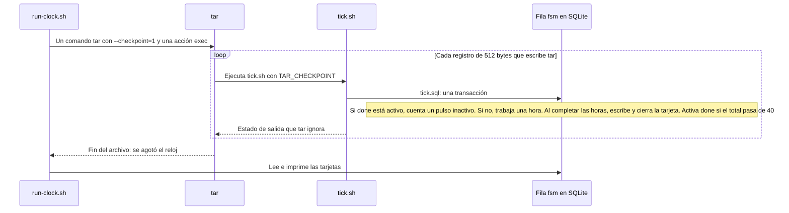

# GNU tar, más raro aún: el archivo es el reloj

**Te enseña:** que la disposición física de un archivo puede marcar el ritmo de un programa: los puntos de control de tar son un reloj y cada pulso hace avanzar un paso a una máquina de estados.

> **DEMO ONLY.** Tarjetas de horas ficticias que se guardan en un archivo temporal de SQLite en `$XDG_DATA_HOME/TarGnuWeird/`.
> Nada de esto afecta a los informes de horas reales.

GNU tar puede ejecutar un comando cada N registros mientras trabaja (`--checkpoint=N --checkpoint-action=exec=...`). Esta opción sirve para mostrar el avance. Aquí es el reloj del programa. **Cada punto de control equivale a una hora de trabajo.** Una pequeña máquina de estados da un paso por pulso. Trabaja una hora en la tarjeta abierta y la cierra al completar sus horas. Luego sortea la duración de la siguiente tarjeta y activa una bandera cuando el total pasa de 40. Nada más hace avanzar la máquina. Ningún bucle llama al pulso. Si tar no escribe registros, no pasan las horas.

```text
$ sh run-clock.sh --seed 42
# DEMO ONLY run 1: seed 42; layout 64 records in 1 member(s); tar -b 1 --checkpoint=1
Meetings	12	12	2026-W47	DEMO ONLY
Coding	17	29	2026-W47	DEMO ONLY
Debugging	17	46	2026-W47	DEMO ONLY
# committed total=46 entries=3 DEMO ONLY
# clock: last tick 64, idle ticks after the stop 18, tape 32768 bytes
```

Esta es la entrada **rara** de un par. Su compañera ordinaria, [`tar-gnu`](../tar-gnu/README.md), usa el *recorrido de los miembros* de tar para ejecutar un programa serializado. Esta ignora lo que dicen los miembros y solo usa *cuántos registros escribe tar*. La primera trata de lo que **significa** una disposición. Esta trata de **cuándo** ocurre.

## Ejecútalo

Necesitas **GNU tar** (se probaron 1.34 y 1.35), un intérprete de comandos (*shell*) POSIX, `od`, `mktemp`, `date` y `sqlite3`.

```bash
cd src/tar-gnu-weird
sh timecards.sh                       # run the demo (SEED=42 sh timecards.sh replays one exact run)
sh run-clock.sh --ticks 30            # a shorter archive: the clock runs out before the run ends (exit 3)
sh run-clock.sh --interval 2 --ticks 128    # tar ticks every 2nd record: 128 records, 64 ticks
sh run-clock.sh --blocking 4 --ticks 260    # tar -b 4: 65 records, so 65 ticks
./check.sh                            # every rule below, and the prediction tests
```

Los registros se guardan en `$XDG_DATA_HOME/TarGnuWeird/demo-timecards.db` (por omisión, `~/.local/share/TarGnuWeird/`). El archivo que escribió tar queda a su lado como `tape.tar`.

## Ejecútalo en un contenedor

Requisito: Docker, configurado una sola vez como se describe en [`SANDBOX-SETUP.md`](../../SANDBOX-SETUP.md#docker).

```bash
sandbox/container/run-image.sh src/tar-gnu-weird
```

Construye la imagen a partir del archivo [`Dockerfile`](Dockerfile) de esta carpeta y la ejecuta sin red, con un sistema de archivos de solo lectura y con el usuario `nobody`. La imagen incluye GNU tar (de la base de Ubuntu) y sqlite3 en un Ubuntu mínimo.

## Flujo del programa



**Qué muestra:** el programa es una máquina de estados en una fila de SQLite y el punto de control de tar es su reloj. Cada pulso es una transacción. tar no se detiene cuando termina la máquina. Sigue dando pulsos y los pulsos extra solo cuentan como inactivos.

**Por qué importa este mecanismo:** la disposición de un archivo funciona como fuente de eventos. El tamaño del archivo fija el número de pulsos. Si la disposición es demasiado corta, la máquina se atasca a mitad de una tarjeta. Los pulsos son llamadas a una función de devolución de llamada (*callback*), una función que tar ejecuta para el programa. El programa no espera esos eventos.

## Cómo funciona el truco

### El reloj

[`run-clock.sh`](run-clock.sh) dispone los datos, crea una máquina y ejecuta **un** comando `tar`:

```sh
tar --format=ustar -b 1 --checkpoint=1 --checkpoint-action="exec=sh .../tick.sh" -cf tape.tar -T list
```

Con `-b 1`, un *registro* es un bloque de 512 bytes. `--checkpoint=1` significa "en cada registro". Así, tar ejecuta `tick.sh` una vez por cada 512 bytes que escribe. tar asigna a `TAR_CHECKPOINT` el número de registros escritos hasta entonces e ignora el estado de salida del comando.

### La máquina

[`tick.sh`](tick.sh) ejecuta [`tick.sql`](tick.sql), que realiza una transición. Todo el estado cabe en una fila de la tabla `fsm`:

| Registro | Significado |
|---|---|
| `seed` | Estado del generador (Park-Miller, 48271 y 2147483647) |
| `card` | Tarjetas cerradas hasta ahora. El número selecciona la categoría: Meetings, Coding, Debugging, Learning, Meetings |
| `worked`, `target` | Horas trabajadas en la tarjeta abierta y cuánto durará (de 10 a 19 horas) |
| `total` | El total acumulado |
| `done` | Se activa cuando el total pasa de 40 al cerrar una tarjeta |
| `tick`, `idle` | El último `TAR_CHECKPOINT` y cuántos pulsos llegaron después de `done` |

Un pulso hace cuatro cosas en una transacción: (1) si `done`, cuenta un pulso inactivo y se detiene; (2) de lo contrario, trabaja una hora; (3) si `worked = target`, escribe la tarjeta; (4) luego la cierra. Al cerrarla, pasa a la siguiente categoría, sortea la siguiente duración y activa `done` si el total pasa de 40. La regla de parada es ese último `done = total > 40`. Se ejecuta *después* de escribir la tarjeta, así que se conserva la que hace pasar el total del límite.

| Tarea | Quién la hace |
|---|---|
| El paso del tiempo y el bucle | **Los puntos de control de tar**: una función de devolución de llamada por registro escrito |
| Qué hace un paso | `tick.sql`: una transacción |
| Horas aleatorias | El generador de `fsm.seed`, un sorteo por tarjeta cerrada |
| Regla de parada | `done`, que se activa en la transición que cierra la tarjeta con la que el total pasa del límite |
| Después de la parada | Los pulsos siguen (tar no se detiene) y solo incrementan `idle` |
| Persistencia | `sqlite3`, con restricciones `CHECK` |

### La disposición marca el ritmo

El archivo decide cuántos pulsos hay, sin intervención del programa. Para un comando de creación, donde `b` es el factor de bloqueo y `K` es el intervalo entre puntos de control:

```text
blocks = sum over members of (1 header + ceil(size / 512) data blocks) + 2 end-of-archive blocks
records = ceil(blocks / b)
ticks   = floor(records / K)
```

[`layout.sh`](layout.sh) escribe miembros llenos de ceros para que el archivo tenga el número de bloques que pidas. Una ejecución necesita de 41 a 59 pulsos. El total debe pasar de 40, así que es de al menos 41, y la ejecución más larga termina en 40 + 19 = 59. Por omisión hay 64 pulsos. Pide menos y la máquina **se atasca**: el reloj se agota a mitad de una tarjeta. La ejecución imprime lo que tiene, dice `the clock ran out` y termina con estado 3. `check.sh` no confía en que esto ocurra. Lo predice.

### Predicción en vez de observación

`check.sh` contiene una segunda implementación de la máquina en awk: el mismo generador y un bucle sobre los pulsos. Usa cinco semillas y trece disposiciones: de 20 a 260 bloques, factores de bloqueo de 1 a 8, intervalos de 1 a 5 y de uno a siete miembros. Calcula qué tarjetas debe haber cuando el reloj se detiene y si la ejecución termina o se atasca. Después ejecuta la entrada y compara los resultados. También comprueba el tamaño de la cinta (registros completos) y el último `TAR_CHECKPOINT`, que es `ticks × K`.

## Es solo un archivo tar, pero su disposición marca los tiempos del programa

En [`tar-gnu`](../tar-gnu/README.md#es-solo-un-archivo-tar-serialización-deserialización-y-ejecución), el *contenido* del archivo es el programa y el orden de los miembros es el orden de ejecución. Aquí los datos son ceros. El programa es la máquina en `tick.sql` y el archivo solo decide **cuándo** se ejecuta cada paso. Esa es otra cosa que puede hacer una disposición serializada: influye en cuándo ocurren los eventos además de en lo que significan. Cuanto más largo es el archivo, más pulsos hay. Cuanto mayor es el factor de bloqueo, menos pulsos hay. Cambia la disposición y cambiarán los tiempos, con los mismos bytes de "programa".

## Por qué es raro

Los puntos de control indican el avance. Nadie los diseñó para planificar la ejecución. Al usarlos para ello, tar se convierte en una fuente de eventos: **se invierte el flujo de control**. Lo habitual es que el programa llame a tar. Aquí tar llama al programa una vez por registro y el programa carece de un bucle propio. Es una función de devolución de llamada en un diseño dirigido por eventos y el reloj la hace avanzar.

## Qué comprueba `check.sh`

`check.sh` necesita GNU tar y sqlite3.

- **La restricción es real.** El único bucle de `run-clock.sh` y `tick.sh` es el del analizador sintáctico de argumentos. Hay exactamente un comando `tar`, el pulso es su acción de punto de control y el comando solo crea el archivo. `tick.sql` no tiene recursión, disparadores ni función aleatoria.
- **Las reglas del reto.** 20 ejecuciones aleatorias: categorías en orden, de 10 a 19 horas, totales correctos y parada la primera vez que el total pasa de 40. Se conserva la tarjeta con la que pasa del límite. También se comprueba que `DEMO ONLY` esté en todas partes, stderr quede vacío, se borre la carpeta temporal y haya al menos ocho valores de horas distintos en total.
- **Los invariantes del reloj.** Cada tarjeta se cierra en el pulso cuyo número coincide con su total acumulado. La ejecución por omisión recibe 64 pulsos y cada pulso posterior a la parada cuenta como inactivo.
- **Sin reloj no hay avance.** Con `--checkpoint=1000` y un archivo de 64 registros, no hay pulsos. No se escribe ninguna tarjeta, el estado se queda en cero y la ejecución termina con estado 3.
- **Predicciones.** Se comparan 65 ejecuciones con la simulación (ver arriba), incluidos los atascos. También se comprueba el tamaño de la cinta.
- **Los pulsos extra no cambian nada.** Un archivo de 600 registros da las mismas tarjetas que uno de 64.
- **Qué cuenta un punto de control.** En modo de creación, `floor(ceil(blocks / b) / K)`, con tamaños dispares, miembros vacíos y cinco pares de `b` y `K`.
- **Una función de devolución de llamada que falla.** En una copia de la entrada, la transición falla en cada pulso. tar termina de todos modos, no se escribe ninguna tarjeta, stderr recibe el error de SQL y la ejecución termina con estado 3.
- **Un `TAR_CHECKPOINT` inválido.** Si el valor no es un número, se rechaza antes de abrir la base de datos.
- **El esquema.** SQLite rechaza una fila ajena a la demostración, 9 horas y una quinta categoría.

## Trampas que conviene conocer

- **Qué promete GNU tar y qué vimos.** El manual documenta `--checkpoint=N`, `--checkpoint-action=exec=COMMAND` y la variable `TAR_CHECKPOINT`. Es comportamiento **permitido por la implementación**: solo GNU, fuera de POSIX. El manual dice además que un punto de control cuenta *registros*. Medimos cuántos registros escribe un comando para un conjunto dado de miembros. Lo hicimos con GNU tar 1.34 (Ubuntu 22.04) y 1.35 (Ubuntu 24.04 y 26.04). Las cifras coincidieron en todos los casos.
- **Un punto de control cuenta registros, no archivos.** Con `-b 1`, un registro tiene 512 bytes. El valor por omisión es `-b 20`. Así que un registro tiene 10 240 bytes y todo el archivo de demostración ocuparía tres registros. Por eso la entrada fija `-b 1`.
- **`TAR_CHECKPOINT` cuenta registros y la máquina cuenta funciones de devolución de llamada.** Con `--checkpoint=2`, la variable toma los valores 2, 4, 6 y así sucesivamente. La máquina sigue sumando una hora por llamada. Por eso la entrada cuenta llamadas y guarda la variable solo para registrar dónde se cerró cada tarjeta.
- **El modo cambia el recuento.** Crear el mismo archivo de 21 bloques da 21 pulsos. Listarlo con `-t` da 10, porque tar omite los datos que no necesita leer. Extraerlo vuelve a dar 21. Aquí solo se usa el modo de creación, que tiene la regla más sencilla. Trata la cifra del listado como un dato **aprovechado por accidente**, no como una promesa.
- **tar ignora el estado de salida de la función de devolución de llamada.** Un comando que termina con estado 7 deja el estado de tar en 0. Lo vimos en todas las versiones que probamos. La entrada no depende de eso. Como no se le puede pedir a tar que pare, la máquina hace que los pulsos extra sean inocuos. Si un pulso falla, la máquina simplemente no avanza.
- **tar sigue después de que se cumple la regla de parada.** Tras la tarjeta que hace pasar el total del límite, tar sigue escribiendo todos sus registros y ejecuta la función de devolución de llamada para cada uno. Esos son los 18 pulsos inactivos del ejemplo. Por eso el diseño usa una bandera `done` y no intenta terminar tar.
- **Dónde se ve el fallo de un pulso.** Si `tick.sql` falla, el mensaje de SQLite llega a stderr, tar sigue y la ejecución termina con `the clock ran out` y estado de salida 3.
- **tar no se llama de forma recursiva.** El comando del punto de control es `sh tick.sh` y ejecuta un `sqlite3`. Nunca inicia otro `tar`.
- **Es lento a propósito.** Unos 64 pulsos y un inicio de `sqlite3` por pulso: unas décimas de segundo. No uses un punto de control para planificar tareas.
- **El productor.** `layout.sh` genera la cinta aquí. `tar-gnu` podría escribirla en su lugar, pero entonces cada demostración dependería de la otra en CI y la entrada tendría que leer un programa que no usa. Las dos entradas siguen siendo independientes.

---

Consulta el [README de la raíz del repositorio](../../README.md#los-resultados-hasta-ahora) para comparar esta entrada con las demás. Si quieres escribir la tuya, consulta [`RETO.md`](../../RETO.md).
