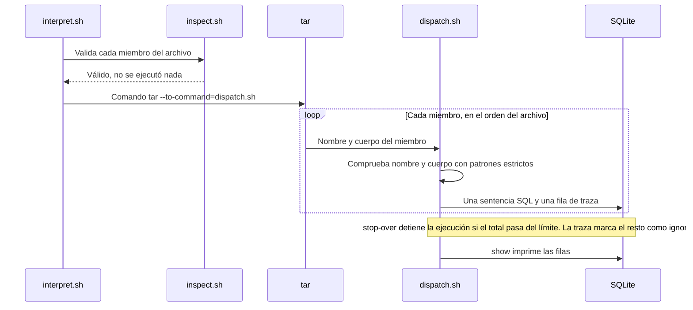

# GNU tar: es solo un archivo tar

**Te enseña:** que un archivo tar puede ser un programa serializado: tar lee los miembros en orden y solo el comando que indica el operador les da un efecto.

> **DEMO ONLY.** Tarjetas de horas ficticias que se guardan en un archivo temporal de SQLite en `$XDG_DATA_HOME/TarGnu/`.
> Nada de esto afecta a los informes de horas reales.

El programa es un archivo tar. Cada miembro es una instrucción: el nombre indica qué hacer y el cuerpo indica con qué. GNU tar recorre el archivo en orden y llama a un pequeño despachador por cada miembro (`tar --to-command=...`). El despachador sabe qué significan cinco palabras. No tiene bucle, dados, lista de categorías ni el número 40. Todo eso está en el archivo.

```text
$ tar -tvf program.tar
-rw-r--r-- 0/0   41 ... 000.begin
-rw-r--r-- 0/0   27 ... 010.card
-rw-r--r-- 0/0    9 ... 011.stop-over
 ...
-rw-r--r-- 0/0    0 ... 990.show

$ sh interpret.sh --execute program.tar
# DEMO ONLY run 1
Meetings	13	13	2026-W47	DEMO ONLY
Coding	11	24	2026-W47	DEMO ONLY
Debugging	13	37	2026-W47	DEMO ONLY
Learning	15	52	2026-W47	DEMO ONLY
# committed total=52 entries=4 DEMO ONLY
```

Esta es la entrada **idiomática** de un par. Usar `--to-command` es la forma documentada de pasar los miembros de un archivo a un programa. El mecanismo es común. Lo raro es su uso: un generador de tarjetas de horas que es un archivo. Su compañera, [`tar-gnu-weird`](../tar-gnu-weird/README.md), usa otra función de tar, los puntos de control, como reloj.

## Ejecútalo

Necesitas **GNU tar** (se probó 1.35), un intérprete de comandos (*shell*) POSIX, `od`, `mktemp`, `date` y `sqlite3`. El tar de BSD y macOS carece de `--to-command`.

```bash
cd src/tar-gnu
sh timecards.sh                     # build the archive, list it, inspect it, run it
SEED=42 sh timecards.sh             # replay one exact program (the seed is stored in the archive)
sh build-archive.sh --seed 7 --hours "12 14 19 10 10" program.tar   # write an archive with chosen hours
sh inspect.sh program.tar           # READ the program. Runs nothing from it.
sh interpret.sh --execute program.tar   # RUN the program. The flag is required.
./check.sh                          # every rule below
```

Los registros se guardan en `$XDG_DATA_HOME/TarGnu/demo-timecards.db` (por omisión, `~/.local/share/TarGnu/`). El archivo queda a su lado como `program.tar` para que puedas abrirlo.

## Ejecútalo en un contenedor

Requisito: Docker, configurado una sola vez como se describe en [`SANDBOX-SETUP.md`](../../SANDBOX-SETUP.md#docker).

```bash
sandbox/container/run-image.sh src/tar-gnu
```

Construye la imagen a partir del archivo [`Dockerfile`](Dockerfile) de esta carpeta y la ejecuta sin red, con un sistema de archivos de solo lectura y con el usuario `nobody`. La imagen incluye GNU tar (de la base de Ubuntu) y sqlite3 en un Ubuntu mínimo.

## Flujo del programa



**Qué muestra:** tar es el bucle y el archivo es el programa. Por cada miembro, tar pasa los bytes al despachador, que decide qué significa el nombre. El orden de los miembros es el orden de ejecución.

**Por qué importa este mecanismo:** leer y ejecutar son dos pasos distintos. El inspector analiza y comprueba todo sin ejecutar nada. El despachador ejecuta una sentencia SQL por miembro y no pasa ninguna parte del miembro a un intérprete de comandos. Esa es la diferencia entre datos que se *serializan* y datos que se *ejecutan*.

## Cómo funciona el truco

El archivo es el programa, tar es el bucle y el despachador es la máquina que da significado a cinco palabras.

```text
000.begin      format=tarprog/1, seed=N, label=DEMO ONLY     start a run
010.card       category=Meetings, hours=13                  add a card
011.stop-over  limit=40                                     halt if the total is over 40
020.card       category=Coding, hours=11
021.stop-over  limit=40
 ...           (five card slots in all)
990.show       (empty)                                      print the rows
```

| Tarea | Quién la hace |
|---|---|
| Bucle | **tar**, que recorre los miembros en el orden del archivo |
| Orden de las categorías | **El archivo**: posiciones de las tarjetas en el orden Meetings, Coding, Debugging, Learning, Meetings |
| Horas aleatorias | **El generador**, una sola vez, cuando escribe el programa. Usa un generador Park-Miller con semilla, que se guarda en `000.begin` |
| Total acumulado | El significado de `card`: suma las horas al último total (una sentencia SQL) |
| Regla de parada | **El archivo** contiene el límite (`limit=40` en cada miembro `stop-over`). El significado de `stop-over` es "detén la ejecución si el total pasa del límite". La ejecución detenida ignora el resto |
| Salida | El significado de `show` |
| Persistencia | `sqlite3`, con restricciones `CHECK` para la categoría, las horas y `DEMO ONLY` |

¿Por qué cinco posiciones para tarjetas? Cuatro tarjetas de 10 horas suman exactamente 40, así que el total no pasa de 40. Una quinta tarjeta siempre completa el trabajo, así que cinco posiciones bastan para toda ejecución posible. La ejecución suele detenerse con tres o cuatro tarjetas. El programa lee e ignora las posiciones sin usar (la tabla `trace` dice `ignored: halted`).

### El despachador

[`dispatch.sh`](dispatch.sh) es el intérprete. Tiene unas 80 líneas y la mayoría comprueba la afirmación sobre qué contiene la entrada de datos. Cumple cuatro tareas:

1. Comprueba el nombre del miembro con un patrón estricto. Reconoce cuatro nombres: `NNN.begin`, `NNN.card`, `NNN.stop-over` y `NNN.show`.
2. Comprueba el cuerpo del miembro: líneas correctas, palabras correctas y de 10 a 19 horas.
3. Ejecuta una sentencia SQL.
4. Registra lo que ocurrió en una tabla `trace`.

`check.sh` comprueba que el despachador no tenga `for`, `while`, `until`, `eval` ni `exec`, ni operaciones aritméticas del intérprete de comandos, ni dados, ni `40`.

### El generador, el inspector y el intérprete

Tres programas pequeños usan el mismo archivo:

- [`build-archive.sh`](build-archive.sh) **serializa** el programa. La misma semilla produce los mismos bytes porque fija el orden, las marcas de tiempo y los propietarios.
- [`inspect.sh`](inspect.sh) lo **lee**. Usa `tar -t` y `tar -xO` (extrae a la salida estándar) y nunca ejecuta nada del archivo. Comprueba la gramática de los registros de forma distinta al despachador, así que `check.sh` puede comparar ambas comprobaciones.
- [`interpret.sh`](interpret.sh) lo **ejecuta**. Debes pasar `--execute`. Primero pide al inspector que valide todo el archivo y solo después inicia `tar --to-command`.

## Es solo un archivo tar: serialización, deserialización y ejecución

Un archivo tar permite escribir archivos en un solo flujo de bytes. No es un formato de programa. Lo que convierte a este archivo en un programa es un *consumidor* que da significado a sus miembros. Esta sección separa los pasos. Consulta [Serialización, deserialización y empaquetado de objetos](../../lessons/informatica/06-estado-mas-alla-de-las-variables.md#serialization-deserialization-and-object-pickling) para ver las ideas generales.

1. **Codificar datos.** Una tarjeta son dos líneas en el cuerpo de un miembro: `category=Coding` y `hours=11`. Los datos están en los bytes del miembro.
2. **Codificar las instrucciones del programa y el contexto de interpretación.** Cada instrucción está en el *nombre* del miembro (`010.card`). El orden de los miembros es el orden de ejecución. El contexto es una promesa entre el programa que escribe y el lector: el formato `tarprog/1`. tar no sabe nada de ella. Dos programas que respetan la promesa se entienden entre sí y ningún otro programa puede entenderlos.
3. **Codificar el estado del programa.** El archivo contiene el estado *inicial*: la semilla y los dados ya tirados. El estado *en ejecución* está en SQLite: el total acumulado y si se detuvo la ejecución. Ese estado no está en el archivo y tar nunca modifica el archivo mientras lee.
4. **Capturar el estado de una ejecución en curso o sus continuaciones.** Esta entrada **no** lo hace. Si terminas el intérprete después de la segunda tarjeta, nada puede reanudarlo desde la tercera. Puedes arrancar todo el programa de nuevo. Eso produce las mismas tarjetas (repetición de la ejecución) y es distinto de continuar el proceso interrumpido.
5. **Empaquetado frente al tipo de archivo tar.** `pickle` de Python guarda una *receta para reconstruir objetos* y al desempaquetar llama a lo que indica la receta. tar guarda *archivos* y la extracción escribe archivos. Ambas operaciones son formas de serialización. Deserializar (separar los bytes en partes mediante análisis sintáctico) y ejecutar (dar un efecto a las partes) son dos pasos distintos. Pickle los une por diseño. Aquí puedes hacer el primero sin el segundo: `inspect.sh` analiza y muestra cada miembro sin ejecutar nada.
6. **Cómo un consumidor malicioso convierte bytes inertes en instrucciones.** Los bytes no tienen ese poder. El consumidor sí. Si el despachador pasara el cuerpo de `010.card` a un intérprete de comandos, cada tarjeta sería un comando. Este despachador no lo hace. Comprueba cada registro con un patrón estricto y no pasa ninguna parte del registro a un intérprete de comandos ni a otro intérprete. `check.sh` crea archivos de prueba con `$(touch ...)` dentro de las horas y con un miembro llamado `030.exec`. Demuestra que ninguno se ejecuta.
7. **Dos límites de confianza.** `tar -xf program.tar` escribe los miembros como archivos y no ejecuta nada. Un archivo **no puede registrar su propio gancho**. El poder viene de la línea de comandos: el operador elige `--to-command=...` y tar no le pide nada al archivo. El límite está en el comando que escribe el operador. Es la misma confianza que depositas en cualquier programa que inicias.

### Cuatro sentidos de "lo mismo"

| Tipo | Afirmación de esta entrada | Cómo la prueba `check.sh` |
|---|---|---|
| Byte por byte | La misma semilla produce los mismos bytes del archivo | `cmp` de dos compilaciones |
| Estructura y estado | Las tarjetas que decodifica el inspector son las que contiene la base de datos | Compara las dos listas |
| Comportamiento | Ejecutar el mismo archivo en dos bases de datos nuevas produce las mismas tarjetas | Compara las filas |
| Proceso en curso | **No se afirma** | Volver a ejecutar en la misma base de datos crea otra ejecución. Ninguna reanuda la anterior |

La repetición tampoco es **idempotente**: ejecutar el mismo archivo dos veces en una base de datos agrega otra ejecución con las mismas tarjetas. La repetición determinista y la idempotencia son propiedades distintas.

## Por qué esto es idiomático

`--to-command` aparece en el manual de GNU tar, en "Extracting Files to a Program". Sirve para tareas como pasar cada miembro por un filtro. Esta entrada lo usa tal como se documenta: un proceso por miembro regular, sus bytes en la entrada de datos estándar y sus detalles en las variables de entorno `TAR_*`. Lo inusual no es el mecanismo. Es usar un archivo como programa y hacer que la persona que lo ejecuta indique el intérprete.

## Qué comprueba `check.sh`

`check.sh` necesita GNU tar y sqlite3.

- **La restricción es real.** `dispatch.sh` no tiene `for`, `while`, `until`, `eval` ni `exec`. Tampoco tiene operaciones aritméticas del intérprete de comandos, fuente de azar ni `40`. `inspect.sh` no tiene `--to-command`, `sqlite3` ni `eval`.
- **Las reglas del reto.** 25 ejecuciones aleatorias: categorías en orden, de 10 a 19 horas y totales acumulados correctos. La ejecución se detiene justo después de que el total pasa de 40 por primera vez y conserva la tarjeta con la que pasa del límite. Se comprueba `DEMO ONLY` en cada fila, la coincidencia entre las filas de SQLite y las impresas, que stderr quede vacío y que haya al menos ocho valores de horas distintos.
- **Dados trucados.** Siete programas con horas elegidas se comparan con una simulación aparte. Un total de exactamente 40 debe continuar. Las tarjetas sin usar deben aparecer como `ignored: halted` en la traza.
- **Cuatro sentidos de "lo mismo".** Consulta la tabla anterior.
- **Coincidencia.** El inspector, `tar -t` y la traza del despachador dan la misma lista de doce miembros en el mismo orden.
- **Consumidores pasivos.** `tar -t`, `tar -xf` sin opciones adicionales y el inspector no ejecutan nada de un archivo hostil. La prueba usa archivos señuelo y sustitutos de `sqlite3` y `date` que hacen fallar la prueba si algo los llama.
- **Rechazo ante fallos.** Sin `--execute` no hay ejecución. La comprobación previa rechaza un archivo hostil antes de que arranque nada. Si se omite la comprobación previa (se llama directamente a `tar --to-command`), el despachador rechaza el registro inválido **y todos los siguientes**. El estado de salida de tar es distinto de cero. Se rechazan estos miembros inválidos: horas por debajo de 10, horas por encima de 19, horas con un comando, categoría desconocida y línea extra. También se rechazan un nombre inválido, un nombre con ruta, un cuerpo demasiado grande y un tipo de registro desconocido. El inspector señala también los miembros de tipo directorio y enlace simbólico.
- **El esquema.** SQLite rechaza una fila ajena a la demostración, 9 horas y una quinta categoría.

## Qué puedes aprender

- **Los datos se vuelven código cuando un consumidor los trata como tal.** Los mismos bytes son un listado, un conjunto de archivos o un programa, según el comando.
- **Primero analiza, después ejecuta.** Un lector pasivo del mismo formato te permite hacer una revisión del programa antes de ejecutarlo.
- **Rechazo ante fallos.** Un registro desconocido es un error. El programa no lo omite ni adivina su significado.
- **Di en qué sentido dices "lo mismo".** Los bytes, la estructura, el comportamiento y un proceso en curso son cuatro promesas distintas.
- **Un formato es un contrato entre dos programas.** tar no definió `tarprog/1`. El generador y el despachador acordaron el formato. Solo una prueba comprueba que sigan al mismo paso.

## Trampas que conviene conocer

- **Solo GNU.** `--to-command` es una extensión de GNU, al igual que `--occurrence`, que usa el inspector. Ambas son parte del comportamiento **permitido por la implementación**: el manual de GNU las documenta y el tar de POSIX carece de ellas. Solo probamos GNU tar 1.35.
- **tar no se detiene cuando falla el comando.** Lo probamos. tar informa el estado del proceso hijo (`Child returned status 1`), sigue leyendo y al final termina con estado 2. Por eso el despachador guarda `faulted` en la base de datos y rechaza por su cuenta todos los miembros posteriores. La parada es del intérprete y **tar no la garantiza**.
- **Qué miembros llegan al comando.** Solo los archivos regulares. Los directorios, enlaces simbólicos y enlaces duros no llegan. tar omite sin aviso un enlace duro a un miembro anterior, así que el comando no se ejecuta dos veces. El inspector informa qué miembros no son archivos y la comprobación previa los rechaza.
- **Los nombres duplicados se ejecutan dos veces, en orden.** tar conserva los duplicados. El inspector usa `--occurrence=N` para mostrar cada uno.
- **tar te protege de `..`.** El propio tar rechaza un miembro llamado `../x` ("Member name contains '..'") antes de ejecutar cualquier comando. tar sí entrega un nombre de miembro con un salto de línea. Por eso el despachador comprueba la coincidencia con un patrón que excluye esos nombres.
- **La variable es `TAR_FILETYPE`.** No `TAR_TYPE`. En 1.35 el despachador lee `TAR_FILENAME` y `TAR_SIZE`. Un archivo pax también agrega `TAR_ATIME` y `TAR_CTIME`, así que esta entrada escribe archivos `ustar`. Así los bytes son reproducibles.
- **Los dados se tiran durante la compilación.** El archivo contiene las cinco tarjetas y también se tiraron los dados para las que quedan sin usar. Si quieres tirar los dados durante la ejecución del programa, el intérprete necesitaría una fuente de azar. La particularidad de esta entrada es que carece de ella.
- **Una ejecución corta desperdicia posiciones.** La ejecución válida más corta tiene tres tarjetas (19 + 19 + 19). El programa lee e ignora las últimas dos posiciones.
- **SQLite se encarga de cómo viaja el dato.** La sentencia `card` hace una suma en SQL. Eso es lo que significa `card` y es el único lugar donde hay operaciones aritméticas. La comprobación de parada está en `stop-over` y su límite viene del archivo.

---

Consulta el [README de la raíz del repositorio](../../README.md#los-resultados-hasta-ahora) para comparar esta entrada con las demás. Si quieres escribir la tuya, consulta [`RETO.md`](../../RETO.md).
