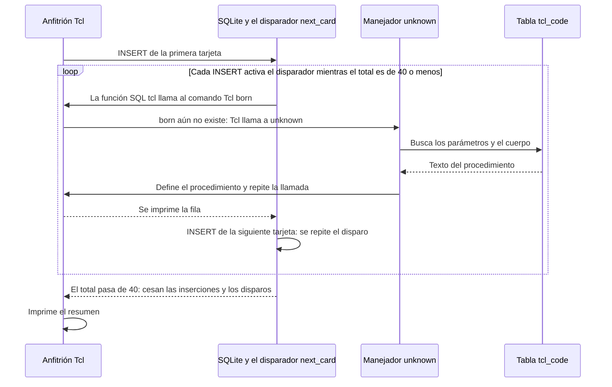

# Tcl, todavía más raro

**Te enseña:** que el código Tcl se compone solo de cadenas de texto. Por eso puede residir en una base de datos, recuperarse, definirse y ejecutarse bajo demanda. Los disparadores de SQLite determinan el flujo de control.

> **DEMO ONLY.** Tarjetas de horas ficticias en un archivo temporal de SQLite. Sin conexión con ningún sistema real de registro de horas.

[`timecards.tcl`](timecards.tcl) **no define ningún bucle en Tcl ni ningún procedimiento de Tcl que saque o imprima una tarjeta**. El programa está en las filas de una tabla de SQLite. Basta un `INSERT` de la tarjeta 1 para ponerlo en marcha. Un **disparador recursivo** inserta la siguiente tarjeta mientras el total no pasa de 40. Cada inserción llama a procedimientos de Tcl que solo existen como TEXT en una tabla. Una versión redefinida de `unknown` los carga en el intérprete bajo demanda. Con `--gui`, hasta la ventana se reduce a unas cuantas filas.

La versión convencional está en [`tcl`](../tcl/README.md).

## Ejecútalo

Necesitas Tcl 8.6 (`tclsh`) con el paquete Tcl `sqlite3` (Ubuntu: `tcl8.6`, `libsqlite3-tcl`). Para `--gui` necesitas `tk8.6`.

```bash
cd src/tcl-weird
tclsh timecards.tcl                        # text
tclsh timecards.tcl --gui --seconds 3      # also a window, built from rows; closes after 3 seconds
./check.sh                                 # set TCLSH=/path/to/tclsh if it is not on your PATH
```

Los registros se guardan en `$XDG_DATA_HOME/TclWeird/demo-timecards.db` (`~/.local/share/TclWeird/` de forma predeterminada). Una ejecución se ve así:

```text
# DEMO ONLY run 1794860980-15
Meetings	15	15	2026-W47	DEMO ONLY
Coding	13	28	2026-W47	DEMO ONLY
Debugging	17	45	2026-W47	DEMO ONLY
# committed total=45 entries=3 DEMO ONLY
# every proc that ran was fetched from SQLite by unknown: born category hours init runid week
# the loop was a recursive trigger, and one INSERT started it
# the window was built from 8 rows of the ui table
```

La línea `unknown:` muestra introspección real: el programa examina su propio funcionamiento. El manejador `unknown` registra cada nombre que define. Al final se imprime la lista. La última línea solo aparece con `--gui`. **Sin pantalla:** Tk necesita una pantalla X. `xvfb-run -a tclsh timecards.tcl --gui --seconds 1` funciona y la imagen de contenedor de abajo se ejecuta en Xvfb y toma una captura de la ventana.

## Flujo del programa



**Qué muestra:** el bucle es un disparador que inserta una fila y así vuelve a activarse. Cada número y cada línea impresa provienen de código Tcl guardado como texto en una tabla. La primera llamada a un procedimiento da un rodeo por `unknown` y la tabla. Las demás ya encuentran el procedimiento definido.

**Por qué importa este mecanismo:** la base de datos dirige las llamadas, pero no es una cola de eventos. El disparador se ejecuta de forma síncrona dentro de `INSERT`. La recursión hace de bucle. El `WHERE` de la inserción del disparador es la regla de parada. El control pasa por tres capas (Tcl, SQL, Tcl) en una sola pila de llamadas.

## Cómo funciona el truco

Tres interceptores y luego un programa escrito en SQL.

### Interceptor 1: SQL puede llamar a Tcl

```tcl
proc call {command args} { $command {*}$args }
db function tcl call
```

`db function name script` registra un comando Tcl como **función SQL**. A partir de ahí, cualquier código SQL, incluso el de un disparador, puede usar `tcl('hours')` o `tcl('category', 3)`. SQLite vuelve al intérprete y llama a `call hours` o `call category 3`, respectivamente. En Tcl, `{*}$args` significa "expande esta lista en palabras separadas".

### Interceptor 2: la base de datos sirve de ruta de búsqueda de bibliotecas

```tcl
rename unknown _unknown
proc unknown {name args} {
    if {[db exists {SELECT 1 FROM tcl_code WHERE name = $name}]} {
        db eval {SELECT params, body FROM tcl_code WHERE name = $name} {}
        proc $name $params $body
        lappend ::loaded $name
        return [uplevel 1 [list $name {*}$args]]
    }
    tailcall _unknown $name {*}$args
}
```

Si le pides a Tcl que ejecute un comando que no existe, llama a un comando llamado `unknown`. Así funcionan `auto_load` y las abreviaturas de comandos en el intérprete de comandos interactivo (*shell*). Esta versión lo sustituye: busca el nombre en la tabla `tcl_code` y crea el procedimiento con `proc $name $params $body`. Usa el texto de la fila como cuerpo y **repite la llamada**. A partir de ahí, el procedimiento ya existe. La siguiente llamada no toca la base de datos. Todo lo que no aparece en la tabla pasa al manejador original. Así, los errores de escritura siguen produciendo el fallo esperado.

### Interceptor 3: el programa es una tabla TEMP y un disparador TEMP

```sql
CREATE TEMP TABLE tcl_code(name TEXT PRIMARY KEY, params TEXT, body TEXT);
INSERT INTO tcl_code VALUES
    ('hours', '', 'expr {10 + int(rand() * 10)}'),
    ('category', 'n', 'lindex {Meetings Coding Debugging Learning} [expr {($n - 1) % 4}]'),
    ('born', 'category hours total week', 'puts [join [list $category ...] \t] ...'), ...
```

El código Tcl *es* texto, así que cabe en una columna. (Las tablas y los disparadores `TEMP` pertenecen a la conexión y desaparecen al cerrarla. Por eso el archivo en disco solo contiene las tarjetas de horas. `check.sh` lo verifica). El programa anida tres capas de lenguaje en un archivo: Tcl contiene SQL, que a su vez contiene Tcl. Las llaves se anidan y Tcl no sustituye nada dentro de ellas. Así llega intacto el texto.

### El bucle es un disparador

```sql
CREATE TEMP TRIGGER next_card AFTER INSERT ON main.demo_timecards
BEGIN
    SELECT tcl('born', NEW.category, NEW.hours, NEW.running_total, NEW.iso_week);
    UPDATE draw SET h = tcl('hours') WHERE NEW.running_total <= 40;
    INSERT INTO demo_timecards(...)
    SELECT NEW.run_id, tcl('category', (SELECT count(*) ...) + 1),
           h, NEW.running_total + h, NEW.iso_week, datetime('now')
    FROM draw
    WHERE NEW.running_total <= 40;
END;
```

El disparador se activa al insertar una fila. Primero llama a `born` (imprime la fila y, si hay ventana, agrega una fila a la tabla). Luego sortea las horas de la siguiente tarjeta y las guarda en `draw`, una tabla TEMP de una fila. Inserta la siguiente tarjeta **si el total es de 40 o menos**: ese `WHERE` es la regla de parada. Las horas pasan por `draw` porque se usan dos veces, como horas y en el total acumulado. Una fila guarda un solo valor por más veces que SQLite evalúe una función. La inserción vuelve a activar el mismo disparador. `PRAGMA recursive_triggers = ON` lo permite. Sin esa opción, SQLite impide que un disparador se active a sí mismo. La profundidad de la recursión *es* el número de tarjetas.

### Una sola sentencia

```tcl
db eval {SELECT tcl('init')}                       ;# seeds rand()
db transaction {
    db eval {
        UPDATE draw SET h = tcl('hours');
        INSERT INTO main.demo_timecards(...)
        SELECT tcl('runid'), tcl('category', 1), h, h, tcl('week'), datetime('now')
        FROM draw
    }
}
```

Eso es todo lo que ejecuta el programa: insertar la tarjeta 1. Después, el disparador llama a Tcl y los procedimientos Tcl se cargan bajo demanda desde la tabla que consulta el disparador.

### `--gui`: controles de interfaz en filas

```sql
CREATE TEMP TABLE ui(id INTEGER PRIMARY KEY, command TEXT);
INSERT INTO ui(command) VALUES
    ('ttk::treeview .cards -columns {category hours total week} -show headings -height 6'),
    ('.cards heading category -text Category'), ... ('pack .cards ...'), ('ttk::label .note -textvariable ::summary'), ...
```

`SELECT tcl('uplevel', '#0', command) FROM ui ORDER BY id` ejecuta cada fila en el ámbito global. Un solo SELECT arma la ventana. Cuando se ejecuta `born`, comprueba `info commands .cards`. Si el control existe, inserta una fila en él y la tabla se llena cada vez que se activa el disparador. `update` redibuja la ventana y `after 400` reduce el ritmo lo suficiente para verlo.

## Por qué es raro

La afirmación de partida de Tcl es que "todo es una cadena de texto". Este programa la toma al pie de la letra. Los procedimientos son cadenas de texto en una tabla y el bucle es una función de la base de datos. El propio mecanismo del intérprete para comandos inexistentes hace de cargador. SQL llama a Tcl y Tcl llama a SQL. *Cuál* de los dos es "el programa" depende de dónde te pares. Quien programe en Tcl reconocerá `unknown` y `uplevel`. Muy pocos los habrán visto funcionar como cargador automático desde una base de datos. Quien programe en SQL reconocerá un disparador recursivo y se sorprenderá de que sea el único bucle.

Por qué podrían despedirte: el flujo de control de un programa queda oculto en un disparador y un pragma. Ni grep ni la vista del código fuente de un depurador encuentran los procedimientos. Los interceptores de `unknown` vuelven confusos los errores de escritura en el código ajeno. En cuanto alguien ejecute esto contra una base de datos *compartida*, cada inserción hará llamadas al intérprete. No guardes código en una tabla de datos donde otras personas puedan escribir.

## Qué puedes aprender

- `unknown` y cómo funciona realmente la carga automática en Tcl. `rename`, `tailcall` y `uplevel` permiten envolver comandos de forma transparente.
- `proc` como operación *en tiempo de ejecución*: una llamada a un comando crea un procedimiento cuyo cuerpo es una cadena de texto.
- La expansión `{*}`, `uplevel #0` y el uso de `info commands` para comprobar si una función está disponible.
- `db function` del paquete `sqlite3`, que expone cualquier comando Tcl a SQL.
- Los disparadores recursivos (`PRAGMA recursive_triggers`) y los disparadores y tablas `TEMP`. El cuerpo de un disparador puede contener un `SELECT`. SQLite descarta el resultado, pero ejecuta las llamadas a funciones.
- `$name` es solo texto cuando aparece en un literal de cadena de texto de SQL dentro de llaves de Tcl. La regla de variables enlazadas solo rige en el propio SQL. Por eso se puede guardar código que contenga `$n`.

## Prueba de que los mecanismos hacen el trabajo

`check.sh` lo demuestra al editar copias del archivo:

- **Recursión.** Cambia `PRAGMA recursive_triggers = ON` por `OFF` y se anuncia exactamente una tarjeta en vez de entre tres y cinco. El disparador solo se activa para la tarjeta 1.
- **Código en la tabla.** Sustituye por `expr {19}` el texto de la fila `hours`. Cada ejecución imprime tres tarjetas de 19 horas: las horas salen de la fila y de ninguna parte del código Tcl.
- **Carga automática.** La ejecución informa que `unknown` recuperó `born category hours init runid week`. Una comprobación estática muestra que solo se definen dos procedimientos en Tcl (`call` y `unknown`).
- **Ningún comando de bucle.** Si quitas los comentarios, en el archivo no aparece ninguno de estos comandos: `while`, `for`, `foreach`, `lmap` y `dict for`.
- **No quedan rastros.** Tras una ejecución, `sqlite_master` del archivo solo lista `demo_timecards`.

## Trampas que conviene conocer

- **Si el resultado de una función se usa dos veces, se sortea una vez y se guarda.** Las horas aparecen dos veces en la fila nueva (como horas y dentro del total acumulado). Si se llamara dos veces a una función aleatoria, daría dos valores distintos y el total acumulado dejaría de cuadrar. Una versión anterior ponía la llamada en una subconsulta y dependía de que SQLite la evaluara una vez por fila. SQLite no promete eso para funciones no deterministas. Ahora las horas se escriben en `draw`, una tabla TEMP de una fila. De ahí se leen dos veces. `check.sh` cuenta las llamadas al procedimiento `hours` y exige una por tarjeta.
- **Nombres calificados en los disparadores.** SQLite rechaza `INSERT INTO main.demo_timecards` dentro de un disparador ("qualified table names are not allowed"). Por eso el cuerpo usa el nombre sin calificar. El disparador es `TEMP`, así que ese nombre corresponde a la única tabla de `main`.
- **Si tclsh cargó Tk, no sale** al terminar el script mientras exista la ventana principal. Por eso el script termina con `destroy .`.
- **Profundidad.** SQLite limita la recursión de los disparadores (1000 por defecto). El reto necesita de 3 a 5 niveles.
- **Confianza.** `unknown` ejecuta cualquier texto que esté en la tabla. Aquí el propio programa arma la tabla en memoria. Este patrón no se debe usar con datos que otras personas puedan editar.
- **Requisitos.** El programa necesita el paquete Tcl `sqlite3` y, para la ventana, Tk. Se probó con Tcl 8.6.14 y SQLite 3.45.
- **Formato.** No había un formateador para Tcl. El formato se aplicó a mano. El SQL sigue el formato de las otras entradas.

## Qué comprueba `check.sh`

Comprueba todo lo anterior. Luego ejecuta `--gui --seconds 1` con Xvfb y exige que se informe que la ventana se armó con 8 filas. Si no hay Xvfb ni `DISPLAY`, omite esa ejecución y lo indica. Después comprueba los registros de 25 ejecuciones reales: de 10 a 19 horas, categorías en orden, totales correctos y parada cuando el total pasa de 40. SQLite debe coincidir con la salida.

## Ejecútalo en un contenedor

Requisito previo: Docker, configurado una sola vez según [`SANDBOX-SETUP.md`](../../SANDBOX-SETUP.md#docker). La imagen base `cc-rt-tcl` proviene de `sandbox/container/build-bases.sh`.

```bash
sandbox/container/run-image.sh src/tcl-weird
sandbox/container/run-image.sh --out ./results src/tcl-weird    # the folder must be writable by user nobody
```

Construye la imagen con [`Dockerfile`](Dockerfile) de esta carpeta. Ejecuta `--gui` en una pantalla virtual sin red, con un sistema de archivos de solo lectura y el usuario `nobody`. Toma una captura de la ventana e imprime la salida y las filas escritas. La imagen contiene Tcl/Tk, el paquete Tcl sqlite3 y sqlite3 sobre un Ubuntu mínimo.
