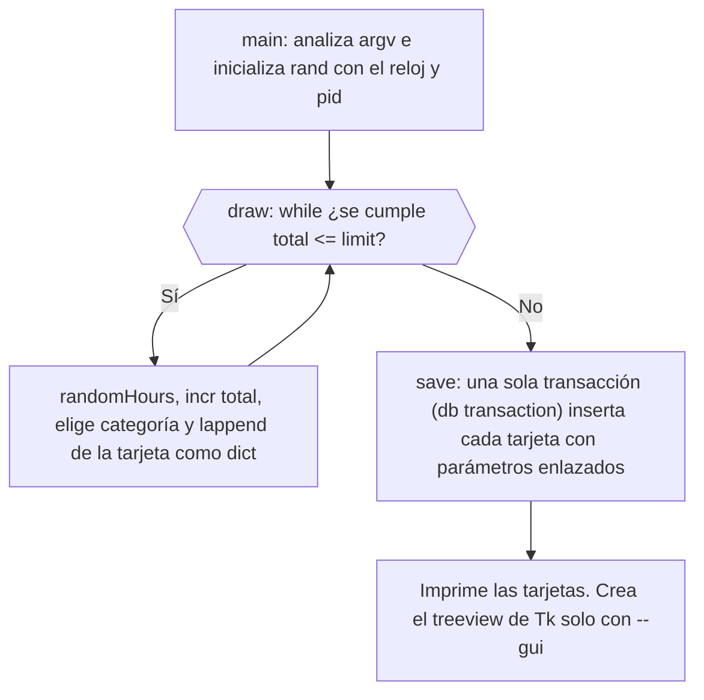

# Tcl

**Te enseña:** que el Tcl idiomático agrupa los procedimientos en un espacio de nombres y usa diccionarios para los registros. Usa `expr` entre llaves y `db eval` para enlazar variables Tcl en SQL.

> **DEMO ONLY.** Tarjetas de horas ficticias en un archivo temporal de SQLite. Sin conexión con ningún sistema real de registro de horas.

Esta es la versión convencional, la que muestra cómo se *suele* escribir Tcl. El reto ("agrega tarjetas de 10 a 19 horas y detente cuando el total pasa de 40") se resuelve con un bucle `while` en el procedimiento `timecards::draw`. El resto de [`timecards.tcl`](timecards.tcl) son procedimientos breves que hacen una sola tarea cada uno. Hay una ventana Tk opcional. La versión rara está en [`tcl-weird`](../tcl-weird/README.md). Allí el bucle es un disparador SQL recursivo y el código reside en la base de datos.

## Ejecútalo

Necesitas Tcl 8.6 (`tclsh`) con el paquete Tcl `sqlite3` (Ubuntu: `tcl8.6` y `libsqlite3-tcl`). Solo necesitas Tk (`tk8.6`) para `--gui`.

```bash
cd src/tcl
tclsh timecards.tcl                      # text
tclsh timecards.tcl --gui                # also open a window; close it to finish
tclsh timecards.tcl --gui --seconds 3    # ...or let it close itself after 3 seconds
./check.sh                               # set TCLSH=/path/to/tclsh if it is not on your PATH
```

Los registros se guardan en `$XDG_DATA_HOME/Tcl/demo-timecards.db` (`~/.local/share/Tcl/` de forma predeterminada). Una ejecución se ve así:

```text
# DEMO ONLY run 1794860932-15
Reuniones	14	14	2026-W47	DEMO ONLY
Programación	10	24	2026-W47	DEMO ONLY
Depuración	14	38	2026-W47	DEMO ONLY
Aprendizaje	16	54	2026-W47	DEMO ONLY
# committed total=54 entries=4 DEMO ONLY
# one while loop, cards as dicts, and db eval binding Tcl variables as SQL parameters
```

Con `--gui` aparece una ventana pequeña con una tabla y debajo la línea "DEMO ONLY". **Sin pantalla:** Tk necesita una pantalla X. Si no tienes una, ejecútalo bajo `xvfb-run -a tclsh timecards.tcl --gui --seconds 1`. La imagen de contenedor de abajo hace eso mismo y toma una captura de pantalla. La versión de texto no requiere pantalla. Solo carga Tk si lo pides.

## Qué hace

El programa sortea de 10 a 19 horas por tarjeta. Las categorías se repiten en ciclo: `Reuniones` (reuniones), `Programación` (programación), `Depuración` (depuración) y `Aprendizaje` (aprendizaje). Se detiene cuando el total acumulado pasa de 40 y conserva la primera tarjeta con la que el total pasa del tope. Imprime cada tarjeta y las guarda en SQLite en una sola transacción.

## Flujo del programa



**Qué muestra:** la estructura convencional de Tcl. Un `while` es el bucle, un dict es la tarjeta y `db transaction` hace que se guarde todo o nada. Una condición de entrada en torno a `main` permite que las comprobaciones carguen el archivo con `source` y prueben `draw` en el mismo proceso.

**Por qué importa este mecanismo:** el programa primero sortea y después guarda. Así la lista de tarjetas está completa antes de que llegue a la base de datos. El `while` de Tcl vuelve a evaluar su condición en cada pasada. Como la evalúa antes de sortear, conserva la tarjeta que hace que el total supere el límite. La variante rara [`tcl-weird`](../tcl-weird/README.md) traslada el bucle a la base de datos.

## Cómo funciona el truco

1. **Un espacio de nombres para las reglas.** `namespace eval timecards { variable ... }` guarda las categorías y los límites. Cada procedimiento se llama `timecards::name`. Así un programa Tcl de un solo archivo evita contaminar el espacio de nombres global.
2. **`randomHours`.** `expr {$minHours + int(rand() * ($maxHours - $minHours + 1))}`. Pon siempre la expresión entre llaves. Sin ellas, Tcl haría sustituciones y volvería a analizar la expresión. Eso es más lento (sin bytecode) y abre una vía clásica para la inyección de código.
3. **`draw`, el reto.**
   ```tcl
   while {$total <= $limit} {
       set hours [randomHours]
       incr total $hours
       set category [lindex $categories [expr {[llength $cards] % [llength $categories]}]]
       lappend cards [dict create category $category hours $hours total $total]
   }
   ```
   La prueba se hace *antes* de cada sorteo. Por eso, la primera tarjeta con la que el total pasa de 40 es la última que se agrega y se conserva. Una tarjeta es un **dict** (una lista de pares clave-valor con una estructura de datos real por debajo).
4. **`save`.** `sqlite3 [namespace current]::db path` crea un *comando* llamado `db`. Toda operación sobre la base de datos es un subcomando. `db transaction {...}` se encarga de la confirmación de la transacción o la revierte. En `db eval {INSERT ... VALUES ($runId, $category, ...)}`, los `$names` son **parámetros enlazados**. Tcl entrega los *valores* a SQLite en vez de pegar texto en SQL, así que las comillas no son un problema. Primero `dict with card { ... }` desglosa las claves de una tarjeta en variables locales. Los nombres solo sirven para el enlace.
5. **`try ... finally`** cierra la base de datos incluso si algo falla.
6. **`main`** analiza `--gui` y `--seconds` con un bucle `while`/`lassign`/`switch` (la forma habitual de recorrer `argv`). Inicializa `rand()` con el reloj de microsegundos y el id de proceso. Luego sortea, guarda e imprime.
7. **La condición de entrada.** `if {[info exists argv0] && [file normalize $argv0] eq [file normalize [info script]]}` ejecuta `main` solo cuando el archivo se ejecuta como script. Es el `if __name__ == "__main__"` de Tcl. Permite que `check.sh` cargue el archivo con `source` y haga una prueba unitaria de `draw` 2000 veces en un solo proceso.
8. **Tk, solo si lo pides.** `package require Tk` ocurre dentro de `showWindow`. Crea un `ttk::treeview` con un encabezado y una fila por tarjeta.

## Por qué es idiomático

- **Todo es un comando** y el programa es un conjunto de procedimientos dentro de un espacio de nombres. Los comentarios dicen qué devuelve cada uno.
- **Todo entre llaves**: `expr {...}`, `while {...}` y `if {...}`. No hay expresiones sin llaves (`check.sh` las busca con grep).
- **Diccionarios para registros y listas para secuencias**, `lindex`/`lappend`/`llength` en vez de hacer aritmética con índices de cadenas de texto.
- **Variables como parámetros SQL** en vez de armar cadenas de texto.
- **Uso seguro de recursos** con `try ... finally` y `db transaction` para garantizar la atomicidad, es decir, guardar todo o nada.
- **Tk es opcional y se carga bajo demanda**. Usa los controles con tema de `ttk::` en vez de los de los años 1990.

## Qué puedes aprender

- La regla de Tcl de que *todo es una cadena de texto* y qué costos y ventajas trae. Por qué `expr` necesita llaves, por qué existe `{*}` ("expande") y por qué `$` y `[ ]` son las únicas sustituciones.
- `namespace eval`, `variable`, `proc ns::name` y `namespace current`.
- `dict create`, `dict get`, `dict with`.
- El modelo de un comando por base de datos del paquete `sqlite3`, `eval`, `transaction` y las variables enlazadas.
- La condición de entrada `info script` / `argv0` para un archivo que es a la vez programa y biblioteca.

## Trampas que conviene conocer

- **Si tclsh cargó Tk, no sale al terminar el script** mientras exista la ventana principal. Por eso `showWindow` termina con `destroy .`. Sin él, el proceso queda colgado (esto se observó con `xvfb-run`).
- **Semanas ISO.** `clock format -format %G-W%V` da el año y la semana según ISO-8601. `%Y` y `%U` dan cosas distintas y no coinciden en torno al Año Nuevo.
- **`rand()` no es criptográfico** y Tcl lo inicializa por proceso. Se llama a `srand` de forma explícita para que dos programas iniciados en el mismo segundo no compartan semilla.
- **El paquete `sqlite3` no viene con Tcl.** Es un paquete aparte (`libsqlite3-tcl` o la extensión Tcl `sqlite3` compilada con SQLite).
- **Formato.** Aquí Tcl no cuenta con un formateador ni un analizador de estilo estándar (`nagelfar` no estaba disponible). El formato se aplicó a mano según la guía de estilo de Tcl. Usa 4 espacios, llaves en la misma línea y documentación encima de cada definición de procedimiento. `check.sh` confirma que el archivo es un script Tcl *completo* (`info complete`) y que cada `expr` va entre llaves.

## Qué comprueba `check.sh`

Comprueba que aparece el marcador `DEMO ONLY` y que ningún texto hace pensar en acceso a la red. `draw` es un `while` sobre el límite. No hay `expr` sin llaves. El archivo es un script completo. Después carga el archivo y llama a `draw` 2000 veces. En cada reparto comprueba de 10 a 19 horas por tarjeta, totales acumulados correctos, categorías en orden y de 3 a 5 tarjetas. Comprueba que no salga otra tarjeta cuando el total pasa de 40. Si hay Xvfb (o `DISPLAY`), ejecuta `--gui --seconds 1`. Si no, dice "gui: SKIPPED". Por último, comprueba los registros de 25 ejecuciones reales y que SQLite coincida con la salida impresa.

## Ejecútalo en un contenedor

Requisito previo: Docker, configurado una sola vez según [`SANDBOX-SETUP.md`](../../SANDBOX-SETUP.md#docker). La imagen base `cc-rt-tcl` proviene de `sandbox/container/build-bases.sh`.

```bash
sandbox/container/run-image.sh src/tcl
sandbox/container/run-image.sh --out ./results src/tcl     # copies screenshot.png and the rows there (the folder must be writable by user nobody)
```

Construye la imagen con [`Dockerfile`](Dockerfile) de esta carpeta. Ejecuta `--gui` en una pantalla virtual (Xvfb) sin red, con un sistema de archivos de solo lectura y el usuario `nobody`. Toma una captura de la ventana e imprime la salida y una vista de solo lectura de las filas escritas. La imagen contiene Tcl/Tk, el paquete Tcl sqlite3 y sqlite3 sobre un Ubuntu mínimo.
