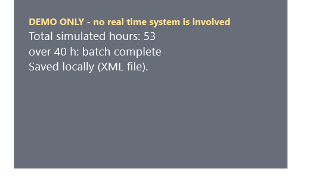
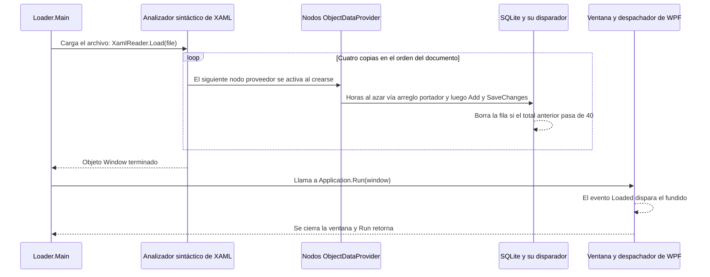

# Reto de XAML: el programa ni siquiera es código C#

**Te enseña:** que un analizador sintáctico de marcado puede ejecutar un programa mientras describe una interfaz de usuario.

Se supone que XAML describe una interfaz de usuario: un árbol de objetos que se declara sin ejecutarlo. Esta entrada toma esa promesa como un reto. El código C# de esta carpeta se reduce a una sola expresión. Esa expresión entrega un archivo `.xaml` al analizador sintáctico de XAML:

```csharp
new Application().Run((Window)XamlReader.Load(File.OpenRead(args[0])));
```

Todo el comportamiento reside en el archivo `.xaml`: los sorteos, la aritmética, la regla de parada, las escrituras en la base de datos, un hilo en segundo plano y el fundido. Todo se ejecuta **mientras se analiza el archivo**. En toda la carpeta no hay código subyacente ni manejadores de eventos.

## Ejecútalo

Necesitas Windows y el SDK de .NET 10.

```powershell
cd src\xaml
dotnet run -- strict.xaml     # only types that ship with .NET and WPF; saves an XML file
dotnet run -- sqlite.xaml     # talks to SQLite directly from XAML
dotnet run -- efcore.xaml     # EF Core: TimeCards.Add and SaveChanges, from XAML
```

Los registros se guardan en `src\xaml\data`. Borra esa carpeta para empezar de cero (la regla de parada cuenta las filas ya guardadas). La ventana dice **DEMO ONLY**: nada aquí interactúa con un sistema real de registro de horas.



## Flujo del programa



**Qué muestra:** no hay bucle ni regla de parada en el flujo de control del marcado. El analizador sintáctico recorre el documento una sola vez, de arriba abajo. Cada proveedor hace su trabajo en cuanto se crea. Cada una de las cuatro pasadas es una copia. El límite de 40 horas lo aplica un disparador de SQLite que elimina las filas que llegan demasiado tarde.

**Por qué importa este mecanismo:** el orden del documento hace de contador de programa, es decir, indica qué se ejecuta a continuación. El único evento en el diagrama es el que activa el disparador `Loaded`. Este solo inicia una animación. La lógica del programa no se suscribe a nada. Aquí el analizador sintáctico hace de intérprete y el código no responde a eventos. El diagrama muestra `efcore.xaml`. `strict.xaml` y `sqlite.xaml` tienen la misma estructura.

## Cómo funciona el truco

En teoría, un lenguaje de marcado no tiene `for`, `if` ni asignación. En la práctica, el analizador sintáctico de XAML de WPF trae algunas funciones que juntas forman un pequeño intérprete:

- **`XamlReader.Load` es el intérprete.** El archivo `.xaml` es el programa. Su análisis sintáctico *es* su ejecución.
- **`ObjectDataProvider` es la instrucción.** Puede construir cualquier objeto y llamar a cualquier método. Se activa en cuanto el analizador lo procesa. El orden del documento se convierte en el contador de programa.
- **`Refresh` hace de goto.** Un proveedor puede volver a ejecutar otro. La llamada pasa por un `x:Array` para que XAML no intente desenvolverla primero.
- **Los arreglos "portadores" son las variables.** Una llamada a `ObjectDataProvider` llena un `char[]` o un `byte[]` in situ, directamente en el mismo arreglo. La siguiente llamada lee el arreglo. Así viaja un número aleatorio desde `Random.Next` a un parámetro SQL, un elemento XML o una entidad de EF Core.
- **Los motores de expresiones hacen de ALU, la unidad aritmética y lógica.** `DataTable.Compute("Sum(h)")`, `DataView.RowFilter` y el propio SQL se encargan de la aritmética y las condiciones. Una cadena de texto SQL dentro de un atributo XAML sigue siendo XAML.
- **El marcado por sí solo crea un `Thread`**, con `Delegate.CreateDelegate`. Luego se inicia y se espera a que termine. Todo se hace con llamadas a `ObjectDataProvider`. El fundido de la ventana usa un `Storyboard` normal de WPF.

## Trampas que conviene conocer

Ofuscar no es lo mismo que mentir. Este es el costo real del truco:

- **El bucle se desenrolla en vez de repetirse.** En estos archivos no hay ninguna estructura de bucle. Solo hay cuatro pasadas copiadas y pegadas. Las "cuatro categorías" están escritas en el marcado y no se calculan.
- **Hay como máximo cuatro tarjetas, así que aquí no se cumple la regla "un total de exactamente 40 continúa".** Las otras entradas que repiten las categorías en ciclo o por duplicación sacan una quinta tarjeta cuando cuatro suman exactamente 40. Esta tiene cuatro pasadas y ninguna quinta. Por eso, una ejecución hipotética de cuatro tarjetas de 10 horas se detendría en 40. Los archivos fijan la semilla de `Random(42)`. Los cuatro primeros sorteos dan 16, 11, 11 y 15 horas (total de 53, así que con la cuarta tarjeta el total pasa del tope y el disparador la conserva). Los archivos incluidos siempre sacan exactamente cuatro tarjetas y nunca se topan con el caso. Con otra semilla (ejercicio E2) podría ocurrir. Es fácil escribir una quinta pasada. Aquí no se pudo probar porque la entrada requiere Windows y WPF, así que no se agregó.
- **Los *efectos* condicionales provienen de los motores de expresiones** y no del sistema `Trigger`/`DataTrigger` de WPF. `DataTable.Compute` y SQL eligen una rama según los datos. Aquí la lógica del programa no usa disparadores de XAML.
- **Tres archivos, tres sabores del mismo programa.** `strict.xaml` solo usa .NET, así que guarda XML en vez de usar una base de datos. `sqlite.xaml` agrega el paquete de SQLite. `efcore.xaml` agrega EF Core con dos clases de modelo pequeñas, copiadas del [original en C#](../ModernChallenge1/README.md).

## Por qué es raro

El trabajo de XAML es *describir* un árbol de interfaz de forma declarativa. Así, una herramienta de diseño puede leerlo y escribirlo sin ejecutar código. Esta entrada muestra qué pasa al descubrir que el analizador sintáctico no impone esa restricción. Con la combinación adecuada de tipos incorporados, el análisis sintáctico de un archivo y la ejecución de un programa se vuelven el mismo acto. La técnica no es para reutilizarla. Es lo que ocurre si tomas al pie de la letra "XAML es solo datos" e insistes hasta que deja de ser cierto.

La idea es anterior a este repositorio. Una [entrada de blog de 2013](../../docs/graficos-de-barras-apiladas.md) hizo lo mismo con ASP.NET Web Forms. Creó un gráfico de barras apiladas sin código subyacente, solo con un `PIVOT` de SQL y marcado. De ahí salió la entrada de XAML. Microsoft jamás deja escapar una idea.

---

Consulta el [README de la raíz del repositorio](../../README.md) para comparar esta entrada con las demás. Si quieres escribir la tuya, consulta [`RETO.md`](../../RETO.md).

## Ejecútalo en Windows Sandbox

Requisitos previos: Windows Sandbox, un entorno aislado (*sandbox*) que limita el acceso al sistema anfitrión. También necesitas las herramientas de esta entrada en tu máquina. Configura ambos una vez según [`SANDBOX-SETUP.md`](../../SANDBOX-SETUP.md#windows-sandbox).

```powershell
sandbox\windows\run.ps1 src\xaml -RunArgs strict.xaml
```

Ejecuta la entrada en una máquina virtual desechable con la red desactivada. Toma una captura de la ventana, le pide que se cierre e imprime lo que guardó.
